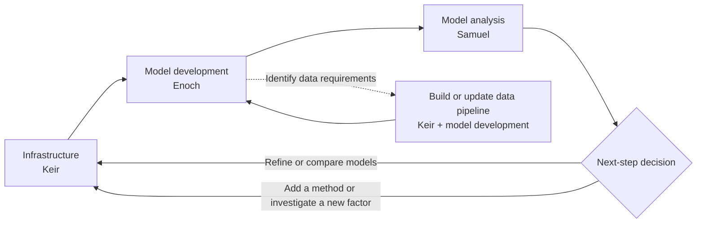

# Gold Volatility Forecasting

An Applied Forecasting Methods group project exploring forecasting approaches for gold-market volatility. The project will develop iteratively, starting with methods from the course and extending the methodology as model comparisons and analysis motivate further work.

## Project workflow

Each iteration follows a shared loop:

1. **Infrastructure** — prepare data and repository artifacts, and support presentations.
2. **Model development** — identify relevant variables and develop a forecasting model.
3. **Model analysis** — compare candidate models, explain results and limitations, and recommend the next step.
4. **Next iteration** — use that recommendation to guide the next round.

The analysis decision closes one round and sets the question for the next. If the next step needs new or changed data, first clarify the model-development requirements, then update the pipeline with Keir. Keep handoffs explicit: model development should share the model specification and inputs with analysis; analysis should share its evidence, limitations, and recommended next step with the team.

Early iterations may explore course methods such as AR, MA, ARMA, ARCH, GARCH, or EGARCH. As the project develops, later iterations may investigate extensions such as quantile regression or shock analysis. These are examples, not a prescribed or exhaustive method list; the team will choose methods based on project questions and findings.

## Team

| Member | Primary focus |
|---|---|
| Keir | Infrastructure, data acquisition, repository management, and presentation materials |
| Enoch | Model development and identifying relevant variables |
| Samuel | Model analysis, evaluating and comparing candidate models, discussing limitations, and recommending next steps |

These are areas of focus rather than exclusive ownership. Coordinate changes and handoffs when work crosses stages.

## Data and reproducibility

The required data have not yet been determined. The initial data pipeline will be designed after model development identifies the data requirements, in coordination between Keir and the model-development work. Do not treat any data source, schema, frequency, or transformation as decided until the team documents it.

As the project develops, record enough information to reproduce and interpret each iteration: data inputs and transformations, model specification, evaluation evidence, selection criteria, limitations, and the rationale for the next step. Do not publish sensitive or restricted data; document its provenance and access requirements instead.

## Repository status

This repository is at its initial setup stage. The project code, datasets, model results, and build/test/lint commands have not yet been established. Add instructions for running the project once its implementation and tooling are chosen.

For AI-agent collaboration guidance, see [`.github/copilot-instructions.md`](.github/copilot-instructions.md). For the team’s branch, pull request, and merge process, see [`GIT_WORKFLOW.md`](GIT_WORKFLOW.md). For a compact project context and pointers, see [`llms.txt`](llms.txt).
