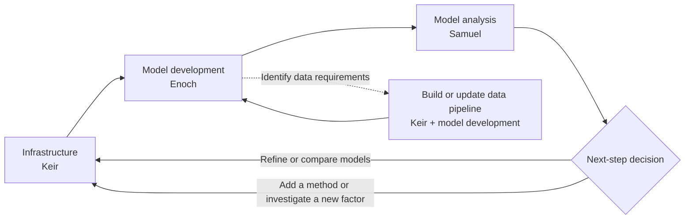

# Gold Volatility Forecasting

An Applied Forecasting Methods group project exploring forecasting approaches for gold-market volatility. The project will develop iteratively, starting with methods from the course and extending the methodology as model comparisons and analysis motivate further work.

## Project workflow

Each iteration follows a shared loop:

1. **Infrastructure** — prepare data and repository artifacts, and support presentations.
2. **Model development** — identify relevant variables and develop a forecasting model.
3. **Model analysis** — compare candidate models, explain results and limitations, and recommend the next step.
4. **Next iteration** — use that recommendation to guide the next round.



The analysis decision closes one round and sets the question for the next. If the next step needs new or changed data, first clarify the model-development requirements, then update the pipeline with Keir. Keep handoffs explicit: model development should share the model specification and inputs with analysis; analysis should share its evidence, limitations, and recommended next step with the team.

Early iterations may explore course methods such as AR, MA, ARMA, ARCH, GARCH, or EGARCH. As the project develops, later iterations may investigate extensions such as quantile regression or shock analysis. These are examples, not a prescribed or exhaustive method list; the team will choose methods based on project questions and findings.

## Team

| Member | Primary focus |
|---|---|
| Keir | Infrastructure, data acquisition, repository management, and presentation materials |
| Enoch | Model development and identifying relevant variables |
| Samuel | Model analysis, evaluating and comparing candidate models, discussing limitations, and recommending next steps |

These are areas of focus rather than exclusive ownership. Coordinate changes and handoffs when work crosses stages.

## Data and reproducibility

The team has not yet finalized spot versus futures; this is pending discussion at the next meeting. The current pipeline prototype accepts a local daily spot-price CSV. Yahoo Finance's `XAUUSD=X` spot ticker returned “No data found” when checked on 2026-11-06. Once the team confirms the instrument, align the pipeline and data source to that decision. Keep spot and futures as separate series, and record the actual provider and instrument in output metadata.

The pipeline computes close-to-close log returns and a forward target over the next five observed price sessions by default. The default target is realized variance, calculated as the sum of squared daily log returns; `realized_volatility` is also available as the square root of that sum. Horizon and target are configurable. The target uses future observations only as the label for each forecast origin; predictors in this baseline contain only information available through that origin.

Keep the original input file under `data/raw/` (or another documented local path); raw data are excluded from Git. Preserve it for each analysis run and record its provenance, observation date range, and pipeline options. The prepared CSV includes the forecast-origin date, close, log return, target-window dates, target value, and provider/instrument metadata. Do not mix futures and spot observations. Do not share Bloomberg or other restricted exports unless the applicable license permits it.

### Setup and commands

Install the package and test dependencies in a virtual environment:

```bash
python -m venv .venv
source .venv/bin/activate
python -m pip install -e ".[dev]"
```

For the interactive inspection notebook, install JupyterLab and plotting support, then launch JupyterLab from the repository root:

```bash
python -m pip install -e ".[interactive]"
python -m jupyter lab
```

Open [`notebooks/01_inspect_gold_data.ipynb`](notebooks/01_inspect_gold_data.ipynb). The notebook lets you set the input path and column names, horizon, and target; inspect and plot spot data; check target dates and values; and save prepared CSVs with a JSON manifest.

Prepare a spot-price CSV with `date` and `close` columns:

```bash
python -m gold_vol_pipeline --input data/raw/gold_spot.csv \
  --source "Provider name" --instrument "Gold spot benchmark/instrument" \
  --currency USD --price-unit "USD per troy ounce"
```

For alternate CSV headers, set `--date-column` and `--close-column`. The original input remains untouched; prepared data are saved to `data/processed/gold_spot.csv`. Override output paths with `--raw-output` and `--output`, and target settings with `--horizon` or `--target realized_variance|realized_volatility`.

Run the full test suite with `python -m pytest`. Run one test with:

```bash
python -m pytest tests/test_pipeline.py::test_default_target_is_forward_five_session_realized_variance
```

There is no configured linter yet.

### Return-only baseline forecasts

The `gold_vol_pipeline` package also provides return-only variance forecasts:
expanding historical variance, rolling historical variance, EWMA, AR(1) and
MA(1) models of squared returns, ARCH(1), and GARCH(1,1). Each forecast
function accepts returns available through a forecast origin and a configurable
horizon; it returns the expected variance summed over the next horizon
observations, matching the pipeline's realized-variance target definition.
For example:

```python
from gold_vol_pipeline import baseline_forecasts, prepare_dataset

dataset = prepare_dataset(prices, horizon=5)
origin_returns = dataset["log_return"].dropna()
forecasts = baseline_forecasts(origin_returns, horizon=5)
```

Only pass returns known at the forecast origin. These are candidate baseline
forecasts, not a backtest or model-selection result. The project still needs
chronological out-of-sample evaluation and comparison against prepared target
values; no model has yet been evaluated on the team's selected gold series.

As the project develops, record enough information to reproduce and interpret each iteration: data inputs and transformations, model specification, evaluation evidence, selection criteria, limitations, and the rationale for the next step. Do not publish sensitive or restricted data; document its provenance and access requirements instead.

## Repository status

The repository includes a Python data-preparation module, return-only candidate baseline forecast functions, and focused tests. Chronological backtesting, model comparison, and project-specific forecast evaluation are not implemented yet.

For AI-agent collaboration guidance, see [`AGENTS.md`](AGENTS.md) and [`.github/copilot-instructions.md`](.github/copilot-instructions.md). Shared AI/team decisions and handoffs are recorded in [`.ai/SESSION_LOG.md`](.ai/SESSION_LOG.md), using the protocol in [`.ai/README.md`](.ai/README.md). For the team’s branch, pull request, and merge process, see [`GIT_WORKFLOW.md`](GIT_WORKFLOW.md). For a compact project context and pointers, see [`llms.txt`](llms.txt).
