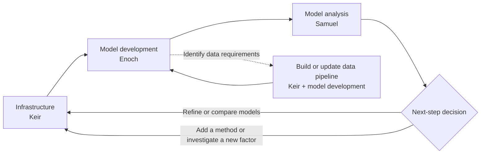

# Gold Volatility Forecasting

An Applied Forecasting Methods group project exploring forecasting approaches for gold-market volatility. The project will develop iteratively, starting with methods from the course and extending the methodology as model comparisons and analysis motivate further work.

## Project workflow

Each iteration follows a shared loop:

1. **Infrastructure** — prepare data and repository artifacts, and support presentations.
2. **Model development** — identify relevant variables and develop a forecasting model.
3. **Model analysis** — compare candidate models, explain results and limitations, and recommend the next step.
4. **Next iteration** — use that recommendation to guide the next round.



The analysis decision closes one round and sets the question for the next. If the next step needs new or changed data, first clarify the model-development requirements, then update the pipeline with Keir. Keep handoffs explicit: model development should share the model specification and inputs with analysis; analysis should share its evidence, limitations, and recommended next step with the team.

Early iterations may explore course methods such as AR, MA, ARMA, ARCH, GARCH, or EGARCH. As the project develops, later iterations may investigate extensions such as quantile regression or shock analysis. These are examples, not a prescribed or exhaustive method list; the team will choose methods based on project questions and findings.

## Team

| Member | Primary focus |
|---|---|
| Keir | Infrastructure, data acquisition, repository management, and presentation materials |
| Enoch | Model development and identifying relevant variables |
| Samuel | Model analysis, evaluating and comparing candidate models, discussing limitations, and recommending next steps |

These are areas of focus rather than exclusive ownership. Coordinate changes and handoffs when work crosses stages.

## Data and reproducibility

Keir selected gold futures as the Stage 2 working instrument; the current
downloadable series is Yahoo Finance `GC=F`, a COMEX gold futures continuous
series. It is not spot gold or a single fixed-expiry contract, and its history
may reflect contract rolls. The CLI and notebook download daily data from
Yahoo Finance by default; local CSV input is also supported. Revisit the series
or instrument only by an explicit team choice, and never mix spot and futures.
Yahoo's `XAUUSD=X` spot ticker returned “No data found” when checked on
2026-11-06.

The pipeline computes close-to-close log returns and a forward target over the next five observed price sessions by default. The default target is realized variance, calculated as the sum of squared daily log returns; `realized_volatility` is also available as the square root of that sum. Horizon and target are configurable. The target uses future observations only as the label for each forecast origin; predictors in this baseline contain only information available through that origin.

Raw and prepared downloads are written under `data/` and excluded from Git. Preserve them for each analysis run and record their provenance, observation date range, and pipeline options. The prepared CSV includes the forecast-origin date, close, log return, target-window dates, target value, and provider/instrument metadata. Do not mix futures and spot observations. Do not share Bloomberg or other restricted exports unless the applicable license permits it.

### Stage 2 daily predictor panel

Keir selected the following daily candidates from Enoch's requirements:

| Candidate | Source and series | Frequency and units |
|---|---|---|
| USD strength | Yahoo Finance `DX-Y.NYB`, ICE U.S. Dollar Index | Daily close, index points |
| Equity return | Yahoo Finance `^GSPC`, S&P 500 price index | Daily close-to-close log return (derived from index points) |
| Equity volatility | Yahoo Finance `^VIX`, CBOE VIX | Daily close, index points |
| Nominal rate | FRED [`DGS10`](https://fred.stlouisfed.org/series/DGS10), 10-year Treasury constant-maturity yield | Daily, percent |
| Inflation expectations | FRED [`T10YIE`](https://fred.stlouisfed.org/series/T10YIE), 10-year breakeven inflation rate | Daily, percent |
| Oil price | FRED [`DCOILWTICO`](https://fred.stlouisfed.org/series/DCOILWTICO), WTI Cushing spot | Daily, U.S. dollars per barrel |
| Gold volume | Yahoo Finance `GC=F` | Daily provider-reported volume, when returned |

The pipeline preserves raw closes, rates, and volume; Enoch can choose and
document further transformations for modeling. The S&P 500 input is a price
index, not a total-return index. Breakeven inflation is market-implied
inflation compensation, not a survey measure. Futures volume is an optional
continuous-series measure, not a fixed-contract or exchange-wide volume
series. Central-bank gold demand is deferred until a specific source and
publication schedule support point-in-time alignment.

Run the daily predictor panel; FRED observations are downloaded as CSV directly
from the public FRED website and do not require an API key:

```bash
python -m gold_vol_pipeline.predictors --start 2016-01-01 --end 2026-11-01
```

[`notebooks/04_predictors.ipynb`](notebooks/04_predictors.ipynb) provides a
notebook interface for this CLI and previews the saved panel and manifest.

Yahoo daily closes are treated as available on their observation date because
the forecast origin is after that date's market data have been published. FRED
series are conservatively treated as available on the next weekday; the
prepared dataset uses the latest value available on or before each gold
forecast origin and retains each source observation date. Missing predictor
values remain missing; Enoch should inspect predictor freshness and choose a
missing-data policy before fitting models.
The one-business-day FRED lag is an availability-date proxy, not a
series-specific release timestamp, and the website download returns current
observations rather than historical real-time vintages. Verify release schedules
and revisions before using this panel for a strict real-time backtest.

The raw downloads, prepared dataset, and run manifest are written beneath the
Git-ignored `data/` directory. A local normalized CSV can be used instead with
`--predictor-input`; its `date` column must be the value's availability date,
with optional `{predictor}_observation_date` columns to retain source dates.
For example:

```bash
python -m gold_vol_pipeline.predictors \
  --gold-input data/raw/gold_futures.csv \
  --gold-source "Yahoo Finance" \
  --gold-instrument "COMEX Gold Futures continuous series (GC=F)" \
  --predictor-input data/raw/stage2_predictors.csv
```

The selected predictor columns are `dxy_close`, `sp500_close`, `sp500_log_return`
(close-to-close log difference), `vix_close`, `treasury_10y_yield`,
`breakeven_inflation_10y`, and `wti_spot`. A gold CSV passed with `--gold-input`
may also contain `volume`.

API access and small file size do not grant redistribution rights. FRED's
series notes identify third-party copyright restrictions for some series
(including S&P 500, VIX, and WTI); check each series' terms before sharing or
committing data. Keep downloaded market data local unless redistribution is
explicitly permitted, and cite the source in any analysis.

### Setup and commands

Install the package and test dependencies in a virtual environment:

```bash
python -m venv .venv
source .venv/bin/activate
python -m pip install -e ".[dev]"
```

For the interactive inspection notebook, install JupyterLab and plotting support, then launch JupyterLab from the repository root:

```bash
python -m pip install -e ".[interactive]"
python -m jupyter lab
```

Open [`notebooks/01_inspect_gold_data.ipynb`](notebooks/01_inspect_gold_data.ipynb). It downloads Yahoo `GC=F` by default, and lets you choose a date range, horizon, and target; inspect and plot data; check target dates and values; and save raw/prepared CSVs with a JSON manifest. Set `DATA_SOURCE = "csv"` to use a local file instead.

Download and prepare Yahoo futures data directly (the end date is exclusive; by default it is today, avoiding a partial current-day bar):

```bash
python -m gold_vol_pipeline
```

By default this downloads from 2015-01-01 to the current date (exclusive), saving the raw Yahoo prices to `data/raw/gold_futures.csv` and prepared data to `data/processed/gold_futures.csv`. Choose a range with `--start YYYY-MM-DD --end YYYY-MM-DD`, or change paths with `--raw-output` and `--output`. Set `--horizon` or `--target realized_variance|realized_volatility` to change target construction.

To prepare a local CSV instead, provide `--input data/raw/your_gold_series.csv`, its `--date-column` and `--close-column`, and accurate `--source` and `--instrument` labels. The original input is not modified. The data source must represent one consistent instrument and series.

Run the full test suite with `python -m pytest`. Run one test with:

```bash
python -m pytest tests/test_pipeline.py::test_default_target_is_forward_five_session_realized_variance
```

There is no configured linter yet.

### Return-only baseline forecasts

The `gold_vol_pipeline` package also provides return-only variance forecasts:
expanding historical variance, rolling historical variance, EWMA, AR(1) and
MA(1) models of squared returns, ARCH(1), and GARCH(1,1). Each forecast
function accepts returns available through a forecast origin and a configurable
horizon; it returns the expected variance summed over the next horizon
observations, matching the pipeline's realized-variance target definition.
For example:

```python
from gold_vol_pipeline import baseline_forecasts, prepare_dataset

dataset = prepare_dataset(prices, horizon=5)
origin_returns = dataset["log_return"].dropna()
forecasts = baseline_forecasts(origin_returns, horizon=5)
```

Only pass returns known at the forecast origin. These are candidate baseline
forecasts, not a backtest by themselves. `notebooks/02_models.ipynb` performs
rolling-origin comparisons against prepared targets over the latest 20 common
origins and reports MAE/RMSE. The Hyndman-Khandakar order is reselected using
only returns available at each origin. The current comparison uses the working
`GC=F` series; target windows overlap and the evaluation window is small, so
the results are exploratory and do not constitute a final model-selection
decision.

Run exploratory diagnostics on the prepared return series with:

```bash
python -m gold_vol_pipeline.diagnostics --input data/processed/gold_futures.csv
```

The report includes tests for zero mean, stationarity, serial dependence,
ARCH effects, and return normality. These are diagnostic checks, not proof
that a model's assumptions hold or a substitute for out-of-sample evaluation.

### Model-evaluation workbench

Open [`notebooks/03_model_evaluation.ipynb`](notebooks/03_model_evaluation.ipynb)
to inspect price levels and transformations, ADF unit-root tests, ACF/PACF
plots, and return diagnostics. It fits configurable AR, MA, ARMA, ARCH, GARCH,
and EGARCH candidate orders and displays their model names, AIC, BIC, and
convergence status in a readable table. These are in-sample criteria for the
same input series; they do not choose a final project model.

The notebook also saves raw and standardized residual series under the
git-ignored `data/processed/` directory, plots residual panels, and applies
Ljung-Box tests to residuals and squared standardized residuals.
The evaluation helpers are in
[`src/gold_vol_pipeline/model_evaluation.py`](src/gold_vol_pipeline/model_evaluation.py).

Select a nonseasonal ARIMA model for squared returns (the volatility proxy)
with the Hyndman-Khandakar stepwise procedure:

```bash
python -m gold_vol_pipeline.auto_arima --input data/processed/gold_futures.csv
```

The implementation uses KPSS tests to choose the differencing order and
stepwise AICc search for AR/MA orders. It prints the selected order, fitted
coefficients, candidate rankings, and a five-session variance-proxy forecast.
Selection on the full sample is exploratory; use training-only selection
inside a chronological backtest before comparing forecast performance.

As the project develops, record enough information to reproduce and interpret each iteration: data inputs and transformations, model specification, evaluation evidence, selection criteria, limitations, and the rationale for the next step. Do not publish sensitive or restricted data; document its provenance and access requirements instead.

## Repository status

The first modeling stage uses traditional univariate time-series methods on one
gold-derived series: return-only candidate forecasts, sequential rolling-origin
comparisons with MAE/RMSE, exploratory diagnostics, configurable in-sample
candidate comparisons, and a nonseasonal Hyndman-Khandakar ARIMA selector.
No final model-selection decision is recorded. The automatic ARIMA selector
is included in an exploratory 20-origin rolling comparison; a broader,
standardized evaluation remains pending. For Stage 2, Keir selected daily DXY,
nominal 10-year Treasury yield, S&P 500 returns, VIX, 10-year breakeven
inflation, WTI spot, and optional gold-futures volume. The pipeline is
implemented in `gold_vol_pipeline.predictors`; it derives close-to-close
log-returns for the S&P 500. `notebooks/05_advanced_models.ipynb` provides an
exploratory all-predictor gradient-boosting forecast with a training-only
HAC-robust coefficient significance screen. In the current snapshot, only VIX
remains significant after Holm correction, and the gradient-boosting model
underperforms the expanding-variance benchmark on the holdout; no final
multivariate model or variable-selection decision is recorded. Central-bank
demand remains deferred.

For AI-agent collaboration guidance, see [`AGENTS.md`](AGENTS.md) and [`.github/copilot-instructions.md`](.github/copilot-instructions.md). Shared AI/team decisions and handoffs are recorded in [`.ai/SESSION_LOG.md`](.ai/SESSION_LOG.md), using the protocol in [`.ai/README.md`](.ai/README.md). The project uses a main-only Git workflow described in [`GIT_WORKFLOW.md`](GIT_WORKFLOW.md). For a compact project context and pointers, see [`llms.txt`](llms.txt).

The presentation-ready progress tracker is [`presentations/project-progress.qmd`](presentations/project-progress.qmd). It summarizes stage status and reads Git submission history when rendered. The model-development report is available as a [Beamer PDF](presentations/iteration-1-summary.pdf), with its [Quarto source](presentations/iteration-1-summary.qmd). Fetch the latest `main` with `git fetch origin main` before rendering updated presentations.
