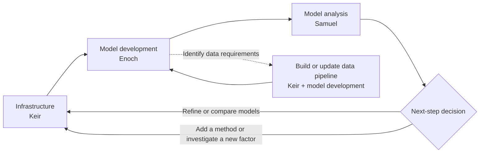

# Gold Volatility Forecasting

An Applied Forecasting Methods group project exploring forecasting approaches
for gold-market volatility. The project proceeds iteratively: prepare data,
develop a model, compare evidence and limitations, and use the analysis to
choose the next question.

## Project workflow

Each iteration follows a shared loop:

1. **Infrastructure** — prepare data and repository artifacts, and support presentations.
2. **Model development** — identify relevant variables and develop a forecasting model.
3. **Model analysis** — compare candidate models, explain results and limitations, and recommend the next step.
4. **Next iteration** — use that recommendation to guide the next round.



If a next step needs new or changed data, first clarify model-development
requirements, then coordinate the pipeline update with Keir. Keep handoffs
explicit: share the model specification and inputs with analysis, and share
analysis evidence, limitations, and the recommended next step with the team.
Course methods such as AR, MA, ARMA, ARCH, GARCH, and EGARCH are possible
starting points, not required methods; later methods should be motivated by
project questions and findings.

## Team

| Member | Primary focus |
|---|---|
| Keir | Infrastructure, data acquisition, repository management, and presentation materials |
| Enoch | Model development and identifying relevant variables |
| Samuel | Model analysis, comparing candidates, discussing limitations, and recommending next steps |

These are areas of focus rather than exclusive ownership. Coordinate changes
and handoffs when work crosses stages.

## Data and reproducibility

The current two-stage analysis uses LSEG Workspace `GCc1`, a generic COMEX gold
futures series. It is not spot gold or a single fixed-expiry contract. Do not
mix it with spot/fixing prices or with another futures series. LSEG source exports are local and are not committed; selected prepared targets
and forecast artifacts are tracked for reproducibility. Check applicable
licenses before sharing or redistributing source exports or derived data.

This analysis is distinct from the original `main` workflow, which used Yahoo
Finance `GC=F` and a five-observed-session realized-variance target. That
pipeline and its detailed procedures are preserved on the
[original-main backup branch](https://github.com/0KeirLi0/Gold-vol-forecasting_ECON4120_GroupProject/blob/archive/main-before-test-merge/README.md).
The current commands below reproduce the merged `test`-branch Yang-Zhang
analysis. Do not mix the two instruments, targets, or evaluation outputs.

For reproducibility, preserve each run's source inputs and generated manifests.
The manifests record input file hashes, transformations, and model/evaluation
settings. `data/` is Git-ignored. The analysis uses a one-weekday availability
proxy for LSEG predictors; it does not reconstruct exact publication times or
historical data vintages. Results are exploratory, not causal findings or a
confirmed team-wide model decision.

### Optional LSEG Workspace export

On a computer with LSEG Workspace installed and authenticated, the downloader
can export the configured LSEG instruments to `data/refinitiv/`:

```bash
python -m pip install lseg-data pandas openpyxl
python scripts/download_lseg_data.py --start 2010-01-01
```

Review `PROJECT_PANEL_REQUESTS` in
[`scripts/download_lseg_data.py`](scripts/download_lseg_data.py) and the
generated `download_manifest.json`. Confirm each RIC, field, units, history,
and data rights in Workspace before relying on or sharing an export. The
predictor screen and forecast evaluation require `GCc1.csv` OHLC and their
respective predictor exports; missing required files cause the scripts to
stop with an error.

## Current analysis

The merged `test`-branch work organizes the active analysis into two stages.
Both use generic COMEX gold futures `GCc1` and Yang-Zhang daily volatility,
but answer different questions. Stage 1 screens predictors using training
data only. Stage 2 evaluates sequential one-step forecasts on a chronological
holdout.

### Stage 1: Predictor significance

Run the training-only screen from the repository root:

```bash
PYTHONPATH=src python scripts/screen_yang_zhang_predictors.py
```

The script requires `GCc1.csv` and 11 predictor exports under
`data/refinitiv/`. It forms consecutive valid training pairs after the
chronological 80/20 split, matches the latest predictor value available at
each origin using the one-weekday proxy, and standardizes predictors on the
training data. It calculates VIFs including a current-volatility control and
iteratively removes the highest-VIF candidate until all remaining VIFs are at
most 5; the control is retained. It then fits a regression for next-valid
Yang-Zhang volatility with HAC(4) standard errors and Holm correction across
retained predictor tests. The holdout responses are not used in this screen.

In the recorded run, the process removed gold IV 6M, 3M, and 2M, leaving eight
predictors; maximum final VIF was 4.31. Gold IV 1M, gold IV 1Y, and DXY had
Holm-adjusted p-values below 5%; VIX did not. These are exploratory
post-selection conditional associations, not causal effects or proof of
out-of-sample predictive value. Remaining collinearity, the selection
procedure, availability timing, and finite HAC lag limit interpretation.

Outputs are saved under
`data/processed/stage1_predictor_significance/`: `training_pairs.csv`,
`vif_history.csv`, `predictor_significance.csv`, and `manifest.json`.

### Stage 2: Yang-Zhang volatility forecasts

The target is unannualized Yang-Zhang volatility computed from two observed
OHLC bars. Incomplete OHLC windows are not imputed. Available targets are
split chronologically 80/20; models are refit sequentially using initial
training targets and prior observed holdout targets. A one-step forecast
advances to the next valid target, which can skip dates after an incomplete
bar. Adjacent two-observation targets overlap, so forecast-loss rankings are
descriptive and the loss sequence is dependent.

Run the no-external-predictor comparison:

```bash
PYTHONPATH=src python scripts/evaluate_yang_zhang_volatility.py
```

For the selected-predictor comparison, evaluate DXY, gold IV 1M, and gold IV
1Y jointly, keeping results separate from the baseline:

```bash
OPENBLAS_NUM_THREADS=1 OMP_NUM_THREADS=1 PYTHONPATH=src \
  python scripts/evaluate_yang_zhang_volatility.py \
  --predictor-dir data/refinitiv --external-models-only \
  --output-dir data/processed/stage2_yz_selected
PYTHONPATH=src python scripts/compare_selected_predictors.py
```

The six predictor-capable models are HARX, Ridge, Lasso, HistGradientBoosting,
range GARCH-X, and VAR. In the recorded comparison all six completed 761
common test dates with no recorded failures. Adding the three predictors
jointly improved both MAE and RMSE for Ridge, Lasso, and VAR; worsened both
for HARX; and had mixed effects for HistGradientBoosting and range GARCH-X.
These changes do not isolate individual predictor effects. The predictors
were selected after earlier holdout results had been observed, so this is not
a fully untouched holdout.

The original no-external-predictor run evaluated 20 candidates on the same
761 test observations without recorded fit failures. HistGradientBoosting
had the lowest MAE (0.00241765) and RMSE (0.00476724) in that run. Optimizer
and convergence warnings occurred. This point ranking is descriptive and is
not a final model-selection decision.

Prepared targets, forecast attempts, summaries, and manifests are saved under
`data/processed/` or the selected `--output-dir`. The selected-predictor
outputs include `stage2_yz_forecasts.csv`, `stage2_yz_summary.csv`,
`stage2_yz_manifest.json`, and `joint_predictor_comparison.csv`. Refer to
[`REPRODUCE.md`](REPRODUCE.md) for additional forecast-error, calibration,
rolling-window, report, and figure procedures.

#### Calendar-month volatility analysis

Summarize the prepared `GCc1` daily-volatility target by month of year and by
calendar year-month:

```bash
PYTHONPATH=src python scripts/analyze_yang_zhang_calendar.py
```

By default, the script reads
`data/processed/stage2_yz_selected/GCc1_yang_zhang_volatility.csv` and writes
`month_of_year_summary.csv`, `calendar_month_summary.csv`,
`calendar_month_summaries.png`, and an input-hash `manifest.json` under
`data/processed/stage2_yz_calendar/`. The month-of-year table reports each
calendar month's count, year coverage, mean, median, standard deviation, and
quartiles separately for all, training, and test targets. The year-month table
shows the corresponding statistics over each individual calendar month.
Incomplete OHLC targets are excluded. This is a descriptive view of the
unannualized two-observation Yang-Zhang volatility proxy, not a formal
seasonality test or a causal calendar effect; the chronological test sample
was previously examined. In the tracked 2010-2026 target series, the
full-sample mean was highest in March (0.00899) and lowest in July (0.00694).
The difference is descriptive and may reflect changing volatility regimes,
not a recurring calendar effect. The
[calendar analysis report](reports/yang-zhang-calendar.pdf), its
[editable Quarto source](reports/yang-zhang-calendar.qmd), and the
[supporting summaries, chart, and manifest](reports/yang-zhang-calendar-data/)
are tracked in the repository.

## Setup and commands

Install the package and test dependencies; add interactive dependencies for
notebook, plotting, or report figure work:

```bash
python -m pip install -e ".[dev]"
python -m pip install -e ".[interactive]"
```

Run the test suite:

```bash
python -m pytest
```

The current merged test suite covers Yang-Zhang preparation, the significance
screen, forecasting, predictor comparison, calendar summaries, and diagnostics.
There is no configured linter.

### Reports and diagnostics

The main report, editable Quarto source, and holdout forecast-error report are:

- [`reports/yang-zhang-volatility.pdf`](reports/yang-zhang-volatility.pdf)
- [`reports/yang-zhang-volatility.qmd`](reports/yang-zhang-volatility.qmd)
- [`reports/yang-zhang-residual-diagnostics.pdf`](reports/yang-zhang-residual-diagnostics.pdf)
- [`reports/yang-zhang-residual-diagnostics.qmd`](reports/yang-zhang-residual-diagnostics.qmd)
- [`reports/yang-zhang-calendar.pdf`](reports/yang-zhang-calendar.pdf)
- [`reports/yang-zhang-calendar.qmd`](reports/yang-zhang-calendar.qmd), with its
  [calendar summary data and figure](reports/yang-zhang-calendar-data/)

The residual diagnostics describe out-of-sample forecast errors, not fitted
GARCH innovations. Holdout volatility-tercile labels are retrospective, and
the Ljung-Box results are exploratory given overlapping targets. Reproduction
commands and limitations are documented in
[`REPRODUCE.md`](REPRODUCE.md).

### Original Yahoo/FRED procedures

The original `main` README documented the Yahoo `GC=F` five-session target,
Yahoo/FRED daily predictor panel, return-only baselines, diagnostics, ARIMA
selection, model-evaluation notebooks, and optional LSEG import workflow.
Those procedures remain available in the
[original-main README](https://github.com/0KeirLi0/Gold-vol-forecasting_ECON4120_GroupProject/blob/archive/main-before-test-merge/README.md)
as historical reference. The merged branch replaces that implementation
with the current LSEG `GCc1` Yang-Zhang analysis described above; commands and
results from the archived workflow should not be assumed to run against this
branch.

## Repository status

The active work now includes a training-only predictor-significance screen,
an expanding one-step Yang-Zhang forecast comparison, a joint selected-
predictor experiment, paired forecast plots, and descriptive forecast-error
diagnostics. The holdout has already informed predictor selection and has
overlapping targets; reported rankings and diagnostics are therefore
exploratory. The team has not made a final model-selection decision. Use the
analysis limitations and evidence to agree on the next step before treating
any candidate as the project recommendation.

Follow [`GIT_WORKFLOW.md`](GIT_WORKFLOW.md) for shared Git changes and the
[AI handoff protocol](.ai/README.md). Historical context and dated decisions
are recorded in the append-only [session log](.ai/SESSION_LOG.md).
