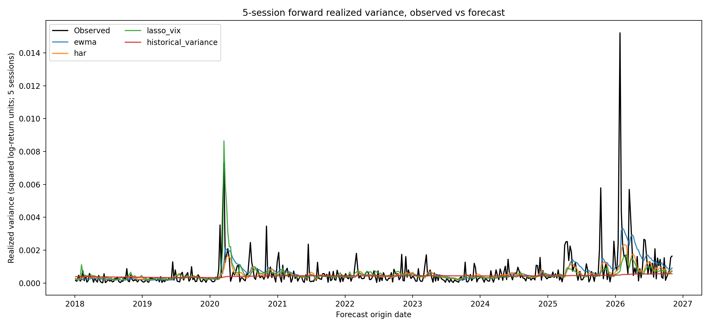
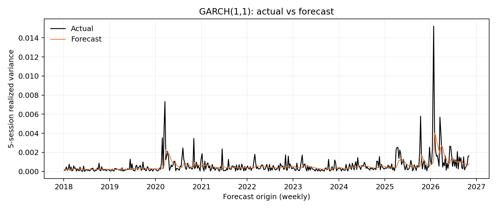
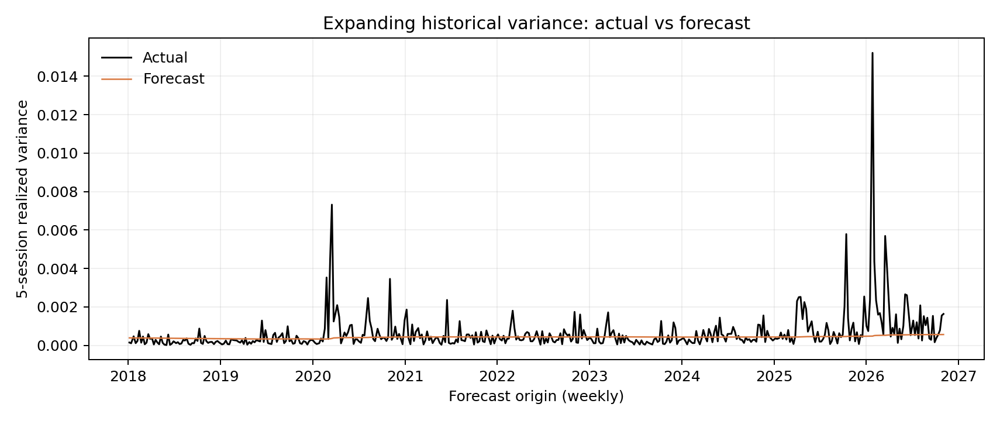

::: {.content-visible unless-format="beamer"}

# Introduction

Gold prices and gold-market volatility matter for investors, traders, and policy observers because gold is used both as a safe-haven asset and as a hedge against macroeconomic uncertainty. In this project, we study whether gold volatility can be forecast more accurately by combining past gold volatility with market information such as the U.S. dollar index, CBOE VIX, Treasury yields, inflation expectations, and oil prices. The core task is not simply to fit a complicated model, but to define a clear forecast target, maintain a valid information set, and compare models on a shared evaluation sample.

We use a rolling-origin forecasting design in which the forecast at each date uses only information available up to that date. The target is the five-session-ahead realized variance of the working gold futures series, computed as the sum of squared daily log returns over the next five observed price sessions. This keeps the target aligned with the project’s methodology and avoids look-ahead leakage.

# Data and forecast target

The working instrument is a daily continuous COMEX gold futures series, not spot gold. The project includes a separate exploratory Refinitiv/LSEG panel, but the latest integrated 25-model comparison uses the saved Yahoo Finance `GC=F` gold series and Yahoo/FRED predictor panel. We keep those evidence sources distinct rather than describing the integrated model ranking as a Refinitiv-only result. The Refinitiv/LSEG screen is partial, and its predictor timing uses a one-weekday availability proxy rather than verified historical publication times.

## Predictors and model inputs

The project tested the following predictors and historical gold inputs across its separate analyses. They are not all included together in every model.

| Predictor or input | Source and transformation | Role and coverage |
|---|---|---|
| Gold returns and past variance | Continuous gold futures close; daily log returns, squared returns, and daily/weekly/monthly realized-variance lags | Historical inputs for univariate, HAR/HARX, GARCH, and quantile-GARCH models; also define the forecast target |
| U.S. dollar strength (DXY) | Yahoo Finance `DX-Y.NYB` or LSEG `.DXY`; daily close | Candidate predictor in the multivariate screen and regression variants |
| S&P 500 return | Yahoo `^GSPC` or LSEG `.SPX`; close-to-close log return derived from index closes | Candidate predictor in the multivariate screen and regression variants |
| Equity volatility (VIX) | Yahoo `^VIX` or LSEG `.VIX`; daily close | Candidate predictor; GARCH-X specifically uses normalized lagged VIX |
| 10-year Treasury yield | FRED `DGS10`; LSEG `US10YT=RR` bid/ask midpoint when available | Candidate macro-financial predictor |
| 10-year breakeven inflation | FRED `T10YIE`; LSEG `USBEI10Y=RR` bid/ask quotes | Yahoo/FRED candidate predictor; not available in the current LSEG export |
| WTI spot price | FRED `DCOILWTICO`; LSEG `USCRWT=ECI` candidate | Yahoo/FRED candidate predictor; not available in the current LSEG export |
| Gold futures volume | Yahoo `GC=F` reported volume; LSEG `ACVOL_1` if returned | Optional Yahoo/FRED predictor; `ACVOL_1` was absent from the current LSEG export |
| Gold implied volatility | LSEG `XAU` 1M, 2M, 3M, 6M, and 1Y tenor midpoint quotes | Separate exploratory LSEG predictor screen; not used in the integrated 25-model ranking |
| 1M risk reversal and butterfly | LSEG `XAU1MRR=` and `XAU1MBF=` midpoint quotes | Separate exploratory LSEG predictor screen; quote conventions require verification |

The integrated comparison and the recommended GARCH-X fit use the Yahoo/FRED panel, not the separate LSEG option panel. For GARCH-X, the external input is lagged VIX; the other GARCH-family inputs are the gold return and its recursively estimated conditional variance.

The forecast target is

$$
RV_{t+5|t} = \sum_{j=1}^{5} r_{t+j}^2,
$$

where $r_t$ is the daily log return on the working gold futures series. This is a realized-variance target rather than a level forecast of the gold price itself. Using a forward realized-variance target is natural for volatility forecasting because it focuses on the volatility of future returns rather than the future price level.

We use a chronological evaluation setup with no leakage from future observations into the information set at each forecast origin. The report treats the Refinitiv source as an alternative panel that should be checked carefully for availability dates, quote conventions, and source-specific issues before strong conclusions are drawn.

# Methodological approach

Our forecasting workflow follows the project’s staged structure:

1. Build a baseline volatility specification using only the gold series and its own lagged volatility behavior.
2. Add macro-financial predictors and evaluate whether they help beyond the baseline.
3. Compare candidate models on a common evaluation sample, with benchmark models included.
4. Interpret the results in light of sample comparability and multiple-testing adjustments.

The project contains both univariate and multivariate approaches. The simplest benchmarks include expanding historical variance, rolling variance, fixed-decay EWMA, AR and MA models on squared returns, and ARCH/GARCH-type volatility models. Additional methods include HAR/HARX, penalized regression, VAR, a GARCH-X model with lagged VIX in the variance equation, and an exploratory quantile-GARCH extension. For the Refinitiv panel, the pipeline also supports exploratory tests that screen predictors using a standardized regression with HAC standard errors and Holm correction.

The recommended GARCH-X is not a linear regression of the form
$Y_t=\beta_0+\beta_1X_t+\cdots$; it models the conditional variance of returns.
At forecast origin $o$, for daily log return $r_t$:

$$
\begin{aligned}
r_t &= \sqrt{h_t}\,z_t,\qquad z_t\sim N(0,1),\\
h_t &= \omega+\alpha r_{t-1}^{\,2}+\beta h_{t-1}
      +\delta x_t,\\
x_t &= \frac{\mathrm{VIX}_{t-1}}
            {\overline{\mathrm{VIX}}_{\leq o}}.
\end{aligned}
$$

Here, $h_t$ is conditional return variance; $\omega>0$ is its intercept,
$\alpha$ measures the response to the previous squared return, $\beta$ captures
variance persistence, and $\delta$ measures the contribution of normalized
lagged VIX. The fit constrains $\omega>0$, $\alpha,\beta,\delta\geq0$, and
$\alpha+\beta\leq0.999$. Parameters and the VIX scaling mean use data available
through origin $o$. Since future VIX is unknown, the forecast holds it at its
origin value: $\mathrm{VIX}_{o+j-1|o}=\mathrm{VIX}_o$ for forecast step
$j=1,\ldots,5$. The five-session realized-variance forecast is

$$
\widehat{Y}_{o,5}
=\widehat{RV}_{o,5}
=\sum_{j=1}^{5}
  \mathbb{E}\!\left[r_{o+j}^{\,2}\mid\mathcal{F}_o\right]
=\sum_{j=1}^{5}\widehat{h}_{o+j|o},
$$

where $\mathcal{F}_o$ is the information available at origin $o$ and
$\widehat{h}_{o+j|o}$ is the recursively forecast conditional variance.
Quantile GARCH adds an extra squared-shock response when the absolute return
exceeds the 95th percentile threshold estimated from the available history:

$$
h_t=\omega+\alpha r_{t-1}^2+\beta h_{t-1}
    +\gamma r_{t-1}^2\mathbf{1}(|r_{t-1}|>q_{0.95}),
\qquad r_t=\sqrt{h_t}z_t,\quad z_t\sim N(0,1).
$$

Its five-session forecast uses Gaussian simulation; it is an extreme-magnitude extension, not a quantile-regression forecast.

This design is appropriate because volatility forecasting is sensitive to both persistence and external risk conditions. However, the comparison is descriptive rather than a final model verdict unless the sample and evaluation rules are matched carefully.

# Empirical evidence

## Predictor screening

The training-only screen on the Yahoo/FRED panel identifies VIX as the clearest conditional predictor in the sample. Other predictors are not individually significant after Holm correction. This indicates that VIX is the strongest candidate among the tested macro-financial predictors, but it does not by itself prove that other variables lack out-of-sample value.

For the Refinitiv/LSEG panel, the exploratory screen found DXY and VIX to be individually significant after Holm correction, while the gold implied-volatility tenors were jointly significant as a block but not individually identified. This is useful evidence, but the LSEG panel is partial and the availability proxy remains conservative rather than a verified publication-time history. These screening results are separate from the Yahoo/FRED out-of-sample comparison below.

## Common-origin model comparison

The latest integrated comparison evaluates 25 candidates on 443 common successful weekly forecast origins (from 445 requested origins). Two quantile-GARCH fits failed; the common-origin sample excludes those dates for every model, which may affect the comparison. GARCH-X with lagged VIX has the lowest MSE and RMSE. Asymmetric EGARCH has the lowest MAE and QLIKE. The table compares these models with standard GARCH(1,1) and the expanding historical-variance benchmark.

\clearpage

| Model | MSE ($\times 10^{-6}$) | RMSE | MAE | QLIKE |
|---|---:|---:|---:|---:|
| GARCH-X with lagged VIX | **0.949** | **0.000974** | 0.000420 | 0.4552 |
| Asymmetric EGARCH | 0.960 | 0.000980 | **0.000413** | **0.4432** |
| Quantile GARCH | 0.974 | 0.000987 | 0.000423 | 0.4556 |
| GARCH(1,1) | 0.974 | 0.000987 | 0.000423 | 0.4554 |
| Expanding historical variance | 1.132 | 0.001064 | 0.000445 | 0.6364 |

{#fig-integrated-forecasts width=95% fig-align="center"}

GARCH-X's MSE is about 16.1% lower than the historical-variance benchmark on this sample. However, after Holm correction it does not significantly outperform the benchmark (Diebold-Mariano adjusted $p=0.905$ for MSE and $p=0.866$ for QLIKE). Its Mincer-Zarnowitz joint test has $p=0.148$, which does not establish calibration. EGARCH's lower MAE and QLIKE mean that the preferred model changes with the loss function. Thus, GARCH-X is the best point-forecast model **if MSE is the prespecified priority**, not an unqualified winner.

Quantile GARCH and standard GARCH(1,1) have nearly identical point-error scores in this comparison. Quantile GARCH also failed at two requested origins, and the extra tail coefficient is constrained at a boundary in the reported single-origin calibration; the comparison does not establish a reliable incremental benefit from the quantile term.

{#fig-stage1 width=90% fig-align="center"}

{#fig-stage3 width=90% fig-align="center"}

| Model family | Result |
|---|---|
| Expanding historical variance | Benchmark with strong stability |
| GARCH(1,1) | Lowest point-estimate MSE and RMSE, but convergence failure on 10 dates |
| EWMA / rolling variance | Competitive simple benchmarks |
| HAR / HARX / penalized regression | Useful but not dominant on the aligned sample |
| VAR | Significant underperformance relative to benchmark after correction |
| HK auto-ARIMA | Exploratory benchmark, but not a final model choice |

The important methodological point is that the benchmark remains difficult to beat in this sample. If a candidate model is to be preferred, the evidence must show both lower forecast loss and robustness to the exact sample design, forecast origins, and multiple-testing corrections.

# Interpretation and limitations

The integrated comparison gives GARCH-X with lagged VIX the best point MSE, while asymmetric EGARCH gives the best MAE and QLIKE. Neither ranking alone establishes a universal best model: GARCH-X does not significantly outperform expanding historical variance after correction, and model choice depends on the loss function. The macro-financial predictors are informative in screening, but the available evidence does not establish a statistically robust out-of-sample improvement over the benchmark. The Refinitiv panel is informative as a separate analysis, but the integrated 25-model ranking is based on Yahoo/FRED data and must not be presented as a Refinitiv-only result.

Several limitations matter:

- The working series is a futures contract, not a spot series, and the project keeps those identities separate.
- The evaluation sample and origin definitions are not always identical across all sections of the project; comparison should therefore be interpreted as descriptive evidence rather than a single pooled ranking.
- Multiple-model comparisons require p-value adjustment and careful treatment of convergence failures.
- The Refinitiv panel uses a conservative availability proxy and should not be interpreted as a strict real-time vintage dataset without additional verification.
- Even when a variable is statistically significant in a training screen, it may not improve out-of-sample forecast loss.

These are not reasons to stop the analysis; rather, they show why forecasting evidence must be framed as conditional and limited.

# Conclusion

This project treats gold volatility forecasting as a forecasting exercise with explicit data definitions, benchmark comparisons, and diagnostic caution. In the latest integrated comparison, GARCH-X with lagged VIX has the lowest MSE; asymmetric EGARCH has the lowest MAE and QLIKE. If the team prioritizes squared forecast errors, GARCH-X is the provisional working choice, with expanding historical variance retained as a benchmark. This is not a statistically decisive victory: Holm-adjusted tests do not show GARCH-X significantly outperforming the benchmark, and another model ranks first under alternative losses.

The practical lesson is that the next step should not be a blanket adoption of a new model. Instead, the team should agree on the relevant forecast loss, review the constant-future-VIX assumption and optimizer warnings, and test GARCH-X and EGARCH against the benchmark on a later holdout. Refinitiv/LSEG results should be compared only after its source coverage and availability assumptions are verified. The current recommendation is therefore provisional, not a definitive model-selection decision.

# AI Reflection

We used AI tools to support the project in three ways: understanding the repo state, organizing the project guidance, and drafting the report structure. AI was helpful for summarizing the existing findings, checking the formatting and evaluation logic, and identifying the relevant files to use. However, the final interpretation remains our responsibility: we validated the claims against the project code, README notes, and evaluation evidence rather than accepting AI output uncritically. This is especially important in forecasting work, where small differences in the target definition, forecast origins, or leakage rules can materially change the results.

# Contribution statement

We agree to the following contribution statement.

- Luo Pui Ki Enoch: contributed to the forecast question, source/data interpretation, and project analysis workflow; assisted in checking the forecasting logic and report structure.
- Li Hung Kui: contributed to the data preparation and evaluation workflow, including checking the Refinitiv/LSEG pipeline and the report’s consistency with the project evidence.
- Siriasavakul Hok Sum: contributed to the review, synthesis, and final drafting of the report, including interpretation of the model comparison and limitations.

All members reviewed the report content, agreed on the final interpretation, and approved the submission-ready structure.

:::

::: {.content-visible when-format="beamer"}

## Research question and target

**Question:** Can macro-financial information improve forecasts of gold-futures volatility beyond past volatility?

$$
RV_{o,5}=\sum_{j=1}^{5}r_{o+j}^{2}
$$

- Five future observed trading sessions
- Forecast information set ends at origin $o$
- Target is realized variance, not the gold-price level

## Data: keep the evidence panels distinct

- **Integrated model comparison:** Yahoo Finance `GC=F` continuous COMEX gold futures and the Yahoo/FRED predictor panel
- **Separate exploration:** partial Refinitiv/LSEG `GCc1` panel, including available gold options
- Futures are not spot; do not combine the instruments
- LSEG availability uses a one-weekday proxy, not verified historical publication times

## Predictors tested

::: {.columns}

::: {.column width="58%"}
**Core Yahoo/FRED candidates**

- Gold returns and lagged realized variance
- DXY and S&P 500 log return
- VIX, 10-year Treasury yield, breakeven inflation
- WTI spot and optional gold volume
:::

::: {.column width="42%"}
**Additional LSEG screen**

- Gold implied volatility: 1M, 2M, 3M, 6M, 1Y
- 1M risk reversal and butterfly
- Partial coverage; quote conventions require verification
:::

:::

Not every candidate is included in every model. GARCH-X uses lagged VIX as its external predictor.

## Models and evaluation

- Benchmarks: expanding/rolling variance, EWMA, AR/MA, ARCH/GARCH
- Extensions: HAR/HARX, penalized regressions, VAR, asymmetric GARCH, quantile GARCH
- **GARCH-X:** lagged VIX enters the conditional-variance equation
- 25 candidates; 443 common successful origins from 445 requested
- Compare five-session forecasts using MSE, MAE, QLIKE and paired tests

## Recommended GARCH-X specification

$$
\begin{aligned}
r_t &= \sqrt{h_t}\,z_t,\qquad z_t\sim N(0,1),\\
h_t &= \omega+\alpha r_{t-1}^{2}+\beta h_{t-1}+\delta x_t,\\
x_t &= \frac{\mathrm{VIX}_{t-1}}{\overline{\mathrm{VIX}}_{\leq o}},\\
\widehat{RV}_{o,5} &= \sum_{j=1}^{5}\widehat{h}_{o+j|o}.
\end{aligned}
$$

- $\omega>0$; $\alpha,\beta,\delta\geq0$; $\alpha+\beta\leq0.999$
- Future VIX is held at its last observed value
- The forecast sums expected variance over five sessions

## Common-origin results

| Model | MSE ($\times 10^{-6}$) | RMSE | MAE | QLIKE |
|---|---:|---:|---:|---:|
| **GARCH-X + VIX** | **0.949** | **0.000974** | 0.000420 | 0.4552 |
| EGARCH (asym.) | 0.960 | 0.000980 | **0.000413** | **0.4432** |
| Q-GARCH | 0.974 | 0.000987 | 0.000423 | 0.4556 |
| Historical variance | 1.132 | 0.001064 | 0.000445 | 0.6364 |

GARCH-X uses lagged VIX; Q-GARCH is quantile GARCH. GARCH-X has the lowest MSE; EGARCH has the lowest MAE and QLIKE.

## Forecasts across the evaluation period

{width=95%}

## What the evidence supports

- GARCH-X MSE is **16.1% below** the historical-variance benchmark
- It does **not** significantly beat that benchmark after Holm correction ($p=0.905$ for MSE; $p=0.866$ for QLIKE)
- The preferred model depends on the loss function
- Quantile GARCH is close to standard GARCH(1,1) and failed at two requested origins

## Limitations and next steps

- Common-origin results omit the two dates where quantile GARCH failed
- Future VIX is assumed constant; the assumption needs sensitivity analysis
- The integrated ranking is Yahoo/FRED-based; LSEG results are separate and exploratory
- Review the loss criterion, then test GARCH-X and EGARCH on a later holdout

**Takeaway:** GARCH-X is the provisional choice if MSE is the priority—not a statistically decisive winner.

:::
