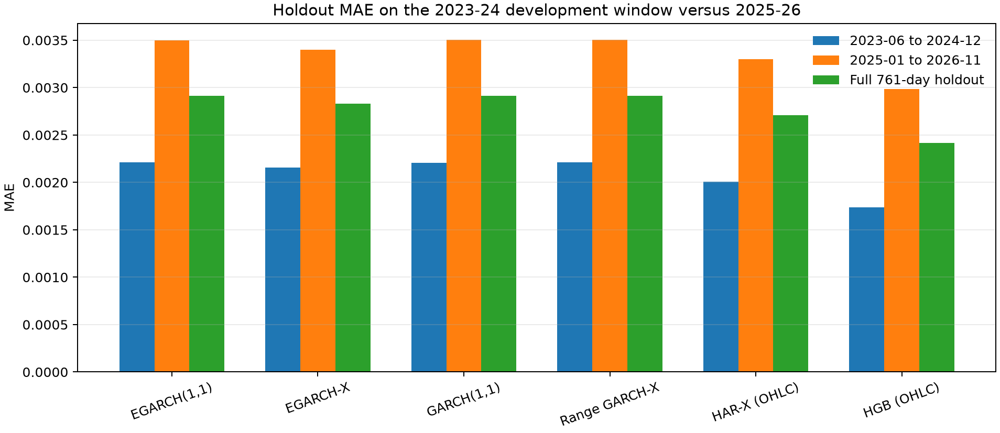
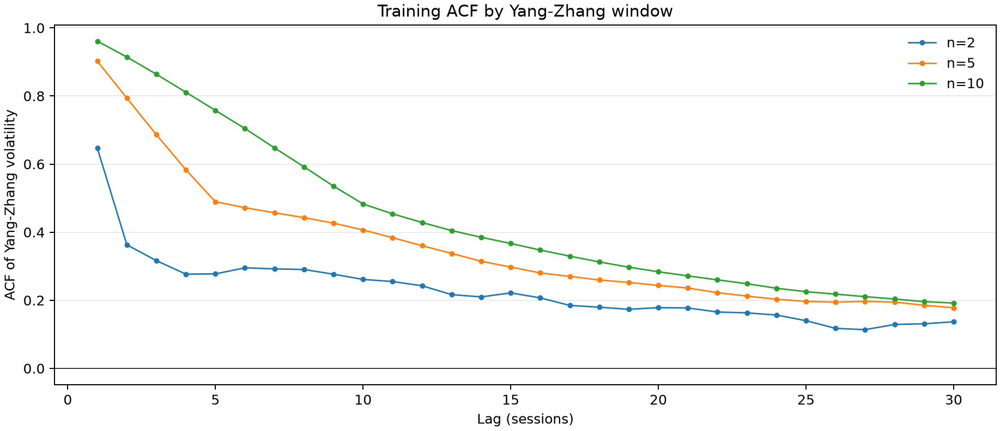

## Study at a glance

**Group 2**

Luo Pui Ki Enoch (1155212655) · Li Hung Kui (1155212707) ·
Siriasavakul Hok Sum (1155179729)

**Forecast object:** next trading-day unannualised Yang–Zhang volatility
of continuous COMEX gold futures (`GCc1`). Not the gold price, not spot.

**Headline:** among six shortlisted models, forecast-error variance rises
when $\hat y$ is in the top 20% (Q5). Three patches did not remove it.
Most of the headline Q5/Q1 ratio is a handful of 2026 crash dates.

::: notes
One sentence for the object, then the residual headline. Do not open with
"HGB wins." Outline: data and YZ; ladder; Q5, spike, three failed patches;
confirmatory split and window check.
:::

## Why forecast gold *futures* volatility?

- Target: daily volatility of gold **futures**, not spot
- Same LSEG run: `XAUFIX=` permission error; `XAU=` does not support `TRDPRC_1`
- `GCc1` did download: continuous COMEX gold, no manual stitching
- Futures embed carry (rates, storage, convenience yield)
- Object faced by futures traders, hedgers, and options on futures

::: notes
Lead with availability, then economics. Futures and spot are different
instruments. Do not claim futures vol equals spot vol.
:::

## Data: LSEG `GCc1`

Source: LSEG Workspace, `data/refinitiv/GCc1.csv`, 2010-01-01 to 2026-11-10.

| Field | Label | Role |
|---|---|---|
| `Date` | Session date | Trading day of the daily interday bar |
| `TRDPRC_1` | LAST | Close proxy $C_t$ (not settlement) |
| `OPEN_PRC`, `HIGH_1`, `LOW_1` | OHLC | Yang–Zhang inputs |
| `OPINT_1` | Open interest | Downloaded; unused in YZ |

- Volume `ACVOL_1` requested, not returned
- 4,241 rows; **4,064** complete OHLC; incomplete bars dropped, never filled

::: notes
LAST is a close proxy. Open interest is on the bar; YZ uses OHLC only.
Date is the trading session, not a filled calendar (2010-01-08 then
2010-01-11). Incomplete 27–28 January 2026 bars matter later for the spike.
:::

## A different price regime in the holdout

{width=86%}

::: notes
Training is roughly 1,050–2,000 USD/oz. The holdout runs from about 2,000
to above 5,000. That is why later-sample MAE is higher, and why 2026 is a
stress test rather than a replay of training.
:::

## Horizon: one trading day

- LSEG `Date` = exchange session of that daily bar
- Weekends and holidays skipped; incomplete OHLC $\Rightarrow$ no target
- Forecast $\hat y_{t+1\mid t}$: **next valid session**, unannualised
- 3,801 targets; 3,040 / 761; test 2023-06-02 to 2026-11-10
- Sequential one-step; future $y$ is never a predictor

::: notes
Not a five-session sum, not annualised, not next calendar day.
:::

## The Yang–Zhang series

{width=86%}

::: notes
Point at the 2026 spike in the shaded window — that is the later shared
miss. Quiet stretches sit near 0.003–0.01.
:::

## Why not close-to-close?

Ideal daily variance uses high-frequency $RV_t=\sum_i r_{t,i}^2$.
No tick or 5-minute bars here: one OHLC bar per `Date`.

Close-to-close uses two points and ignores the range:

$$
r^{cc}_t=\log(C_t/C_{t-1}),\qquad \hat\sigma^{cc,2}_t=(r^{cc}_t)^2.
$$

**Same close-to-close return, two paths:**

1. Price walks almost straight open $\to$ close (quiet range).
2. Price swings; high–low is large; $C_t=C_{t-1}$ so $r^{cc}_t=0$.

Close-to-close treats them as identical. Overnight gaps are missed too.

::: notes
Spend time on path 2. A zero close-to-close day can be a wild session.
That is why we want an OHLC estimator.
:::

## Yang–Zhang (2000)

DOI 10.1086/209650. AI suggested an OHLC estimator; the team used the paper.
Window $n=2$, $k\approx 0.078341$.

$$
\hat\sigma^{2}_{\mathrm{YZ},t}
= s^{2}_{o,t} + k\, s^{2}_{c,t} + (1-k)\,\overline{RS}_{t},
\qquad
y_t=\sqrt{\max(0,\hat\sigma^{2}_{\mathrm{YZ},t})}.
$$

- Overnight variance + open-to-close variance + Rogers–Satchell (1991) range
- Drift-independent; handles opening jumps (Yang and Zhang 2000)
- Unannualised; adjacent windows **overlap**

::: notes
Incomplete windows have no target. $y_t$ is a proxy, not tick RV.
Do not say $n=2$ is optimal; the later window check shows longer $n$
makes overlap worse.
:::

## Seasonality (descriptive, then a check)

::: columns
::: {.column width="50%"}
{width=95%}
:::
::: {.column width="50%"}
{width=95%}
:::
:::

- February–April elevation; March highest, July lowest
- HAR-X month dummies: MAE $0.002711\to 0.002739$ (Q5/Q1 $11.55\to 11.92$)
- Calendar dummies known at the origin do **not** fix Q5

::: notes
Month pattern is real descriptively. Overlapping $n=2$ windows make
calendar tests lag-sensitive. The robustness check is a failed forecasting
fix, not a reason to ignore the plot.
:::

## Course ladder

Each step is a response to the previous limit.

| Step | Models | Limit that motivates the next step |
|---|---|---|
| 1 | AR / MA / ARIMA on $\log y_t$ | Constant innovation variance; vol clusters |
| 2 | ARCH / GARCH / EGARCH | Own shocks only |
| 3 | Range GARCH-X, EGARCH-X | Need multi-horizon features |
| 4 | HAR / HAR-X | Linear in features |
| 5 | HGB | No likelihood; trees |

Engle (1982), Bollerslev (1986), Nelson (1991); gold: Tully and Lucey (2007), Baur (2012), Bentes (2015, FIGARCH). HAR: Corsi (2009); Todorova (2017) on COMEX gold. We do **not** estimate FIGARCH.

::: notes
Walk the ladder. Stay with course EGARCH. HAR here is Corsi-style on
Yang–Zhang, not tick RV. Student-$t$ is scored later as a Q5 patch, not
as a reason to pick $t$-GARCH on MAE.
:::

## Holdout MAE (761 common dates)

| Model | Role | MAE |
|---|---|---:|
| **HGB** | Trees | **0.002418** |
| HAR-X | Multi-horizon | 0.002711 |
| EGARCH-X | -X in the mean | 0.002833 |
| GARCH(1,1) | Persistent variance | 0.002912 |
| Persistence | Naive | 0.003190 |

HGB vs persistence MAE gap $0.000772$ ($24\%$).
$\times\sqrt{252}\approx 1.23$ annualised vol points.
At mean holdout price $\approx 3{,}136$ USD/oz, $1.65\sigma$ of that gap
is about $\$4$/oz, or about $\$400$ on a 100 oz COMEX contract.

**Shortlist:** GARCH, EGARCH, range GARCH-X, EGARCH-X, HAR-X, HGB.

::: notes
Illustration, not option pricing or regulatory VaR. Ranking is descriptive;
overlapping targets; leader chosen on this holdout. Squared-loss: HGB does
not significantly beat GARCH. Absolute-loss Holm $p$ vs persistence / HAR /
GARCH: $7.95\times10^{-14}$, $1.15\times10^{-13}$, $1.78\times10^{-9}$.
:::

## Forecasts versus actuals

{width=82%}

::: notes
Scatter is for clustering and large misses, not for declaring a DGP.
High actuals sit above the 45-degree line: average under-forecasting.
:::

## Residuals versus predicted volatility

{width=90%}

::: notes
These are predictive errors, not GARCH standardised innovations.
Positive = under-forecast. Walk one panel, then say the shape is shared.
HAC slope of squared error on forecast level is positive for all six.
:::

## When $\hat y$ is in the top 20% (Q5)

Q5 is a **predicted**-volatility bin, known at the origin.

| Model | Raw Q5/Q1 variance |
|---|---:|
| GARCH / EGARCH / range GARCH-X | 9.2–9.3 |
| HAR-X | 11.6 |
| HGB | 12.3 |
| EGARCH-X | 15.1 |

Relative ratios 0.96–1.33; log-error ratios 0.48–0.85.
Q5 errors stay right-skewed and heavy-tailed.

**2026-02-02:** actual $0.0775$; forecasts $0.01$–$0.015$.

::: notes
Much of the raw widening is scale. Q5 is still the unreliable region:
skew, kurtosis, and the shared crash. Calm-period point forecasts are
more trustworthy.
:::

## Error variance by forecast quintile

{width=90%}

::: notes
Left panel is the exhibit. Middle and right show that rescaling removes
most of the inflation. Keep the punchline: high predicted vol is where
point forecasts fail.
:::

## The 2026-02-02 cluster

Dropping the largest Q5 misses, **keeping the original Q5 set**:

| | Drop 1 | Drop 5 | Q5/Q1 after drop 5 |
|---|---:|---:|---:|
| GARCH family | $\approx 37\%$ | $\approx 59\%$ | $\approx 3.7$ |
| HAR-X / HGB | $\approx 35\%$ | $70$–$72\%$ | $\approx 3.2$–$3.6$ |

- 27–28 Jan: missing OHLC, so $n=2$ YZ is delayed
- 29 Jan: record near $5{,}595$; OI jumps $171\to 30{,}082$
- 30 Jan: steepest gold drop since 1983 (Warsh nomination)
- 2 Feb: first valid $y=0.0775$; CME gold margins $6\%\to 8\%$

Headline Q5/Q1 is **mostly a few crash dates**. A ratio near $3$–$6$ remains.

::: notes
Reuters 2 February 2026. Round-number lows and the OI jump are
continuation-series caveats; the crash itself is a real price move.
The first valid YZ uses 30 Jan + 2 Feb because Jan 27–28 poison the
overnight return.
:::

## How much Q5 variance the largest misses carry

{width=88%}

::: notes
Every model’s largest miss is 2026-02-02. Next is 2026-03-23. After the
top five, Q5 is still noisier than Q1. Crash cluster first, milder
high-vol problem second.
:::

## Patch 1 — Student-$t$ MLE (ran)

761 origins $\times$ 6 models $\times$ 2 distributions; **0 failures**.
$df\approx 4.1$–$4.4$ (HGB residual $df=3.51$).

| Model | Normal MAE | $t$ MAE | Normal Q5/Q1 | $t$ Q5/Q1 |
|---|---:|---:|---:|---:|
| GARCH family | 0.002912 | 0.002916–0.002925 | 9.19–9.21 | 9.47–9.49 |
| HAR-X | 0.002758 | 0.002726 | 18.55 | 15.76 |
| HGB | 0.002421 | 0.002421 | 13.39 | 13.39 |

Density scores improve. Point-forecast Q5 does **not** go away.
HGB point forecast is unchanged by construction.

::: notes
This experiment’s HAR-X/HGB include selected DXY and gold IV. GARCH-X and
EGARCH-X are the custom likelihoods, not the shortlist `arch` EGARCH-X.
A heavier tail is a better density, not a Q5 point-forecast fix.
:::

## Patch 2 — segmented high-vol parameters

Training-history 80th percentile. Two triggers: pilot forecast, or lagged $y$.
12 fits, 761 dates, 0 failures.

| | Unsegmented MAE | Forecast trigger | Lagged $y$ |
|---|---:|---:|---:|
| HGB | 0.002418 | 0.002680 | 0.002760 |
| HAR-X | 0.002711 | 0.002883 | 0.002879 |
| GARCH | 0.002912 | 0.003238 | 0.003249 |

**Failed patch:** segmented MAE is worse. Same reused holdout.

::: notes
Forecast-trigger mixes a pilot forecast with lagged-vol estimation
samples. Do not present this as a deployable regime model.
:::

## Patch 3 — log $Y$ and Jensen reverse

Fit $\log y_t$; reverse with $\exp(\hat\mu + \hat\sigma^{2}/2)$.

- Bias moved toward zero for all six
- MAE/RMSE vs baseline: **not Holm-significant**
- On baseline-Q5 dates, residual variance **rose** for five models;
  HGB $-0.2\%$

**Failed Q5 patch** that did reduce average under-forecasting.

::: notes
The Jensen term is a mean correction under normal log errors. It was not
a Q5-variance fix. HGB/HAR-X baselines in this run are the joint-predictor
saved forecasts.
:::

## Confirmatory later-holdout split

Same 761 days, split at 2024-12-31. **Not** an untouched holdout:
2026-02-02 was already inspected.

| | 2023–24 MAE | Rank | Q5/Q1 | 2025–26 MAE | Rank | Q5/Q1 |
|---|---:|---:|---:|---:|---:|---:|
| HGB | 0.001739 | 1 | 1.28 | 0.002987 | 1 | 9.29 |
| HAR-X | 0.002010 | 2 | 1.36 | 0.003299 | 2 | 5.54 |

HGB then HAR-X in both slices. Q5 is weak in 2023–24 and returns in 2025–26.

::: notes
347 vs 414 dates. Quintiles recomputed inside each window. EGARCH-X Q5/Q1
in 2025–26 is 23 because Q1 variance is tiny. Absolute MAE is higher later
because it is a higher-vol regime.
:::

## MAE on 2023–24 versus 2025–26

{width=88%}

::: notes
Green is the full 761-day holdout. Orange is the later slice that contains
the crash. The ranking is stable; the Q5 problem is not an early-holdout
artefact.
:::

## Window $n=2,5,10$

Lag-1 ACF **rises** with $n$: $0.65$, $0.90$, $0.96$.
At $n=5$ and $n=10$, persistence wins; Q5/Q1 rises to $30$–$63$.

{width=72%}

::: notes
Date-aligned last training date 2023-06-01. Test size shrinks to 677 and
558. Q1 variance collapses on the smoother target while the crash still
sits in Q5. Lengthening $n$ is not the Q5 fix.
:::

## Limits

- Overlapping Yang–Zhang windows; $n=5$ and $n=10$ make that worse
- One chronological holdout, reused; 2025–26 is confirmatory, not unused
- 1M gold IV vs next-session realised vol; next-weekday LSEG proxy
- `GCc1` is a generic continuation; `TRDPRC_1` is last trade
- MAE-to-dollar figures are illustrations, not pricing results

We do **not** claim HGB is the DGP, that IV causes futures vol, or that
any patch solved Q5.

::: notes
If asked which model to use: give MAE as descriptive, then qualify with
Q5. Point forecasts in calm periods are more trustworthy. Next step is
an event/jump treatment of 2026, not a larger GARCH grid.
:::

## Use of AI and contributions

**AI.** Copilot and Grok wrote pipeline code, diagnostics, and drafts.
The team chose `GCc1` Yang–Zhang, the three-part story, and the shortlist.
Quoted numbers come from saved CSVs. AI did not invent holdout scores
and did not estimate FIGARCH.

**Focus, not exclusive ownership**

- Enoch (1155212655): model development, ladder, predictor screen
- Keir (1155212707): infrastructure, LSEG/YZ pipeline, report and slides
- Samuel (1155179729): Q5 diagnosis, log reverse, segmented experiment

::: notes
Do not improvise extra AI claims. Yang–Zhang: AI suggested an OHLC
estimator; the team used Yang and Zhang (2000).
:::

## Recap

- Futures (`GCc1`), not spot; Yang–Zhang because only daily bars
- Horizon = next trading session, unannualised
- Six candidates; HGB lowest MAE (descriptive)
- **Shared finding:** residual variance rises with $\hat y$, especially Q5
- 2026 crash dates carry most of the headline Q5/Q1; a ratio $\approx 3$–$6$ remains
- Segmented MAE worse; Jensen bias only; Student-$t$ helps density, not Q5
- High predicted volatility is the unreliable region
