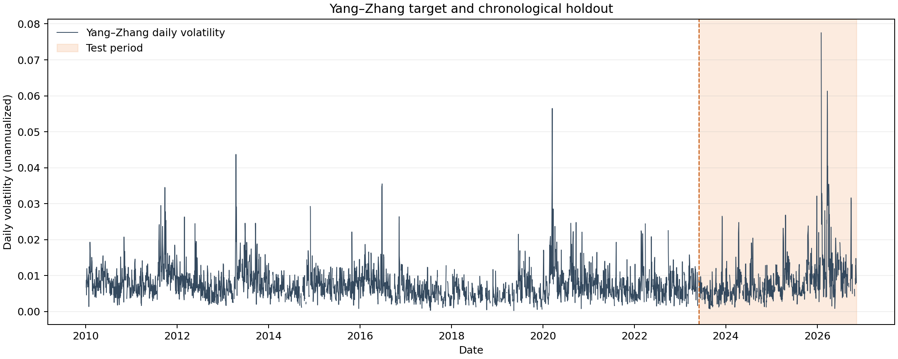
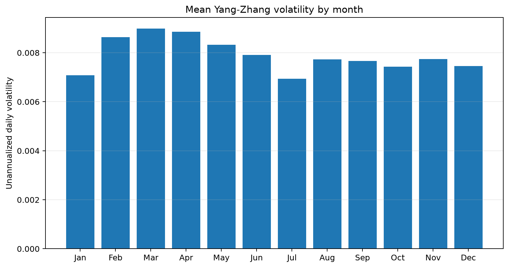
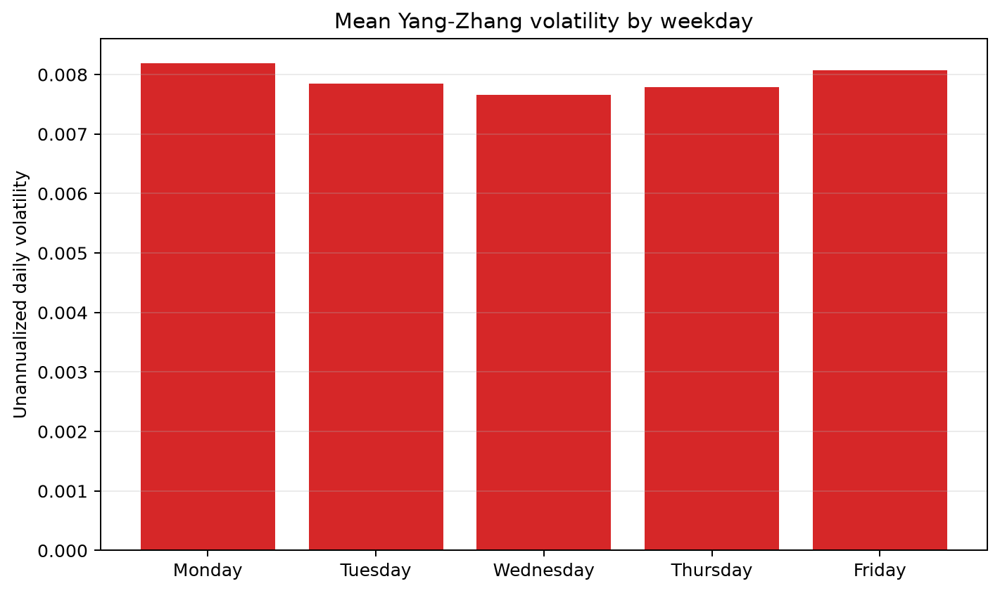
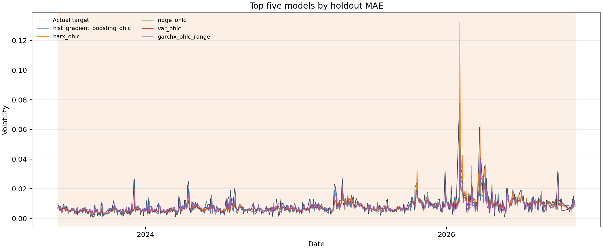
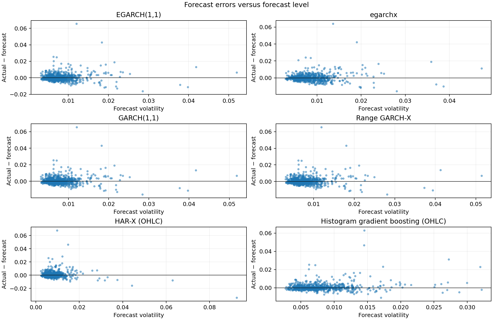
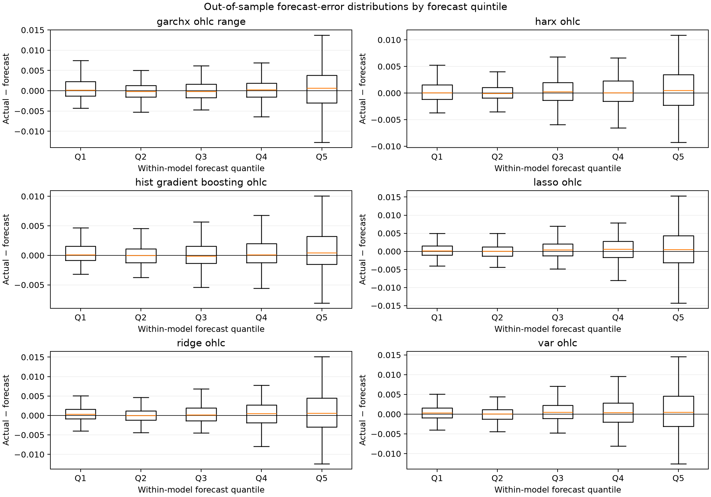

## Study at a glance

**Group 2**

Luo Pui Ki Enoch (1155212655) · Li Hung Kui (1155212707) ·
Siriasavakul Hok Sum (1155179729)

*Working roles: Enoch—model development · Li Hung Kui—infrastructure ·
Siriasavakul—model analysis*

**Forecast object:** next-valid-day unannualized volatility of continuous
COMEX gold futures, not the gold price level and not spot gold.

::: notes
State the forecast object in one sentence: next-valid-day unannualized
volatility of the continuous COMEX gold futures series. Outline the
20-minute plan: motivation and data, candidate models, residual
evaluation, then a brief AI note. Do not quote numerical results until
the team has inserted them.
:::

## Why forecast gold *forward* volatility?

- Target: daily volatility of gold **forward/futures** prices, not spot
- Primary reason: continuous futures histories are **more readily accessible**
- COMEX gold futures (GC): global benchmark contract, high liquidity
- Continuous series (`GCc1`): long, consistent history without manual stitching
- Futures prices embed the cost of carry (rates, storage, convenience yield)
- Directly relevant for futures traders, hedgers, and options on futures
- Less exposed to physical-market frictions (premia, delivery constraints)

::: notes
Lead with accessibility, then the economic rationale. Futures and spot
are different instruments. The cost-of-carry relation means futures
volatility is the object faced by exchange-traded hedging and options on
futures. Do not claim that futures volatility equals spot volatility.
:::

## Spot versus futures

::: columns
::: {.column width="48%"}
**Spot gold**

- OTC / locational quotes
- Premia and delivery constraints
- Harder to obtain as one long continuous series
:::

::: {.column width="48%"}
**COMEX futures (`GCc1`)**

- Exchange-traded benchmark (GC)
- Cost of carry already in the price
- Continuous generic contract; no manual roll stitching
:::
:::

**Suggested visual:** side-by-side schematic, optionally with a `GCc1`
price path and the evaluation window shaded.

::: notes
Use this slide as a pause. The research question is futures-vol, not a
claim that spot is uninteresting. If asked about roll effects, say that
`GCc1` is a generic continuous series and that we keep it distinct from
spot and from a single fixed-expiry contract.
:::

## Data: Refinitiv `GCc1`

Source: Refinitiv / LSEG Workspace, continuous contract **`GCc1`**.
Daily bars are OHLC **plus** open interest.

| Field | Label | Role |
|---|---|---|
| `TRDPRC_1` | LAST | Last trade; closing-price proxy |
| `OPEN_PRC` | Open | Session open |
| `HIGH_1`, `LOW_1` | High, low | Daily range |
| `OPINT_1` | Open interest | Downloaded with the bar |

- Incomplete OHLC bars are **not imputed**
- Windows with incomplete quotes have no Yang–Zhang target
- Sample counts: `[N rows]` source rows; `[N complete OHLC]`; `[N valid targets]`

::: notes
LAST is a close proxy, not a settlement-price series. Open interest is
part of the downloaded bar; the Yang–Zhang estimator uses OHLC only.
Missingness is handled by dropping incomplete windows rather than
filling prices. Insert the team's sample counts before the talk.
:::

## The target and chronological split

{fig-alt="Yang–Zhang target with test window shaded" width=82%}

::: notes
Point out the chronological 80/20 split: later calendar time is the
holdout. Incomplete OHLC windows have no target, so successive test
dates can skip sessions. Replace the figure if the team changes the
split display.
:::

## Why Yang–Zhang?

Ideal daily variance uses high-frequency intraday returns. Only daily
bars were available, so the **Yang–Zhang** estimator is used.

$$
\hat\sigma^{2}_{\mathrm{YZ},t}
= s^{2}_{o,t} + k\, s^{2}_{c,t} + (1-k)\,\overline{RS}_{t},
\qquad
y_t=\sqrt{\max(0,\hat\sigma^{2}_{\mathrm{YZ},t})}.
$$

- Combines overnight variance, open-to-close variance, and Rogers–Satchell range variance
- Weight $k$ minimises estimator variance
- Drift-independent; accounts for overnight gaps
- More efficient than close-to-close; suited to futures with overnight moves
- Window and weight: $n=[n]$, $k=[k]$ (insert team defaults)

**Suggested visual:** one-bar schematic $C_{t-1}\to O_t\to C_t$ with the
three variance components labelled.

::: notes
Close-to-close ignores the high–low range and the overnight gap.
Rogers–Satchell is efficient for the open-to-close range but ignores
overnight returns. Yang–Zhang restores the overnight term, keeps the
range estimator, and chooses k to minimise the variance of the
combination. Models forecast volatility y_t, unannualized. Adjacent
windows overlap.
:::

## Pre-modelling diagnostics

- Seasonality checks (calendar month / weekday)
- Chronological **80/20** train–test split (no shuffling)
- Volatility clustering (visual inspection of $y_t$ and squared returns)
- Stationarity: ADF
- Conditional heteroskedasticity: ARCH-LM
- Normality: Jarque–Bera, QQ-plot, excess kurtosis
- Serial dependence: Ljung–Box on returns and on squared returns
- Cleaning: incomplete OHLC dropped; outliers documented, not silently filled

Results: `[insert ADF / ARCH-LM / JB / LB]`.

::: notes
The 80/20 split is chronological, so the test sample is later in calendar
time. Seasonality is a descriptive check, not automatically a forecasting
feature. ARCH-LM and Ljung–Box on squares motivate GARCH-type models.
Heavy tails caution against treating Gaussian residuals as more than a
quasi-likelihood device. Insert the team's statistics before the talk.
:::

## Calendar profiles of the target

::: columns
::: {.column width="50%"}
{width=95%}
:::
::: {.column width="50%"}
{width=95%}
:::
:::

**Suggested visual (additional):** 2×2 panel of target path, ACF of
squares, QQ-plot, and these calendar means.

::: notes
These are descriptive calendar means, not a decision to add seasonal
dummies. If asked whether month effects are significant, say the team
will insert the overlap-aware tests and should not treat a visual
February–April elevation as a forecasting feature until that is done.
:::

## Course-related models (ECON4120)

- Linear time-series: AR, ARMA, and related specifications
- GARCH family: ARCH, GARCH, EGARCH
- Exogenous extensions: GARCH-X, EGARCH-X

| Mean / linear | Conditional variance | With exogenous information |
|---|---|---|
| AR, ARMA | ARCH | GARCH-X |
| | GARCH | EGARCH-X |
| | EGARCH | |

GARCH-X in this project is the range-augmented GARCH-X recursion on the
volatility target.

::: notes
AR/ARMA on returns or on a volatility proxy capture serial correlation
in the mean but not changing conditional variance. ARCH/GARCH model that
variance directly. EGARCH allows asymmetric news effects and keeps
variance positive without inequality constraints. The -X versions add
lagged exogenous information to the variance equation (GARCH-X) or to
the mean and variance (EGARCH-X).
:::

## Additional models and exogenous variables

- Realised-volatility regressions: HAR and HAR-X
- Regularised regression: Ridge and Lasso
- Machine learning: Histogram Gradient Boosting (HGB)

After correlation / collinearity screening, the **-X** specifications use:

- **DXY** — U.S. Dollar Index
- **Gold IV 1M** — one-month gold implied volatility
- **Gold IV 1Y** — one-year gold implied volatility

Screening statistics: `[insert correlation / VIF / HAC p-values]`.
The three variables enter **jointly**; the design does not isolate each
effect.

::: notes
HAR brings in daily, weekly, and monthly volatility components, which is
natural for a persistent volatility target. Ridge and Lasso are linear
benchmarks that penalise collinear predictors. HGB is a nonlinear tree
ensemble. DXY is the dollar channel for gold. The two IV tenors summarise
the options market at short and long horizons. Screening is association
on the training sample, not proof of out-of-sample value.
:::

## Shortlisted candidates

Retained on out-of-sample **MAE**, with **AIC** and **BIC** as supporting
in-sample diagnostics (within comparable likelihood families):

**GARCH · EGARCH · GARCH-X · EGARCH-X · HAR-X · HGB**

| Model | MAE | AIC | BIC |
|---|---:|---:|---:|
| GARCH | [ ] | [ ] | [ ] |
| EGARCH | [ ] | [ ] | [ ] |
| GARCH-X | [ ] | [ ] | [ ] |
| EGARCH-X | [ ] | [ ] | [ ] |
| HAR-X | [ ] | [ ] | [ ] |
| HGB | [ ] | — | — |

Linear AR/ARMA, plain HAR, Ridge, and Lasso were explored and not
retained. HGB has no likelihood, so AIC/BIC are undefined.

::: notes
Shortlisting is descriptive. MAE is the headline out-of-sample loss
because the target is already in volatility units. AIC/BIC summarise
in-sample likelihood fit and are not comparable across different target
transformations or between likelihood models and HGB. Overlapping
Yang–Zhang windows mean adjacent losses are dependent. Do not claim a
Diebold–Mariano test unless the team later inserts one.
:::

## Evaluation design

- Common chronological holdout; sequential one-step forecasts
- Residual here = forecast error $e_t = y_t - \hat{y}_{t\mid t-1}$
- Positive $e_t$: under-forecasting
- These are **predictive errors**, not GARCH standardised innovations
- Diagnostics: $e_t$ versus $\hat{y}$; residual ACF; error distribution;
  quantile split of $\hat{y}$

Holdout metrics (insert): MAE `[ ]`, RMSE `[ ]`, mean error `[ ]`.

::: notes
Define the residual carefully. We are looking at out-of-sample forecast
errors on the volatility scale, not fitted GARCH innovations. Overlapping
two-observation targets induce serial dependence in e_t.
:::

## Forecasts on the shared holdout

{width=88%}

::: notes
If the displayed figure still shows an earlier candidate set, say so and
point to the shortlisted six. The visual is for clustering and common
misses, not for declaring a winner.
:::

## Residual heteroskedasticity

- Consistent pattern across all six shortlisted models
- Residual **variance increases with the size of the fitted value** $\hat{y}$
- Fan-shaped residual plot: errors more dispersed when predicted volatility is high
- Reliability is weaker precisely when volatility risk is most material

::: notes
This is heteroskedasticity of forecast errors with respect to the
forecast level, not a restatement of ARCH in returns. Even GARCH-family
models leave a volatility-of-the-volatility problem on the y_t scale:
high predicted volatility coincides with larger absolute misses. Walk
through one panel on the next slide, then note that the same shape
appears in the others.
:::

## Residuals versus predicted volatility

{width=82%}

::: notes
The fan shape is the exhibit. When predicted volatility is low, misses
are compressed; when it is high, the scatter opens up. That pattern is
shared, so it is not an artefact of one specification.
:::

## When predicted volatility is in the top 20%

- Sort $\hat{y}$ within each model into quantiles
- When predicted volatility is in the **top 20%** (Q5), residual variance
  rises markedly
- The worst-calibrated region is the high-volatility regime
- Q5 is a *predicted*-volatility bin, so it is observable at the origin

Quantile summaries: `[insert mean, variance, skewness by Q1–Q5]`.

::: notes
The top quintile is defined from the forecast, unlike a split on realised
y_t. When the model itself says volatility is high, its error band should
be treated as much wider. Do not over-claim a formal variance test unless
the team inserts one.
:::

## Residual distributions by forecast quintile

{width=82%}

::: notes
If this figure was built on a neighbouring candidate set, treat it as
illustrative of the Q5 pattern and swap in the shortlisted six-model
panel before the talk.
:::

## Implications, remedies, and limits

- Point forecasts in calm periods are more trustworthy than those in stress
- Risk-management use (margin, option hedges) is weakest where it is most needed
- Remedies considered:
  - regime-wise or quantile-wise evaluation
  - empirical calibration of bias and error scale using only past errors
  - heavier-tailed or heteroskedastic observation equations
- Limits: overlapping targets; holdout reused in development; no deployable cutoff

::: notes
Close Part 3 by lowering confidence, not by picking a winner. If asked
which model is best, give the MAE ranking as descriptive, then qualify it
with the high predicted-volatility residual-variance result, which is
shared. Mention empirical error calibration only as a considered remedy,
without quoting unconfirmed coverage numbers. Retrospective realised
terciles are descriptive only and are not a deployable regime classifier.
:::

## Use of AI

- Course requirement: AI tools were used in the project
- The report will reflect how they were used, and whether responses were
  constructive or misleading
- **Content to be added by the group**

::: notes
Do not improvise a reflection until the group has agreed the text. If
questions arise, say that the written section will document prompts,
checks against saved outputs, and the group's remaining responsibility
for every claim.
:::

## Recap

- Futures (`GCc1`), not spot; Yang–Zhang because only daily bars were available
- Six candidates: GARCH, EGARCH, GARCH-X, EGARCH-X, HAR-X, HGB
- Shared finding: residual variance rises with $\hat{y}$, especially in the top 20%
- High-volatility forecasts are the least reliable — insert metrics before submission
- AI reflection: to be completed
