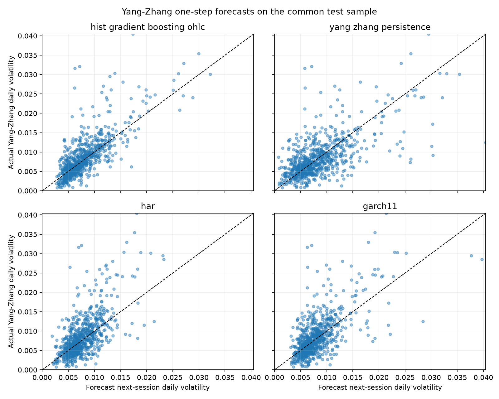

## Study at a glance

**Group 2**

Luo Pui Ki Enoch (1155212655) · Li Hung Kui (1155212707) ·
Siriasavakul Hok Sum (1155179729)

**Forecast object:** next trading-day unannualised Yang–Zhang volatility
of continuous COMEX gold futures (`GCc1`). Not the gold price, not spot.

**Headline:** among six shortlisted models, forecast-error variance rises
when $\hat y$ is in the top 20% (Q5). Two patches did not remove it.

::: notes
One sentence for the object, then the residual headline. Do not open with
"HGB wins." Outline: why this object (data, futures, YZ, horizon,
seasonality); ladder and shortlist; Q5; failed patches; limits.
:::

## Why forecast gold *futures* volatility?

- Target: daily volatility of gold **futures**, not spot
- Same LSEG run: `XAUFIX=` permission error; `XAU=` does not support `TRDPRC_1`
- `GCc1` did download: continuous COMEX gold, no manual stitching
- Futures embed carry (rates, storage, convenience yield)
- Object faced by futures traders, hedgers, and options on futures

::: notes
Lead with availability, then economics. Futures and spot are different
instruments. Do not claim futures vol equals spot vol.
:::

## Data: LSEG `GCc1`

Source: LSEG Workspace, `data/refinitiv/GCc1.csv`, 2010-01-01 to 2026-11-10.

| Field | Label | Role |
|---|---|---|
| `Date` | Session date | Trading day of the daily interday bar |
| `TRDPRC_1` | LAST | Close proxy $C_t$ (not settlement) |
| `OPEN_PRC`, `HIGH_1`, `LOW_1` | OHLC | Yang–Zhang inputs |
| `OPINT_1` | Open interest | Downloaded; unused in YZ |

- Volume `ACVOL_1` requested, not returned
- 4,241 rows; **4,064** complete OHLC; incomplete bars dropped, never filled

::: notes
LAST is a close proxy. Open interest is on the bar; YZ uses OHLC only.
Date is the trading session, not a filled calendar (2010-01-08 then
2010-01-11).
:::

## Horizon: one trading day

- LSEG `Date` = exchange session of that daily bar
- Weekends and holidays skipped; incomplete OHLC $\Rightarrow$ no target
- Forecast $\hat y_{t+1\mid t}$: **next valid session**, unannualised
- Not a five-session sum, not annualised, not next calendar day

{width=78%}

::: notes
3,801 targets; 3,040 / 761; test 2023-06-02 to 2026-11-10. Sequential
one-step; future $y$ never a predictor. Point at the 2026 spike in the
shaded window — that is the later 2026-02-02 miss.
:::

## Why not close-to-close?

Ideal daily variance uses high-frequency $RV_t=\sum_i r_{t,i}^2$.
No tick or 5-minute bars here: one OHLC bar per `Date`.

Close-to-close uses two points and ignores the range:

$$
r^{cc}_t=\log(C_t/C_{t-1}),\qquad \hat\sigma^{cc,2}_t=(r^{cc}_t)^2.
$$

**Same close-to-close return, two paths:**

1. Price walks almost straight open $\to$ close (quiet range).
2. Price swings; high–low is large; $C_t=C_{t-1}$ so $r^{cc}_t=0$.

Close-to-close treats them as identical. Overnight gaps are missed too.

::: notes
Spend time on path 2. A zero close-to-close day can be a wild session.
That is why we want an OHLC estimator.
:::

## Yang–Zhang (2000)

DOI 10.1086/209650. AI suggested an OHLC estimator; the team used the paper.
Window $n=2$, $k\approx 0.078341$.

$$
\hat\sigma^{2}_{\mathrm{YZ},t}
= s^{2}_{o,t} + k\, s^{2}_{c,t} + (1-k)\,\overline{RS}_{t},
\qquad
y_t=\sqrt{\max(0,\hat\sigma^{2}_{\mathrm{YZ},t})}.
$$

- Overnight variance + open-to-close variance + Rogers–Satchell (1991) range
- Drift-independent; handles opening jumps (Yang and Zhang 2000)
- Unannualised; adjacent windows **overlap**

::: notes
$s_o^2$ is overnight, $s_c^2$ open-to-close, $\overline{RS}$ the range
term. Incomplete windows have no target. $y_t$ is a proxy, not tick RV.
Do not say AI invented the estimator, and do not say $n=2$ is optimal.
:::

## Seasonality (descriptive only)

::: columns
::: {.column width="50%"}
{width=95%}
:::
::: {.column width="50%"}
{width=95%}
:::
:::

- March 0.00899 highest; July 0.00694 lowest; Feb/Apr also high
- Weekdays 0.00766–0.00819; no weekday HAC rejection
- Month-only $p=0.012$ at 5 lags, $0.068$ at 10, $0.122$ at 20
- **No seasonal dummy** in the forecasting models

::: notes
February–April elevation is descriptive. Overlapping $n=2$ windows make
calendar tests lag-sensitive. We did not add month dummies.
:::

## Course ladder

Each step is a response to the previous limit.

| Step | Models | Limit that motivates the next step |
|---|---|---|
| 1 | AR / MA / ARIMA on $\log y_t$ | Constant innovation variance; vol clusters |
| 2 | ARCH / GARCH / EGARCH | Own shocks only |
| 3 | Range GARCH-X, EGARCH-X | Need multi-horizon features |
| 4 | HAR / HAR-X | Linear in features |
| 5 | HGB | No likelihood; trees |

Engle (1982), Bollerslev (1986), Nelson (1991); gold: Tully and Lucey (2007), Baur (2012), Bentes (2015, FIGARCH). HAR: Corsi (2009); Todorova (2017) on COMEX gold. We do **not** estimate FIGARCH.

::: notes
Walk the ladder. Gold literature: inverted asymmetry (Baur) and long memory (FIGARCH, Bentes; FIAPARCH, Chkili et al.). We stay with course EGARCH. HAR here is Corsi-style on Yang–Zhang, not tick RV. ARIMA MAE $\approx 0.0030$–$0.0033$. Student-$t$ GARCH MAE 0.002921 vs Gaussian 0.002912 — overall MAE, not Q5.
:::

## Holdout MAE (761 common dates)

| Model | Role | MAE |
|---|---|---:|
| **HGB** | Trees | **0.002418** |
| HAR-X | Multi-horizon | 0.002711 |
| EGARCH-X | -X in the mean | 0.002833 |
| GARCH(1,1) | Persistent variance | 0.002912 |
| EGARCH(1,1) | Asymmetry | 0.002912 |
| Range GARCH-X | GARCH-X | 0.002914 |
| Persistence | Naive | 0.003190 |

HGB vs persistence / HAR / GARCH, absolute-loss Holm $p$:
$7.95\times10^{-14}$, $1.15\times10^{-13}$, $1.78\times10^{-9}$.

**Shortlist:** GARCH, EGARCH, range GARCH-X, EGARCH-X, HAR-X, HGB.

::: notes
MAE is headline because $y$ is already volatility. Ranking is descriptive;
overlapping targets; leader chosen on this holdout. HGB/HAR-X/GARCH/EGARCH
here are no-external; EGARCH-X has selected predictors in the mean.
Squared-loss: HGB does not significantly beat GARCH.
:::

## Forecasts versus actuals

{width=82%}

::: notes
Scatter is for clustering and large misses, not for declaring a DGP.
High actuals sit above the 45-degree line: average under-forecasting.
:::

## Residuals: definition and fan

Residual $e_t=y_t-\hat y_{t\mid t-1}$. Positive = under-forecast.
These are **predictive errors**, not GARCH standardised innovations.

- Positive mean error on all six
- Fan: dispersion rises with $\hat y$
- HAC slope of squared error on forecast level: positive for all six

::: notes
This is heteroskedasticity of forecast errors with respect to the forecast
level. High predicted vol coincides with larger absolute misses.
:::

## Residuals versus predicted volatility

{width=86%}

::: notes
Walk one panel, then say the shape is shared. The isolated point near
forecast 0.01 and error 0.06 is 2026-02-02.
:::

## When $\hat y$ is in the top 20% (Q5)

Q5 is a **predicted**-volatility bin, known at the origin.

| Model | Raw Q5/Q1 variance |
|---|---:|
| GARCH / EGARCH / range GARCH-X | 9.2–9.3 |
| HAR-X | 11.6 |
| HGB | 12.3 |
| EGARCH-X | 15.1 |

Relative ratios 0.96–1.33; log-error ratios 0.48–0.85.
Q5 errors stay right-skewed and heavy-tailed.

**2026-02-02:** actual $0.0775$; forecasts $0.01$–$0.015$.

::: notes
Much of the raw widening is scale. Q5 is still the unreliable region:
skew, kurtosis, and the shared crash. Calm-period point forecasts are
more trustworthy.
:::

## Error variance by forecast quintile

{width=90%}

::: notes
Left panel is the exhibit. Middle and right show that rescaling removes
most of the inflation. Keep the punchline: high predicted vol is where
point forecasts fail.
:::

## Patch 1 — Student-$t$ MLE

Fat-tailed likelihood instead of Gaussian QMLE.

- Code: `distribution_comparison.py`
- **No saved six-model holdout CSV**
- On the 20-model ladder, Student-$t$ GARCH MAE 0.002921 vs Gaussian 0.002912

Quote design only. Do not invent a Q5 $t$-versus-Normal number.

::: notes
If asked, say the dedicated comparison was not written to
`distribution_summary.csv`. The ladder $t$-GARCH is overall MAE, not Q5.
:::

## Patch 2 — segmented high-vol parameters

Training-history 80th percentile. Two triggers: pilot forecast, or lagged $y$.
12 fits, 761 dates, 0 failures.

| | Unsegmented MAE | Forecast trigger | Lagged $y$ |
|---|---:|---:|---:|
| HGB | 0.002418 | 0.002680 | 0.002760 |
| HAR-X | 0.002711 | 0.002883 | 0.002879 |
| GARCH | 0.002912 | 0.003238 | 0.003249 |

**Failed patch:** segmented MAE is worse. Same reused holdout.

::: notes
Forecast-trigger mixes a pilot forecast with lagged-vol estimation
samples. Do not present this as a deployable regime model.
:::

## Patch 3 — log $Y$ and Jensen reverse

Fit $\log y_t$; reverse with $\exp(\hat\mu + \hat\sigma^{2}/2)$.

- Bias moved toward zero for all six
- MAE/RMSE vs baseline: **not Holm-significant**
- On baseline-Q5 dates, residual variance **rose** for five models;
  HGB $-0.2\%$

**Failed Q5 patch** that did reduce average under-forecasting.

::: notes
The Jensen term is a mean correction under normal log errors. It was not
a Q5-variance fix. HGB/HAR-X baselines in this run are the joint-predictor
saved forecasts.
:::

## Limits

- Overlapping two-observation targets
- One chronological holdout, reused in development and patches
- 1M gold IV vs next-session realised vol
- Next-weekday LSEG availability proxy
- `GCc1` is a generic continuous futures series; `TRDPRC_1` is last trade

We do **not** claim HGB is the DGP, that IV causes futures vol, or that
any patch solved Q5.

::: notes
If asked which model to use: give MAE as descriptive, then qualify with
Q5. Point forecasts in calm periods are more trustworthy.
:::

## Use of AI

- Course requirement: AI tools were used
- **Content to be added by the group**

::: notes
Do not improvise the reflection. Yang–Zhang: AI suggested an OHLC
estimator; the team used Yang and Zhang (2000).
:::

## Recap

- Futures (`GCc1`), not spot; Yang–Zhang because only daily bars
- Horizon = next trading session, unannualised
- Six candidates; HGB lowest MAE (descriptive)
- **Shared finding:** residual variance rises with $\hat y$, especially Q5
- Segmented MAE worse; log correction bias only; Student-$t$ unevaluated
- High predicted volatility is the unreliable region
