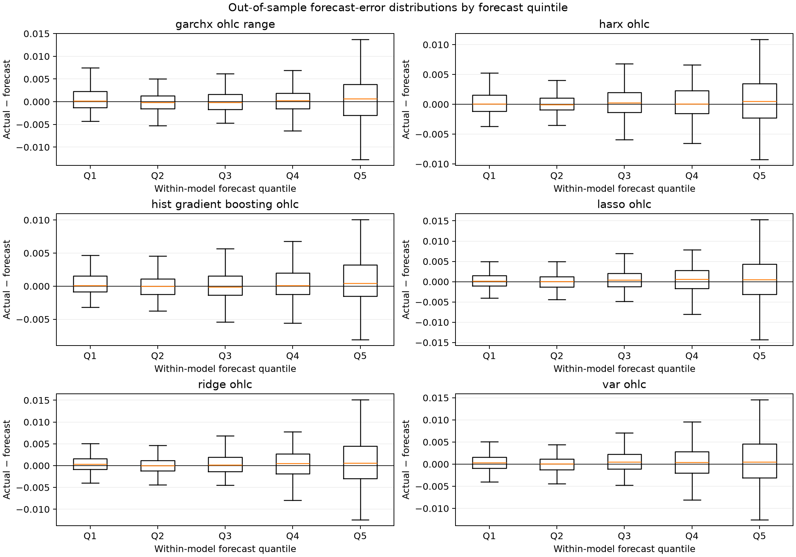

**Draft status.** Numerical results, test statistics, and some figure panels are left as placeholders for the group to insert from saved outputs. Do not treat bracketed entries such as `[MAE]` or Table [X] as estimated values.

**Contribution statement.** *[To be agreed by all group members before submission. Record each member's contribution to data preparation, modelling, evaluation, writing, and presentation.]*

# Research motivation, data, and pre-modelling analysis

## Why forecast gold forward volatility?

This project forecasts the daily volatility of gold *forward* (futures) prices rather than spot prices. The working series is the continuous COMEX gold futures contract `GCc1`. The primary reason for this choice is practical: continuous futures histories are more readily accessible than a clean, long spot series, and they can be obtained in a form that does not require the research team to stitch successive delivery months by hand.

That practical advantage is reinforced by market structure. COMEX gold futures (ticker GC) are the global benchmark gold-futures contract and are highly liquid. The generic continuous series `GCc1` therefore supplies a long, internally consistent price history. Futures quotes also have a direct economic interpretation. By covered-interest and storage arguments, the futures price embeds the cost of carry—financing rates, storage costs, and convenience yield—so its volatility is the object faced by futures traders, hedgers, and traders in options on futures. Relative to over-the-counter spot quotes, exchange futures are less affected by physical-market frictions such as locational premia and delivery constraints. Spot and futures volatility are therefore related but distinct; this study targets the latter.

## Data

The price data are the Refinitiv/LSEG Workspace continuous gold futures contract `GCc1`. Each daily bar contains open, high, low, and last trade prices together with open interest. The fields used are listed in @tbl-fields. `TRDPRC_1` (“LAST”) is treated as the closing-price proxy. LAST is a transaction price, not a clearing-house settlement quote. Open interest is retained as part of the downloaded bar; the volatility estimator below uses the OHLC prices.

Incomplete OHLC rows are not imputed. A target is undefined whenever the rolling window required by the estimator contains a missing or invalid bar, so successive observation dates may skip market sessions. Sample counts, the exact calendar span, and any additional outlier rule are reported in Table [X]: `[N rows]` source rows, of which `[N complete OHLC]` have complete OHLC and `[N valid targets]` yield a Yang–Zhang target.

| Field | Vendor label | Role |
|---|---|---|
| `TRDPRC_1` | LAST | Last trade price; closing-price proxy |
| `OPEN_PRC` | Open | Session opening price |
| `HIGH_1` | High | Daily high |
| `LOW_1` | Low | Daily low |
| `OPINT_1` | Open interest | Downloaded with the bar; not an input to Yang–Zhang |

: Refinitiv `GCc1` fields used in the study. {#tbl-fields}

{#fig-target-split}

## The Yang–Zhang estimator

Accurate measurement of daily variance would ideally use high-frequency intraday returns. Only daily bars were available, so the study uses the Yang–Zhang estimator [@yang2000]. For each complete bar the estimator combines three sources of variation: overnight variance, constructed from the previous close to the current open; open-to-close variance within the session; and the Rogers–Satchell range variance, which uses the open, high, low, and close [@rogers1991]. These components are combined with a weight \(k\) chosen to minimise the variance of the resulting estimator.

Let \(O_t\), \(H_t\), \(L_t\), and \(C_t\) denote open, high, low, and close. The overnight and open-to-close log returns and the Rogers–Satchell term are

\[
r_{o,t}=\log\left(\frac{O_t}{C_{t-1}}\right),\qquad
r_{c,t}=\log\left(\frac{C_t}{O_t}\right),
\]

\[
RS_t
=
\log\left(\frac{H_t}{O_t}\right)\log\left(\frac{H_t}{C_t}\right)
+\log\left(\frac{L_t}{O_t}\right)\log\left(\frac{L_t}{C_t}\right).
\]

The dependent variable in the forecasting exercise is the corresponding volatility

\[
y_t
=\sqrt{\max\bigl(0,\hat\sigma^{2}_{\mathrm{YZ},t}\bigr)},
\qquad
\hat\sigma^{2}_{\mathrm{YZ},t}
=s^{2}_{o,t}+k\,s^{2}_{c,t}+(1-k)\,\overline{RS}_{t}.
\]

Neither \(y_t\) nor \(\hat\sigma^{2}_{\mathrm{YZ},t}\) is annualized. The window length and the implied weight are \(n=[n]\) and \(k=[k]\). The estimator is independent of drift, incorporates overnight gaps explicitly, and is substantially more statistically efficient than a close-to-close variance that discards the intra-bar range. Those properties are particularly relevant for gold futures, which trade across time zones and regularly gap between one session’s close and the next open. Adjacent windows overlap, so adjacent values of \(y_t\) are dependent by construction; this dependence is carried into forecast-error inference later in the report.

A compact schematic of one bar is:

\[
C_{t-1}
\xrightarrow{\text{overnight } r_o}
O_t
\xrightarrow{\text{range } RS(H_t,L_t)}
C_t.
\]

Overnight variance is computed from \(r_o\); open-to-close variance from \(r_c\); and Rogers–Satchell from the intra-bar range. Yang–Zhang is the variance-minimising combination of the three.

## Pre-modelling analysis

Before fitting forecasting models, the series is examined for calendar seasonality (month-of-year and day-of-week patterns in \(y_t\)). @fig-season-month and @fig-season-weekday illustrate the descriptive calendar profiles. Estimation and evaluation use a chronological 80/20 train–test split: the first 80 percent of valid targets form the initial training sample, and the final 20 percent form the holdout. Observations are never randomly shuffled.

Standard time-series diagnostics are then applied to returns and to the volatility target, as appropriate: visual inspection for volatility clustering; an augmented Dickey–Fuller test for a unit root; an ARCH-LM test for conditional heteroskedasticity; a normality assessment based on the Jarque–Bera statistic, a QQ-plot, and excess kurtosis; and Ljung–Box tests on returns and on squared returns. Data cleaning consists of rejecting malformed prices, retaining incomplete rows without imputation, and documenting any remaining outliers. Numerical results of these tests are collected in Table [X] and Figure [X]. Suggested entries are ADF statistic `[ ]`, ARCH-LM \(p\)-value `[ ]`, Jarque–Bera `[ ]`, excess kurtosis `[ ]`, and Ljung–Box \(p\)-values on returns and squared returns `[ ]`.

{#fig-season-month}

{#fig-season-weekday}

# Model exploration and candidate selection

## Course-related specifications

The first group of models is drawn from the ECON4120 toolkit. Linear time-series models (AR, ARMA, and closely related specifications) are applied to an appropriate transformation of the gold series or of the volatility proxy, and serve as mean-dynamics benchmarks. The GARCH family is then used to model time-varying conditional variance: ARCH, GARCH, and EGARCH [@bollerslev1986; @nelson1991]. EGARCH is included because gold returns and volatility proxies typically exhibit clustered variance and, potentially, asymmetric responses to signed shocks. These univariate variance models are extended to GARCH-X and EGARCH-X, in which lagged exogenous variables enter the conditional-variance equation and, in the EGARCH-X specification used here, the conditional-mean equation.

In this project, GARCH-X denotes the range-augmented GARCH-X recursion estimated on the volatility target, with a high–low range term and the selected exogenous regressors entering the variance equation under nonnegativity constraints.

## Additional specifications

A second group of models is used to probe whether realised-volatility structure, shrinkage, or nonparametric nonlinearity improves one-step forecasts of \(y_t\). HAR and HAR-X regress the target on daily, weekly, and monthly lagged volatility components, following @corsi2009, with HAR-X adding the selected exogenous variables. Ridge and Lasso provide regularised linear benchmarks in the presence of correlated predictors. Histogram gradient boosting (HGB) is included as a tree-based learner that can capture nonlinearities and interactions without a parametric likelihood.

## Exogenous variables

Candidate market variables were screened on the training sample for association with next-valid Yang–Zhang volatility, after a collinearity filter. The variables retained for the -X specifications are the U.S. Dollar Index (DXY), one-month gold implied volatility, and one-year gold implied volatility. These three series are entered jointly; the design does not isolate the incremental contribution of each variable. Screening results, including any variance-inflation-factor removals among neighbouring implied-volatility tenors, are reported in Table [X]. They are exploratory conditional associations, not causal estimates and not, by themselves, evidence of out-of-sample forecast value.

| Variable | Description | Screening statistic | Retained |
|---|---|---|---|
| DXY | U.S. Dollar Index | `[insert]` | Yes |
| Gold IV 1M | One-month gold implied volatility | `[insert]` | Yes |
| Gold IV 1Y | One-year gold implied volatility | `[insert]` | Yes |
| Other screened series | `[list]` | `[insert]` | No |

: Placeholder for the training-sample predictor screen. {#tbl-screen}

## Shortlisting

Models were compared primarily by out-of-sample mean absolute error (MAE) on the chronological holdout, with AIC and BIC used as supporting in-sample diagnostics for specifications that possess a well-defined likelihood. On this basis the retained candidates are GARCH, EGARCH, GARCH-X, EGARCH-X, HAR-X, and histogram gradient boosting. Linear AR/ARMA specifications, the HAR model without exogenous variables, and the Ridge and Lasso regressions were investigated and not shortlisted.

AIC and BIC are not reported for HGB, which does not specify a likelihood, and they are not treated as comparable across different target transformations. The ranking in @tbl-shortlist is a descriptive shortlist for deeper residual study, not a formal model-selection decision. Overlapping Yang–Zhang windows imply that adjacent forecast losses are dependent.

| Model | Out-of-sample MAE | AIC | BIC |
|---|---|---|---|
| GARCH | `[ ]` | `[ ]` | `[ ]` |
| EGARCH | `[ ]` | `[ ]` | `[ ]` |
| GARCH-X | `[ ]` | `[ ]` | `[ ]` |
| EGARCH-X | `[ ]` | `[ ]` | `[ ]` |
| HAR-X | `[ ]` | `[ ]` | `[ ]` |
| Histogram gradient boosting | `[ ]` | — | — |

: Placeholder shortlist. Fill from the saved holdout and training-origin criteria. HGB has no likelihood. {#tbl-shortlist}

# In-depth evaluation of candidate models

## Setup

The six shortlisted models are evaluated on the same chronological holdout using sequential one-step-ahead forecasts of \(y_t\). For this section a residual is the out-of-sample forecast error

\[
e_t = y_t - \hat y_{t|t-1}.
\]

A positive residual corresponds to under-forecasting. These quantities are not the standardised innovations of a fitted GARCH equation; they describe predictive accuracy on the volatility scale. Because adjacent Yang–Zhang windows overlap, the error series is serially dependent, and residual tests that assume independence are treated as descriptive. @fig-forecasts overlays actuals and forecasts on the shared holdout; replace the panel if the displayed candidate set differs from the shortlist above.

{#fig-forecasts}

## A common residual pattern

Across GARCH, EGARCH, GARCH-X, EGARCH-X, HAR-X, and histogram gradient boosting, residual plots of \(e_t\) against the fitted value \(\hat y_{t|t-1}\) display the same qualitative shape: residual variance increases with the size of the prediction (@fig-resid-vs-yhat). When predicted volatility is low, absolute errors are relatively compressed; when predicted volatility is high, the scatter of \(e_t\) fans out. The pattern is visible for each model and is therefore not an artefact of a single specification. It indicates that uncertainty about \(y_t\) is itself state-dependent, even after the models have been given the task of forecasting volatility.

{#fig-resid-vs-yhat}

## Quantile analysis

To summarise this relationship, predicted values are sorted within each model and grouped by quantile. When \(\hat y\) falls in the top 20 percent of that model’s predictions, residual variance rises substantially relative to the lower quantile bins (@fig-quantile). The top quintile is defined from the forecast, so the grouping is, in principle, available at the origin. The finding is that the models’ least stable errors coincide with the states they themselves classify as high volatility. Mean error, dispersion, skewness, and tail statistics for each quantile bin will be inserted in Table [X] once the team finalises the diagnostic tables.

{#fig-quantile}

## Implications

For practical use, this pattern limits the reliability of the point forecasts in high-volatility regimes—the states in which a volatility forecast is most valuable for hedging, margining, and options on futures. A small MAE in the full holdout can mask a marked deterioration in the upper tail of \(\hat y\). Two consequences follow. First, any ranking of the six models on average loss should be read alongside regime-conditional error dispersion. Second, interval or risk statements that assume homoskedastic forecast errors will understate uncertainty precisely when \(\hat y\) is large.

## Remedies and limitations

Several responses were considered. One is to report error metrics by predicted-volatility quantile rather than only in aggregate. Another is to post-process past forecast errors with a leakage-safe calibration of bias and scale, so that the width of an empirical prediction interval can grow with \(\hat y\). A third is to move the observation equation toward heavier tails or an explicit volatility-of-volatility term. None of these steps removes the underlying limitation: with only daily bars, overlapping Yang–Zhang targets, and a holdout that was inspected during model development, the quantile pattern is evidence of weaker high-regime reliability, not a calibrated deployable threshold. Formal tests of equal predictive accuracy and an untouched later holdout remain outstanding.

@fig-regime reports mean absolute error by retrospective realised-volatility tercile. Those terciles use outcomes that are not available at the forecast origin and are descriptive only; they are not a deployable regime classifier.

{#fig-regime}

# Reflections on the use of AI

*[Placeholder. This section will describe how AI tools were used in data preparation, model exploration, drafting, and verification; which responses were useful; which were misleading or required correction against the implementation and saved outputs; and how the group retained responsibility for the analysis. Content to be added later.]*

# References
