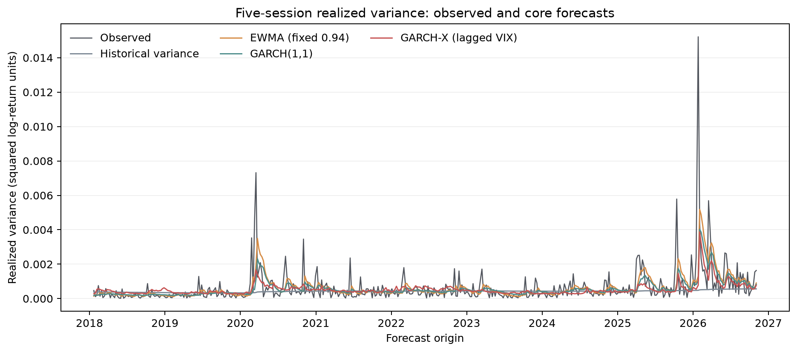

::: {.content-visible unless-format="beamer"}

# Executive summary

We forecast five-session realized variance for COMEX gold futures. To keep the
comparison focused, this report shows seven basic return-only benchmarks and
one extension: GARCH-X with lagged VIX. The user-selected working model is
GARCH-X; it has the lowest MSE among the tested models, including the full
25-model search. This ranking is not statistically decisive: the
Holm-adjusted Diebold-Mariano test does not show GARCH-X beating expanding
historical variance.

# Question, target, and data

**Question:** Does adding lagged VIX to a gold-volatility model improve
five-session-ahead forecasts relative to simple models based on gold's own
return history?

For daily log return $r_t$ at forecast origin $t$, the target is

$$
RV_{t,5}=\sum_{j=1}^{5}r_{t+j}^{\,2}.
$$

This is forward realized variance, not a forecast of the gold-price level.
The evaluation uses Yahoo Finance `GC=F`, a continuous COMEX gold futures
series; it is not spot gold or a single fixed-expiry contract. The integrated
model evaluation uses the saved Yahoo/FRED panel. The separate Refinitiv/LSEG
screen and its additional predictors are exploratory and are preserved in the
[model-exploration archive](../archive/model_exploration_2026-11-15/README.md).
The input series are daily; forecasts are evaluated at weekly origins from
2018-01-05 to 2026-11-03.

## Predictors in the focused comparison

| Input | Definition | Used by |
|---|---|---|
| Gold returns | Daily close-to-close log returns; squared returns and past variance summarize recent volatility | All seven basic benchmarks and GARCH-X |
| Lagged VIX | `^VIX` daily close, lagged one observation and scaled by its mean through the forecast origin | GARCH-X only |

Other predictor screens (DXY, S&P 500 return, Treasury yield, breakeven inflation,
WTI, volume, and LSEG gold-option quotes) are outside this focused comparison;
their earlier analysis is archived rather than mixed into the GARCH-X test.

# Focused model set

All models produce a five-session variance forecast from information available
at the forecast origin.

| Model | Role | Forecast input |
|---|---|---|
| Expanding historical variance | Simple benchmark | All past squared gold returns |
| Rolling variance | Recent-history benchmark | Recent squared gold returns |
| EWMA, fixed $\lambda=0.94$ | Recency-weighted benchmark | Past squared gold returns |
| AR(1), squared returns | Linear dependence benchmark | Lagged squared gold return |
| MA(1), squared returns | Short-memory benchmark | Squared-return innovations |
| ARCH(1) | Conditional-variance benchmark | Lagged squared return |
| GARCH(1,1) | Persistent conditional-variance benchmark | Lagged squared return and variance |
| **GARCH-X with lagged VIX** | **Selected working model** | **Lagged squared return, variance, and normalized lagged VIX** |

The full comparison also examined other model families. They are intentionally
excluded from the main narrative to keep this report about the selected model
and understandable benchmarks. Their earlier report and outputs are in the
[archive](../archive/model_exploration_2026-11-15/README.md).

# GARCH-X specification

GARCH-X is a conditional-variance model rather than an ordinary
$Y_t=\beta_0+\beta_1X_t+\cdots$ regression. Let $r_t$ be the daily gold log
return, $h_t$ its conditional variance, and $z_t$ a standard normal innovation:

$$
\begin{aligned}
r_t &= \sqrt{h_t}\,z_t,\qquad z_t\sim N(0,1),\\
h_t &= \omega+\alpha r_{t-1}^{\,2}+\beta h_{t-1}+\delta x_t,\\
x_t &= \frac{\mathrm{VIX}_{t-1}}
            {\overline{\mathrm{VIX}}_{\leq o}}.
\end{aligned}
$$

At forecast origin $o$, the model is fitted using data available through $o$.
The constraints are $\omega>0$, $\alpha,\beta,\delta\geq0$, and
$\alpha+\beta\leq0.999$. Future VIX is unknown, so it is held at its last
observed value for all five forecast steps. The forecast is

$$
\widehat{RV}_{o,5}
=\sum_{j=1}^{5}
  \mathbb{E}\!\left[r_{o+j}^{\,2}\mid\mathcal{F}_o\right]
=\sum_{j=1}^{5}\widehat h_{o+j|o},
$$

where $\mathcal{F}_o$ is the information available at origin $o$.

# Evaluation and results

The models are compared on the same 443 successful weekly origins, from 445
requested origins. The two omitted origins are where quantile GARCH failed in
the broader model run; all models below have forecasts on the retained dates.
The statistics come from the integrated evaluation, so the multiple-testing
adjustment still reflects the broader 25-model search.

Lower loss is better. MSE and RMSE penalize squared errors, MAE uses absolute
errors, and QLIKE scores variance forecasts with a loss based on
$\log(\widehat{RV})+RV/\widehat{RV}$.

| Model | MSE ($\times 10^{-6}$) | RMSE | MAE | QLIKE |
|---|---:|---:|---:|---:|
| Expanding historical variance | 1.132 | 0.001064 | 0.000445 | 0.6364 |
| Rolling variance | 1.077 | 0.001038 | 0.000478 | 0.4942 |
| EWMA (fixed 0.94) | 0.991 | 0.000996 | 0.000454 | 0.4569 |
| AR(1), squared returns | 1.121 | 0.001059 | 0.000442 | 0.6135 |
| MA(1), squared returns | 1.124 | 0.001060 | 0.000443 | 0.6209 |
| ARCH(1) | 1.126 | 0.001061 | 0.000441 | 0.6227 |
| GARCH(1,1) | 0.974 | 0.000987 | 0.000423 | 0.4554 |
| **GARCH-X with lagged VIX** | **0.949** | **0.000974** | **0.000420** | **0.4552** |

{#fig-core-forecasts width=95% fig-align="center"}

GARCH-X has the lowest MSE and RMSE in this shortlist: its MSE is 16.1% below
expanding historical variance and 2.5% below GARCH(1,1). Its Holm-adjusted
Diebold-Mariano p-value against historical variance is 0.905; the
GARCH-X/GARCH(1,1) unadjusted pairwise MSE p-value is 0.487. These tests do
not establish a reliable improvement. QLIKE also shows little difference
between GARCH-X and GARCH(1,1), while the expanding benchmark has substantially
higher QLIKE.

# Conclusion and limitations

**Working choice:** GARCH-X with lagged VIX, as directed by the user and
prioritized on MSE. Keep expanding historical variance and GARCH(1,1) as
primary reference models; the other basic forecasts provide context.

This is a working specification, not proof that VIX adds statistically
significant predictive value. The comparison uses overlapping five-session
targets, a Yahoo/FRED panel rather than a historical real-time data vintage,
and an assumption that future VIX stays at its last observed value. Test that
assumption and the selected model on a later holdout before treating it as a
confirmed team-wide conclusion.

# AI use and contributions

AI tools helped organize the report and summarize existing project artifacts.
An important limitation was that older project notes described GARCH-X as
skipped, while the later integrated evaluation included it. The equation and
metrics here were checked against the current implementation and saved
evaluation output; AI-generated summaries should not replace that verification.
The team remains responsible for checking the source data and interpretation.

Role descriptions below follow the project README and should be confirmed by
all members for the required agreed contribution statement:

- **Luo Pui Ki Enoch (1155212655):** model development and identifying relevant variables.
- **Li Hung Kui (1155212707):** infrastructure, data acquisition, repository management, and presentation materials.
- **Siriasavakul Hok Sum (1155179729):** model analysis, model comparison, limitations, and next-step recommendations.

:::

::: {.content-visible when-format="beamer"}

## Research question and data

- **Question:** Does lagged VIX improve forecasts beyond gold-return history?
- **Target:** $RV_{t,5}=\sum_{j=1}^{5}r_{t+j}^{2}$
- **Instrument:** Yahoo Finance `GC=F`, continuous COMEX gold futures
- **Integrated evaluation:** Yahoo/FRED panel; separate LSEG screen is exploratory
- Futures are not spot; future target values are never predictors at the origin

## Focused model set

- Expanding historical variance and rolling variance
- Fixed-decay EWMA ($\lambda=0.94$)
- AR(1) and MA(1) models for squared returns
- ARCH(1) and GARCH(1,1)
- **Selected working model: GARCH-X with lagged VIX**

## GARCH-X equation

$$
\begin{aligned}
r_t &= \sqrt{h_t}\,z_t,\qquad z_t\sim N(0,1),\\
h_t &= \omega+\alpha r_{t-1}^{2}+\beta h_{t-1}+\delta x_t,\\
x_t &= \frac{\mathrm{VIX}_{t-1}}{\overline{\mathrm{VIX}}_{\leq o}},\\
\widehat{RV}_{o,5} &= \sum_{j=1}^{5}\widehat h_{o+j|o}.
\end{aligned}
$$

Future VIX is held at its last observed value during the forecast horizon.

## Common-origin results

| Model | MSE ($\times 10^{-6}$) | RMSE | MAE | QLIKE |
|---|---:|---:|---:|---:|
| Historical | 1.132 | 0.001064 | 0.000445 | 0.6364 |
| Rolling | 1.077 | 0.001038 | 0.000478 | 0.4942 |
| EWMA (0.94) | 0.991 | 0.000996 | 0.000454 | 0.4569 |
| AR(1) $r^2$ | 1.121 | 0.001059 | 0.000442 | 0.6135 |
| MA(1) $r^2$ | 1.124 | 0.001060 | 0.000443 | 0.6209 |
| ARCH(1) | 1.126 | 0.001061 | 0.000441 | 0.6227 |
| GARCH(1,1) | 0.974 | 0.000987 | 0.000423 | 0.4554 |
| **GARCH-X + VIX** | **0.949** | **0.000974** | **0.000420** | **0.4552** |

443 common origins from 445 requested dates.

## Forecasts across time

{width=95%}

## Conclusion

- GARCH-X has the lowest MSE in the focused comparison
- MSE is 16.1% below expanding historical variance
- It does **not** significantly beat that benchmark after Holm correction ($p=0.905$)
- The future-VIX assumption and later-holdout performance still need review

**Takeaway:** Use GARCH-X as the working model, while retaining historical
variance and GARCH(1,1) as transparent benchmarks.

:::
