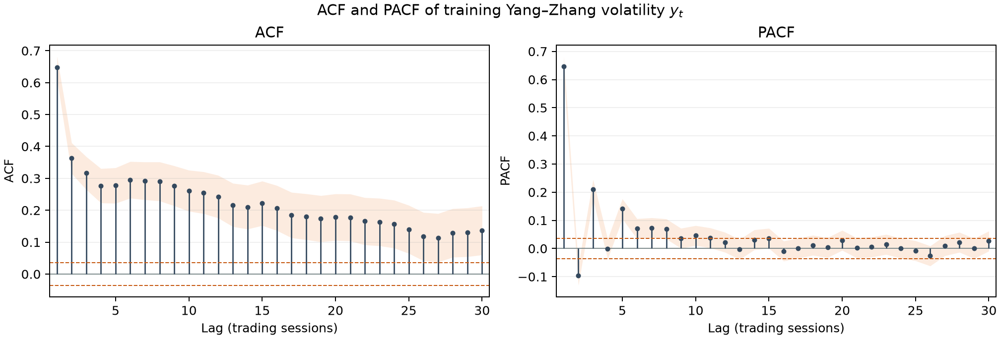
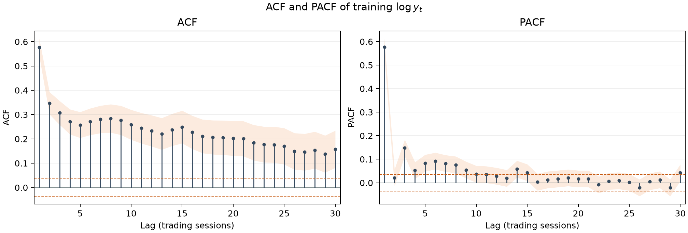
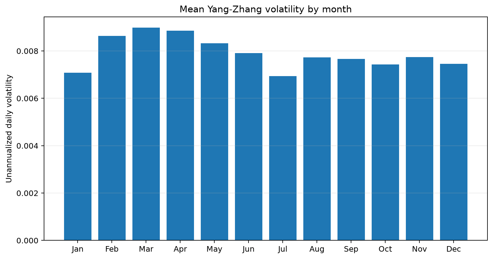
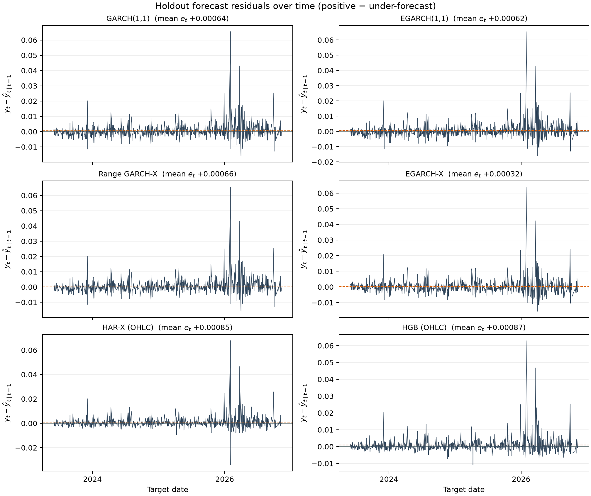
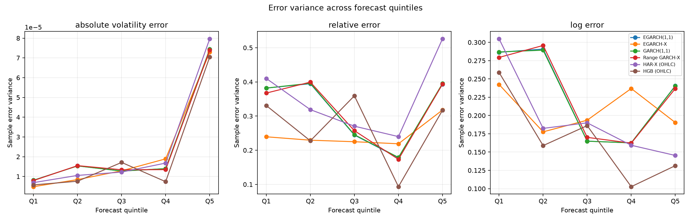
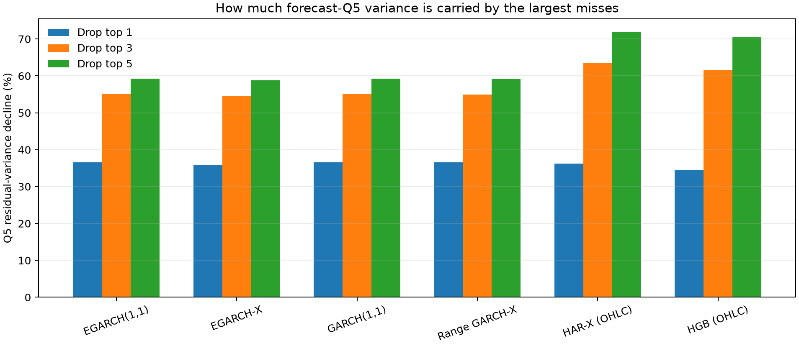

```{=latex}
\setstretch{1.5}
```

# Executive summary

We forecast the next trading session's unannualised Yang–Zhang volatility of continuous COMEX gold futures (`GCc1`). The object is not the gold price and not spot gold.

Six models are shortlisted from a course ladder that runs from AR/MA/ARIMA through ARCH/GARCH/EGARCH and exogenous (-X) extensions to HAR-X and histogram gradient boosting (HGB). On 761 sequential one-step holdout dates (2023-06-02 to 2026-11-10), HGB has the lowest mean absolute error (MAE 0.002418). That ranking is descriptive: adjacent two-observation targets overlap, and the leader was chosen on this holdout.

The shared finding is residual, not a winner. Forecast-error variance rises when the predicted value sits in that model's top 20% (Q5). Raw Q5/Q1 variance ratios are about 9 to 15. All six models miss the 2026-02-02 spike (actual $\approx 0.0775$; forecasts $\approx 0.01$–$0.015$). That single date accounts for about one third of Q5 residual variance; the top five misses account for about $59$–$72\%$. After those dates, Q5/Q1 is still about $3$–$6$. Three implemented patches fail to remove the Q5 problem: segmented high-vol parameters raise MAE; a log-target reverse with $\exp(\hat\mu+\hat\sigma^{2}/2)$ reduces average under-forecasting without shrinking Q5; a standardised Student-$t$ likelihood improves density scores with $df\approx 4$ and leaves Q5/Q1 near 9–16. HGB remains first on a 2025–26 slice of the same holdout.

# Why this forecast object

## The file we have

The gold series is LSEG Workspace (Refinitiv) `data/refinitiv/GCc1.csv`, exported by `scripts/download_lseg_data.py` for 2010-01-01 through 2026-11-10. `GCc1` is the generic first COMEX gold futures continuation. It is not a single expiry and not a stitched spot series.

| Column | LSEG field | Role |
|---|---|---|
| `Date` | history index | Trading-session date of the daily interday bar |
| `TRDPRC_1` | LAST | Close proxy used as $C_t$ (not settlement) |
| `OPEN_PRC` | Open | Session open $O_t$ |
| `HIGH_1`, `LOW_1` | High, low | Daily range $H_t$, $L_t$ |
| `OPINT_1` | Open interest | Downloaded; unused in Yang–Zhang |

Volume `ACVOL_1` was requested and not returned. The manifest records 4,241 dated rows and 4,064 complete OHLC bars. Incomplete bars are dropped; prices are never filled. `TRDPRC_1` is a last-trade close, not a settlement series.

@fig-price plots that last-trade continuation price. It is the gold futures price whose volatility we forecast: a generic front-contract series, not an OTC forward curve and not a single expiry. From 2010 through 2019 the contract mostly traded between about 1,050 and 1,900 USD/oz. The 2020–22 period is higher. The holdout (June 2023–November 2026) is a different price regime: the continuation last trade rises from about 2,000 USD/oz to a peak above 5,000 USD/oz in 2026. Models trained on 2010–mid-2023 therefore face a later sample in which the *level* of gold futures has moved far outside the training range. That does not by itself imply that *volatility* is non-stationary, but it is a reason to treat holdout spikes as a genuine stress test rather than as a replay of the training period.

{#fig-price width=92% fig-align="center"}

## Why futures, not spot

Availability comes first. The same LSEG run requested spot and fixing gold. `XAUFIX=` returned a permission error (`User does not have permission for this universe`). `XAU=` does not support `TRDPRC_1`. A long continuous spot OHLC series was not available from this Workspace account. `GCc1` was: daily open, high, low, last, and open interest from 2010.

Even if spot had downloaded, spot gold and COMEX futures are different instruments. Spot quotes are OTC and locational and can include premia. COMEX GC is the exchange-traded benchmark; `GCc1` is a continuous generic contract, so expiries are not stitched by hand. Futures prices embed carry (rates, storage, convenience yield). The volatility of that price is the object faced by futures traders, hedgers, and options on futures. We forecast futures volatility. We never mix spot and futures in one series.

## Why Yang–Zhang

The object of interest is **daily realised volatility** of the futures price: how much the contract moved over a trading session.

The ideal estimator uses high-frequency intraday log returns $r_{t,i}$ on day $t$:

$$
RV_t=\sum_{i=1}^{M} r_{t,i}^{2},\qquad
\sigma^{\mathrm{HF}}_t=\sqrt{RV_t}.
$$

That uses the whole path. This project has no tick or five-minute bars from LSEG. The source is one OHLC bar per `Date`. High-frequency realised variance is not feasible.

With only closes, the naive alternative is close-to-close,

$$
r^{cc}_t=\log(C_t/C_{t-1}),\qquad
\hat\sigma^{cc,2}_t=\bigl(r^{cc}_t\bigr)^{2}.
$$

This uses two points and ignores the high–low range and the open.

Two sessions can share the same close-to-close return and have very different volatility. In path A the price walks almost straight from open to close, so the high and low sit near the open and close. In path B the price swings; the high–low gap is large; the close equals yesterday's close, so $r^{cc}_t=0$. Close-to-close treats the two days as identical, including a zero-vol day in path B. Any range estimator records path B as much more volatile. Gold futures also gap overnight, so the open can differ from the previous close; close-to-close misses that jump as well.

```{=latex}
\begin{center}
\begin{tikzpicture}[x=0.72cm, y=0.55cm, font=\small]
  \draw[->] (0,0) -- (6.2,0) node[right] {$t$};
  \draw[->] (0,0) -- (0,3.4) node[above] {price};
  \draw[thick, blue!70!black] (0.4,1.6) -- (1.2,1.7) -- (2.4,1.85) -- (3.6,2.0) -- (5.2,2.15);
  \fill (0.4,1.6) circle (1.6pt) node[below] {\scriptsize $C_{t-1}$};
  \fill (1.2,1.7) circle (1.6pt) node[below] {\scriptsize $O_t$};
  \fill (5.2,2.15) circle (1.6pt) node[below] {\scriptsize $C_t$};
  \node[font=\bfseries] at (3.1,3.15) {Path A: quiet range};
  \begin{scope}[shift={(8.2,0)}]
    \draw[->] (0,0) -- (6.2,0) node[right] {$t$};
    \draw[->] (0,0) -- (0,3.4) node[above] {price};
    \draw[thick, red!70!black] (0.4,1.7) -- (1.2,1.85) -- (2.2,3.15) -- (3.4,0.35) -- (5.2,1.7);
    \fill (0.4,1.7) circle (1.6pt) node[below] {\scriptsize $C_{t-1}$};
    \fill (1.2,1.85) circle (1.6pt) node[below] {\scriptsize $O_t$};
    \fill (5.2,1.7) circle (1.6pt) node[below] {\scriptsize $C_t=C_{t-1}$};
    \node[font=\bfseries] at (3.1,3.15) {Path B: $r^{cc}_t=0$};
  \end{scope}
\end{tikzpicture}
\end{center}
```

**Figure.** Same close-to-close return, different paths. Path B has $C_t=C_{t-1}$ and a wide high–low range.

AI suggested a daily OHLC estimator; the team used Yang and Zhang (2000). That estimator is drift-independent, accounts for opening jumps, and is more efficient than close-to-close. It combines overnight variance with the Rogers–Satchell (1991) open-to-close range term. Implementation matches `src/gold_vol_pipeline/yang_zhang.py` with window $n=2$. Let $O_t,H_t,L_t,C_t$ be open, high, low, and last. Overnight and open-to-close log returns and the Rogers–Satchell range term are

$$
r_{o,t}=\log(O_t/C_{t-1}),\qquad
r_{c,t}=\log(C_t/O_t),
$$

$$
RS_t=
\log(H_t/O_t)\log(H_t/C_t)
+\log(L_t/O_t)\log(L_t/C_t).
$$

Over a trailing window of $n=2$ complete bars,

$$
s^{2}_{o,t}=\frac{1}{n-1}\sum_{j=t-n+1}^{t}(r_{o,j}-\bar r_{o,t})^{2},\qquad
s^{2}_{c,t}=\frac{1}{n-1}\sum_{j=t-n+1}^{t}(r_{c,j}-\bar r_{c,t})^{2},
$$

$$
\overline{RS}_t=\frac{1}{n}\sum_{j=t-n+1}^{t}RS_j,\qquad
k=\frac{0.34}{1.34+(n+1)/(n-1)}=\frac{0.34}{4.34}\approx 0.078341.
$$

Yang–Zhang **variance** and the **unannualised daily volatility** we forecast are

$$
\hat\sigma^{2}_{\mathrm{YZ},t}
=s^{2}_{o,t}+k\,s^{2}_{c,t}+(1-k)\overline{RS}_t,\qquad
y_t=\sqrt{\max(0,\hat\sigma^{2}_{\mathrm{YZ},t})}.
$$

Overnight variance uses the previous observed close. Incomplete OHLC windows have no target. Adjacent $n=2$ windows overlap, so adjacent $y_t$ and forecast losses are dependent. $y_t$ is a proxy for latent daily volatility, not high-frequency realised variance. We do not claim $n=2$ is optimal; the window-length check below recomputes $y_t$ at $n=5$ and $n=10$.

## Horizon: one trading day

LSEG stores this series as interday daily summaries. The `Date` column is the exchange trading session of that bar, not a filled calendar. In `GCc1.csv`, 2010-01-08 is followed by 2010-01-11; holidays are skipped the same way. Incomplete OHLC rows have no Yang–Zhang target, so the next valid target can skip an extra session.

The forecast origin $t$ produces $\hat y_{t+1\mid t}$: the next valid session's unannualised daily volatility. It is not a five-session sum and it is not annualised.

## Pre-model diagnostics and the split

There are 3,801 valid targets. The chronological 80/20 split is 3,040 training and 761 test (2023-06-02 to 2026-11-10). Forecasts are sequential one-step refits. The future target is never a predictor at the origin.

@fig-yz shows $y_t$ against date. Volatility clusters: quiet stretches sit near 0.003–0.01, and isolated spikes reach 0.04–0.06 in training (including 2020) and 0.0775 on 2026-02-02 in the holdout. The holdout is not a calmer copy of the training sample. The same 2026 cluster that later dominates residual Q5 is already visible here as a level shift in the *price* series (@fig-price) accompanied by a volatility spike, not as a slow trend in $y_t$.

{#fig-yz width=92% fig-align="center"}

### Stationarity: Dickey–Fuller with the stationary alternative

We apply the augmented Dickey–Fuller test of Dickey and Fuller (1979) as implemented by `statsmodels.tsa.stattools.adfuller`. The null is a unit root. The alternative is stationarity. Lag length is the statsmodels default, AIC (`autolag='AIC'`), with a constant (`regression='c'`). We do not override the lag. Because adjacent $n=2$ Yang–Zhang windows overlap, the $p$-values are exploratory.

| Series | Sample | ADF lag | ADF statistic | $p$-value | 5% critical | Reject unit root at 5% |
|---|---|---:|---:|---:|---:|:--|
| $y_t$ (Yang–Zhang vol) | Train | 14 | $-7.95$ | $3.2\times10^{-12}$ | $-2.86$ | Yes |
| $\log y_t$ | Train | 14 | $-7.43$ | $6.5\times10^{-11}$ | $-2.86$ | Yes |
| GCc1 last price | Train | 0 | $-1.37$ | $0.594$ | $-2.86$ | No |
| First difference of last price | Train | 0 | $-55.47$ | $<10^{-16}$ | $-2.86$ | Yes |
| $y_t$ | Full | 18 | $-8.00$ | $2.3\times10^{-12}$ | $-2.86$ | Yes |
| $\log y_t$ | Full | 18 | $-7.46$ | $5.4\times10^{-11}$ | $-2.86$ | Yes |
| GCc1 last price | Full | 30 | $0.24$ | $0.975$ | $-2.86$ | No |
| First difference of last price | Full | 29 | $-9.81$ | $5.8\times10^{-17}$ | $-2.86$ | Yes |

: Augmented Dickey–Fuller tests. Null: unit root. Alternative: stationary. Lag chosen by AIC. {#tbl-adf}

**Interpretation.** The gold *price* behaves as a unit-root series; its first difference does not. That is why we do not forecast the futures price with the same models we use for volatility. Yang–Zhang volatility and its log both reject a unit root on the training sample and on the full sample. $y_t$ is persistent, but the ADF evidence is against a random walk in volatility. That supports modelling $y_t$ (or $\log y_t$) as a mean-reverting clustered series — GARCH, HAR, or a short-memory ARMA — rather than as an integrated price.

The Hyndman–Khandakar ARIMA selector, however, chooses $d$ with KPSS (Kwiatkowski, Phillips, Schmidt, and Shin 1992), whose null is stationarity. On training $\log y_t$, KPSS rejects stationarity at the 5% floor ($p\le 0.01$) and does not reject after one difference ($p=0.10$). The selector therefore locks $d=1$ and picks ARIMA(1,1,3). ADF and KPSS disagree, which is common for a highly persistent but still mean-reverting series. We keep the saved HK order for the ARIMA step on the ladder; we do not treat $d=1$ as evidence that volatility itself has a unit root.

### ACF and PACF of Yang–Zhang volatility

@fig-acf and @fig-acf-log are computed on the *training* sample only (3,040 observations), so specification plots do not use holdout outcomes. Lags are in trading sessions. Dashed lines are the conventional $\pm 1.96/\sqrt{T}$ bands; the shaded band is the Bartlett interval returned by `statsmodels`.

Training $y_t$ has ACF 0.647 at lag 1, 0.363 at lag 2, and is still about 0.14 at lag 30. The PACF is 0.647 at lag 1, $-0.096$ at lag 2, and 0.210 at lag 3, then small. $\log y_t$ is similar (ACF 0.577 at lag 1; still about 0.16 at lag 30). Two mechanical facts produce that pattern. Adjacent $n=2$ windows share one OHLC bar, so lag-1 correlation is inflated by construction. Volatility clustering then keeps the ACF positive at longer lags. A plain AR(1) on $\log y_t$ is too short-memory; that is the motive for GARCH and for Corsi's 1/5/22 HAR averages.

{#fig-acf width=95% fig-align="center"}

{#fig-acf-log width=95% fig-align="center"}

On the 3,801 targets, calendar-month means are highest in March (0.00899) and lowest in July (0.00694); February and April are also high. Weekday means run only from 0.00766 (Wednesday) to 0.00819 (Monday). HAC joint tests do not reject weekday effects. A month-only Wald test rejects at 5 lags ($p=0.012$) and weakens at 10 and 20 lags ($p=0.068$, $0.122$). Kruskal–Wallis flags months and ignores overlap.

::: {layout-ncol=2}
{#fig-month width=100%}

{#fig-weekday width=100%}
:::

There is a descriptive February–April elevation. Overlapping $n=2$ windows make calendar tests lag-sensitive. A HAR-X robustness check below adds next-session month dummies to that descriptive pattern.

# From linear time series to a shortlist

Each step is motivated by a limit of the previous one. Then we compare holdout metrics and keep several candidates.

## Linear mean: AR, MA, ARIMA

On the log target $z_t=\log y_t$, the course linear models are AR(1), MA(1), ARMA(1,1), and a Hyndman–Khandakar (2008) order selected on the training sample (saved run, and re-confirmed by the diagnostic pipeline: ARIMA(1,1,3); coefficients refit each origin):

$$
\phi(B)(1-B)^d z_t = c + \theta(B)\varepsilon_t.
$$

The point forecast is exponentiated back to the volatility scale. These models a conditional mean of $z_t$ with roughly constant innovation variance. Gold-futures volatility clusters. Linear ARIMA has no changing conditional variance, so it is a weak description of $y_t$ even if it can produce a point forecast. Holdout MAE for this family is about 0.0030–0.0033, against persistence 0.003190.

## Conditional variance: ARCH, GARCH, EGARCH

ARCH (Engle 1982), GARCH (Bollerslev 1986), and EGARCH (Nelson 1991) model the innovation variance. Gold returns are a standard application: Tully and Lucey (2007) prefer an asymmetric power GARCH on gold cash and futures; Baur (2012) documents an *inverted* asymmetry (positive shocks raise gold volatility by more than negative shocks). Long memory in gold variance is often modelled with FIGARCH (Baillie, Bollerslev, and Mikkelsen 1996): Bentes (2015) finds FIGARCH(1,$d$,1) preferred to GARCH and IGARCH for gold-return volatility, and Chkili, Hammoudeh, and Nguyen (2014) report that FIAPARCH, which combines fractional integration with asymmetry, forecasts gold (and other commodity) volatility and VaR better than short-memory GARCH. We stay with the course EGARCH specification rather than estimating FIGARCH.

The implemented GARCH-family fits use an AR(1) mean on a scaled target $x_t=100y_t$, $\epsilon_t=\sigma_t u_t$, and

$$
\sigma_t^2=\omega+\alpha_1\epsilon_{t-1}^2+\beta_1\sigma_{t-1}^2
$$

for GARCH(1,1). EGARCH models $\log\sigma_t^2$ and allows signed shocks to enter asymmetrically, keeping variance positive without inequality constraints. The one-step point forecast is the fitted conditional mean, scaled back to $y$ units.

A Student-$t$ GARCH on this same ladder (standardised $t$ innovations, same GARCH(1,1) variance) has holdout MAE 0.002921, against Gaussian GARCH 0.002912. That is an overall-MAE comparison, not the later Q5 experiment.

**Limit.** These models still use only the gold-volatility series and its own shocks. We do not estimate FIGARCH or FIAPARCH here.

## Exogenous -X models

A training-only screen starts with 11 LSEG predictors plus a current-volatility control. Gold IV 6M, 3M, and 2M are dropped by VIF (VIF at removal 311, 166, 72). On the eight retained predictors, HAC(4) $t$-tests with Holm correction keep gold IV 1M (Holm $p=3.94\times10^{-15}$), gold IV 1Y ($p=0.00138$), and DXY ($p=0.023$). VIX is not retained (Holm $p=0.587$). This is a training association after data-dependent selection, not a causal claim and not proof of out-of-sample value.

Range GARCH-X puts the OHLC log-range and those three predictors into the variance recursion, with an AR(1) mean on $y_t$. EGARCH-X puts the same three predictors in an ARX mean and uses EGARCH(1,1) innovations. The three variables enter jointly.

## Multi-horizon HAR and HGB

HAR (Corsi 2009) uses daily, weekly ($\approx 5$), and monthly ($\approx 22$) averages of $z_t$ as a simple approximation to long memory. On COMEX gold futures, Todorova (2017) estimates HAR models of realized volatility with positive and negative semivariance and finds that gold's asymmetry is horizon-dependent. Our HAR-X is Corsi-style on Yang–Zhang volatility rather than tick realized variance: it appends origin-known OHLC features (close-to-close, overnight, open-to-close, log range) and, in the selected-predictor run, DXY and the two gold IV tenors. Histogram gradient boosting uses the same HAR-X features, additive trees, squared error on log volatility, then exponentiates. Configured learning rate 0.05, at most 100 iterations, at most 15 leaves, seed 42. HGB has no likelihood, so AIC/BIC are undefined.

## Parameter selection: what is chosen, and by which criterion

Different families on the ladder use different rules. AIC, BIC, and Ljung–Box are **not** applied uniformly, and they are not interchangeable with holdout MAE.

**Linear ARIMA (training $\log y_t$ only).** Differencing $d$ is chosen by repeated KPSS tests (null: stationarity), not by ADF. Then a bounded Hyndman–Khandakar search minimises AICc over $p,q$ with $\max p=\max q=3$, $\max d=2$, $\max(p+q)=4$. The selected order is locked before the holdout; each origin only refits the coefficients of that order. The diagnostic re-run on the 3,040 training logs recovers ARIMA(1,1,3) with AICc 3352.52. Nearby orders are close: ARIMA(1,1,2) AICc 3353.54; ARIMA(3,1,1) 3354.00. AR(1), MA(1), and ARMA(1,1) are course defaults, not information-criterion winners.

**GARCH family.** ARCH(1), GARCH(1,1), and EGARCH(1,1) are course specifications. We do **not** grid-search $p,q$ by AIC. At the training origin, the `arch` likelihood gives AIC 1291.8 for GARCH(1,1) (5 parameters) and 1286.6 for EGARCH(1,1) (6 parameters). EGARCH is slightly better in sample; holdout MAE is the same to three digits (0.002912). That is why we keep both on the shortlist and do not declare an AIC winner. Range GARCH-X and EGARCH-X use the same $(1,1)$ variance orders. EGARCH-X training AIC is 992.1, but that likelihood includes the three selected predictors and is not comparable to univariate GARCH or to HGB.

**HAR and HGB.** HAR lags are Corsi's 1, 5, and 22 sessions, not AIC-chosen. HGB hyperparameters are configured (learning rate 0.05, at most 100 iterations, at most 15 leaves, seed 42). HGB has no likelihood, so AIC and BIC are undefined.

**External predictors.** Selection is a training-only screen: drop collinear gold-IV tenors by VIF, then keep variables whose HAC(4) $t$-tests survive Holm correction. Ljung–Box is not part of that screen.

**Ljung–Box as a *check*, not a selector.** After the sequential holdout, we test the six shortlisted forecast-error series $e_t=y_t-\hat y_{t\mid t-1}$ for serial correlation (Ljung and Box 1978), lags 5, 10, and 20. Overlapping $n=2$ targets make the null of white-noise errors implausible by construction.

| Model | MAE | Mean $e_t$ | LB $p$ (lag 5) | LB $p$ (lag 10) | LB $p$ of $e_t^2$ (lag 5) |
|---|---:|---:|---:|---:|---:|
| HGB (OHLC) | 0.002418 | $+0.00087$ | $9.7\times10^{-15}$ | $3.3\times10^{-13}$ | $2.5\times10^{-9}$ |
| HAR-X (OHLC) | 0.002711 | $+0.00085$ | $6.0\times10^{-4}$ | $7.8\times10^{-4}$ | $3.2\times10^{-8}$ |
| EGARCH-X | 0.002833 | $+0.00032$ | $2.5\times10^{-6}$ | $2.2\times10^{-7}$ | $0.092$ |
| GARCH(1,1) | 0.002912 | $+0.00064$ | $4.2\times10^{-8}$ | $2.2\times10^{-11}$ | $0.072$ |
| EGARCH(1,1) | 0.002912 | $+0.00062$ | $4.7\times10^{-8}$ | $2.7\times10^{-11}$ | $0.072$ |
| Range GARCH-X | 0.002914 | $+0.00066$ | $3.0\times10^{-8}$ | $1.4\times10^{-11}$ | $0.073$ |

: Holdout Ljung–Box checks on sequential forecast errors. Positive mean $e_t$ is average under-forecasting. {#tbl-lb}

Every candidate rejects white-noise *levels* of $e_t$. For the GARCH family, squared-error LB at lag 5 is about 0.07 and does not reject at 5%. HAR-X and HGB reject white-noise squared errors strongly: the trees and the linear HAR still leave clustered misses, especially around the 2026 spike. We do not re-specify $p,q$ from these $p$-values. Doing so would use the holdout as a second training sample.

## Holdout comparison and shortlist

Evaluation is sequential one-step on 761 common dates. MAE is the headline loss because the target is already in volatility units. RMSE is complementary and outlier-sensitive. AIC/BIC are used only inside a likelihood family on the training origin; they are not comparable across families or with HGB.

| Model | Role on the ladder | Holdout MAE | Holdout RMSE |
|---|---|---:|---:|
| HGB (OHLC) | Trees on HAR-X features | 0.002418 | 0.004767 |
| HAR-X (OHLC) | Multi-horizon log-vol | 0.002711 | 0.005091 |
| EGARCH-X | Selected predictors in the mean | 0.002833 | 0.004860 |
| GARCH(1,1) | Persistent variance | 0.002912 | 0.005025 |
| EGARCH(1,1) | Asymmetry | 0.002912 | 0.005022 |
| Range GARCH-X | Range and -X in variance | 0.002914 | 0.005029 |
| ARIMA family | Linear mean of $\log y_t$ | 0.0030–0.0033 | — |
| Persistence | $\hat y_{t+1\mid t}=y_t$ | 0.003190 | 0.005447 |

HGB, HAR-X, GARCH, EGARCH, and range GARCH-X in this table are the no-external-predictor Stage 2 run. EGARCH-X uses gold IV 1M, gold IV 1Y, and DXY in the ARX mean. Diebold–Mariano (1995) tests on absolute loss, with Newey–West (1987) bandwidth 1, the Harvey, Leybourne, and Newbold (1997) one-step correction, and Holm (1979) adjustment, give HGB versus persistence / HAR / GARCH $p$-values $7.95\times10^{-14}$, $1.15\times10^{-13}$, and $1.78\times10^{-9}$. Squared-error evidence is less uniform: HGB does not significantly beat GARCH(1,1) under squared loss. The ranking is descriptive. Overlapping targets induce dependent losses. The leader was chosen on this holdout. The MAE gap versus persistence is about $0.000772$ in unannualised daily volatility, or $24\%$ of the persistence MAE. Multiplied by $\sqrt{252}$, that is about $1.23$ annualised volatility points. At the holdout mean last-trade price of about $3{,}136$ USD/oz, a one-day $1.65\sigma$ scaling of the same gap is about $4$ USD/oz, or about $400$ USD on a $100$ oz COMEX contract; at the sample-end price of $4{,}032$ USD/oz the contract-scale figure is about $514$ USD. These are order-of-magnitude risk-management illustrations, not an option-pricing result and not a statement that HGB should be used for VaR.

**Shortlist for residual work:** GARCH, EGARCH, range GARCH-X, EGARCH-X, HAR-X, HGB. Linear AR/ARIMA, plain HAR, Ridge, and Lasso are steps on the ladder and are not retained.

@fig-seq plots the saved sequential one-step forecasts against the holdout actuals for each shortlisted model. These are expanding-origin refits: at date $t$ the model uses only information through the origin, then predicts the next valid $y_{t+1}$. No model is re-estimated here; the lines are the stored Stage 2 paths. All six track the quiet 2023–25 stretches. All six miss the scale of the 2026-02-02 spike (actual 0.0775; forecasts about 0.01–0.015). HAR-X produces a large orange spike of its own near that cluster and still does not match the peak. HGB is the tightest on typical days and still undershoots the extreme. The ranking by MAE is a statement about average absolute misses, not about spike capture.

{#fig-seq width=98% fig-align="center"}

{#fig-scatter width=88% fig-align="center"}

# Residuals, Q5, and three failed patches

## Diagnosis

The residual is the out-of-sample forecast error $e_t=y_t-\hat y_{t\mid t-1}$. Positive $e_t$ means under-forecasting. These are predictive errors, not GARCH standardised innovations.

Across the six candidates:

- Mean error is positive (under-forecast). Mean $e_t$ is about $0.00064$ for GARCH, $0.00062$ for EGARCH, $0.00032$ for EGARCH-X, and $0.00087$ for no-external HGB.
- Residual dispersion rises with $\hat y$ (fan shape; @fig-fan). Four-lag HAC regressions of squared errors on the forecast level have a positive slope for all six models.
- When $\hat y$ is in that model's **top 20% (Q5)**, raw residual variance is about 9 to 15 times Q1 (@tbl-q5, @fig-q5). Relative-error ratios are 0.96–1.33 and log-error ratios are 0.48–0.85, so much of the widening is scale. Q5 errors remain right-skewed (skewness 3.36–4.07) and heavy-tailed (excess kurtosis 22–25).
- A shared miss on **2026-02-02**: actual $y=0.07752$; forecasts 0.0097–0.0145; absolute errors 0.063–0.068.

Q5 is a *predicted*-volatility bin, known at the origin. Calm-period point forecasts are more trustworthy. High predicted volatility is where they fail.

@fig-resid-time plots the same $e_t$ against calendar time. The 2026 spike cluster is a handful of large *positive* residuals in every panel — under-forecasts concentrated in time, not a slow drift in the mean error. EGARCH-X has the smallest average bias ($+0.00032$). HGB has a slightly larger average bias ($+0.00087$) but a smaller MAE because typical-day misses are smaller. The dashed line is that model's mean $e_t$.

{#fig-resid-time width=98% fig-align="center"}

{#fig-fan width=90% fig-align="center"}

| Model | Raw Q5/Q1 | Relative Q5/Q1 | Log-error Q5/Q1 |
|---|---:|---:|---:|
| GARCH(1,1) | 9.19 | 1.04 | 0.84 |
| EGARCH(1,1) | 9.19 | 1.03 | 0.84 |
| Range GARCH-X | 9.33 | 1.07 | 0.85 |
| EGARCH-X | 15.05 | 1.33 | 0.79 |
| HAR-X (OHLC) | 11.55 | 1.28 | 0.48 |
| HGB (OHLC) | 12.28 | 0.96 | 0.51 |

: Forecast-Q5 versus Q1 residual-variance ratios on 761 common dates. Q5 is the top 20% of that model's $\hat y$. {#tbl-q5}

{#fig-q5 width=92% fig-align="center"}

In @tbl-q5 and @fig-q5, GARCH, EGARCH, HAR-X, and HGB are the no-external-predictor forecasts; range GARCH-X and EGARCH-X use the selected predictors as specified above.

## The 2026-02-02 cluster: a few events, then a remaining high-vol problem

Q5 has 152 dates per model. Dropping the largest absolute Q5 errors, *keeping the original forecast-Q5 set*, shows how much of the headline ratio is a handful of misses (@tbl-q5-drop, @fig-q5-drop).

| Model | Q5/Q1 | Drop 1 | Drop 3 | Drop 5 | Q5/Q1 after drop 5 |
|---|---:|---:|---:|---:|---:|
| GARCH(1,1) | 9.19 | 36.6% | 55.1% | 59.3% | 3.74 |
| EGARCH(1,1) | 9.19 | 36.6% | 55.1% | 59.3% | 3.74 |
| Range GARCH-X | 9.33 | 36.5% | 55.0% | 59.1% | 3.81 |
| EGARCH-X | 15.05 | 35.8% | 54.5% | 58.8% | 6.21 |
| HAR-X (OHLC) | 11.55 | 36.3% | 63.4% | 71.9% | 3.24 |
| HGB (OHLC) | 12.28 | 34.5% | 61.7% | 70.5% | 3.62 |

: Decline in forecast-Q5 residual variance after dropping the $k$ largest absolute Q5 errors. Q5 is still the original top fifth of that model's forecasts. {#tbl-q5-drop}

{#fig-q5-drop width=92% fig-align="center"}

The single date 2026-02-02 is the largest miss for every shortlisted model. It accounts for about $35$–$37\%$ of that model's Q5 sum of squared errors and cuts Q5 variance by about one third. The next two dates are 2026-03-23 for every model, then 2026-03-26 in the GARCH family, 2026-03-24 for EGARCH-X, and 2026-02-03 for HAR-X and HGB. After the top five misses, Q5/Q1 falls from $9$–$15$ to about $3.2$–$6.2$. The headline ratio is therefore *mostly a few crash dates*. A ratio near $3$–$6$ remains, so high predicted volatility is still noisier than Q1 after those dates are removed.

Those dates are a market event, with a data-construction delay on top. In `GCc1`, 27–28 January 2026 have missing OHLC (open interest $36$ and $11$). 29 January is complete: high $5{,}586.2$, low $5{,}097.5$, close $5{,}364.7$, and open interest jumps from $171$ on 26 January to $30{,}082$ (the generic continuation rolling onto the liquid contract). 30 January is the crash bar (high $5{,}440.5$, low $4{,}700.0$, close $4{,}879.6$), but $y_t$ is still missing because the $n=2$ window still includes a NaN overnight return from the incomplete bars. The first valid Yang–Zhang after the crash is 2026-02-02: $y=0.077521$, the sample maximum, using 30 January and 2 February (low exactly $4{,}400.0$). Reuters (2 February 2026) reports the same week as a record near $5{,}594.82$ on 29 January, the steepest daily gold drop since 1983 on 30 January after the nomination of Kevin Warsh as Federal Reserve chair, and a CME gold margin increase from $6\%$ to $8\%$ effective after the 2 February close. 23 March 2026 is the second-largest $y_t$ in the prepared sample ($0.061318$; low $4{,}100.8$), during the later drawdown. Round-number lows and the open-interest jump are continuation-series caveats; the crash itself is a real price move.

The 38-session window 30 January–31 March 2026 has MAE about $0.0082$–$0.0089$ against about $0.0019$–$0.0023$ on the 596 pre-spike holdout dates. Q5 inflation is therefore a crash-cluster problem first, and a milder systematic high-vol problem second.

## Remedy A: Student-$t$ MLE (ran; density better, Q5 not fixed)

A natural response to heavy Q5 tails is to replace Gaussian quasi-likelihood with a standardised Student-$t$ likelihood. We now have the six-model sequential holdout (`data/processed/stage2_yz_distributions/`; copied to `report_group2/diagnostics/`). All 761 origins × 6 models × 2 distributions converged. Student-$t$ innovations are standardised to unit variance with $df>2$. GARCH and EGARCH use `arch` with `dist='t'`. GARCH-X and EGARCH-X are the custom SLSQP likelihoods in `distribution_comparison.py`, not the shortlist `arch` EGARCH-X. HAR-X and HGB in this experiment include the selected DXY and gold IV predictors. HGB keeps one squared-error point forecast; Normal versus $t$ changes only a training-only residual density.

| Model | Normal MAE | $t$ MAE | Normal Q5/Q1 | $t$ Q5/Q1 | Median $df$ |
|---|---:|---:|---:|---:|---:|
| GARCH(1,1) | 0.002912 | 0.002921 | 9.19 | 9.49 | 4.14 |
| EGARCH(1,1) | 0.002912 | 0.002917 | 9.19 | 9.48 | 4.11 |
| Range GARCH-X | 0.002913 | 0.002925 | 9.21 | 9.49 | 4.36 |
| EGARCH-X | 0.002912 | 0.002916 | 9.48 | 9.47 | 4.41 |
| HAR-X | 0.002758 | 0.002726 | 18.55 | 15.76 | 4.38 |
| HGB | 0.002421 | 0.002421 | 13.39 | 13.39 | 3.51 |

: Normal versus standardised Student-$t$ on 761 common dates. Q5/Q1 is residual variance in the top versus bottom fifth of that model's point forecasts. HGB $df$ is a residual-density parameter only. {#tbl-studentt}

Estimated $df$ near 4 confirms fat tails. Mean negative log scores improve under $t$ for every model (HGB $-4.455$ versus $-4.378$). $90\%$ interval coverage is slightly lower under $t$ because the intervals are narrower. Point-forecast MAE is slightly *worse* for the GARCH family, slightly better for HAR-X ($0.002758$ to $0.002726$), and unchanged for HGB. Q5/Q1 does not fall to anything like 1: the GARCH-family ratios stay about $9.2$–$9.5$; HAR-X falls from $18.55$ to $15.76$ and remains large; HGB is unchanged at $13.39$. A heavier-tailed innovation is a better density. It is not a Q5 point-forecast fix. This matches the original 20-model ladder, where Student-$t$ GARCH MAE was $0.002921$ against Gaussian GARCH $0.002912$.

## Remedy B: segmented / Q5-regime parameters (ran; MAE worse)

Separate normal and extreme parameter sets are estimated for the six models. The threshold is the training-history 80th percentile of realised volatility. Two triggers select the set at each origin: a pilot full-history forecast (`forecast_trigger`), or the latest observed target (`lagged_target_trigger`). Each selected set is refit on prior observations whose *lagged* realised volatility is in that regime. All 12 combinations completed 761 dates with no fit failures (`data/processed/stage2_yz_segmented/`).

| Model | Unsegmented MAE | Forecast trigger | Lagged-target trigger |
|---|---:|---:|---:|
| HGB | 0.002418 | 0.002680 | 0.002760 |
| HAR-X | 0.002711 | 0.002883 | 0.002879 |
| GARCH(1,1) | 0.002912 | 0.003238 | 0.003249 |

Segmented MAE is worse than the unsegmented shortlist for these models (and for EGARCH, range GARCH-X, and EGARCH-X in the same run). This is a failed patch, not a new winner. The comparison reuses the examined holdout. Forecast-trigger regime choice uses a pilot forecast, while the estimation samples are defined by lagged observed volatility.

## Remedy C: log $Y$ plus $\exp(\hat\mu+\hat\sigma^{2}/2)$ (ran; bias down, Q5 not fixed)

Each of the six models is fit to $\log y_t$ and mapped back by $\exp(\hat\mu+\hat\sigma^{2}/2)$, the conditional-mean correction if log errors are normal (`outputs/samuel/stage3_q5/log_transform/`). All 761 dates succeeded.

Mean bias moved toward zero for all six. MAE and RMSE versus each model's saved baseline were **not** significant at 5% after Holm-adjusted Diebold–Mariano tests (Newey–West bandwidths 1 and 4). On the exact baseline-Q5 dates, residual variance **rose** for five models (HAR-X $+13\%$; EGARCH $+5.4\%$; EGARCH-X $+4.3\%$; GARCH $+1.5\%$; range GARCH-X $+1.4\%$) and fell 0.2% for HGB. This is a failed Q5 patch that did reduce average under-forecasting. In this run the HGB and HAR-X baselines are the joint-predictor saved forecasts (MAE 0.002423 and 0.002758).

## Confirmatory later-holdout split

The same 761-day holdout was used for model screening, residual diagnosis, and the two patches. We cannot treat a later slice as a pristine unused sample: 2026-02-02 was already inspected. What we *can* do is split the saved errors into a development window (2023-06-02 to 2024-12-31, $347$ dates) and a later confirmatory window (2025-01-01 to 2026-11-10, $414$ dates) and ask whether the MAE ranking and the Q5 ratio survive (@tbl-split, @fig-split). Quintiles are recomputed inside each window.

| Model | 2023–24 MAE | Rank | Q5/Q1 | 2025–26 MAE | Rank | Q5/Q1 |
|---|---:|---:|---:|---:|---:|---:|
| HGB (OHLC) | 0.001739 | 1 | 1.28 | 0.002987 | 1 | 9.29 |
| HAR-X (OHLC) | 0.002010 | 2 | 1.36 | 0.003299 | 2 | 5.54 |
| EGARCH-X | 0.002157 | 3 | 3.90 | 0.003400 | 3 | 23.34 |
| GARCH(1,1) | 0.002206 | 4 | 3.00 | 0.003503 | 6 | 6.43 |
| EGARCH(1,1) | 0.002211 | 5 | 3.00 | 0.003500 | 4 | 6.43 |
| Range GARCH-X | 0.002212 | 6 | 3.15 | 0.003502 | 5 | 6.43 |

: MAE ranks and forecast-Q5/Q1 variance ratios on the 2023–24 development slice versus the 2025–26 confirmatory slice of the same holdout. {#tbl-split}

{#fig-split width=92% fig-align="center"}

HGB remains first and HAR-X second in both slices. Absolute MAE is higher in 2025–26 for every model, as expected in a higher-price, higher-vol regime. The Q5 problem is much weaker in 2023–24 (ratios $1.28$–$3.90$) and reappears in 2025–26 ($5.54$–$23.34$), where EGARCH-X's ratio is driven by a very small Q1 variance. This is confirmatory evidence that the HGB MAE ranking is not an artefact of only the early holdout. It is **not** an untouched evaluation set.

## Window length $n=2,5,10$

Training ACF of $y_t$ *rises* with the Yang–Zhang window, because a longer trailing window shares more bars with its neighbour (@fig-window-acf). Lag-1 ACF is $0.647$ at $n=2$, $0.902$ at $n=5$, and $0.961$ at $n=10$. ADF with the stationary alternative and AIC lags still rejects a unit root in each training sample ($p=3.2\times10^{-12}$, $4.3\times10^{-13}$, $2.2\times10^{-8}$). The date-aligned split that keeps the last training date at 2023-06-01 yields $3{,}040/761$ targets at $n=2$, $2{,}816/677$ at $n=5$, and $2{,}508/558$ at $n=10$. Lengthening $n$ does not remove overlap; it makes the target smoother and more persistent.

{#fig-window-acf width=90% fig-align="center"}

Sequential one-step persistence, GARCH(1,1), and HAR-X on the same cutoff are in @tbl-window. At $n=5$ and $n=10$, last-value persistence has the lowest MAE. GARCH and HAR-X add nothing once the target is that persistent. Forecast-error lag-1 ACF stays small (about $-0.10$ to $0.06$). Q5/Q1 *rises* with $n$: about $9$–$12$ at $n=2$, $30$–$35$ at $n=5$, and $58$–$63$ at $n=10$, because Q1 variance collapses on the smoother series while the 2026 crash still sits in Q5. The $n=2$ overlap is therefore not the reason Q5 looks bad. A longer OHLC window makes the residual problem worse.

| $n$ | Model | Test $n$ | MAE | Q5/Q1 |
|---|---|---:|---:|---:|
| 2 | Persistence | 761 | 0.003190 | 10.34 |
| 2 | GARCH(1,1) | 761 | 0.002912 | 9.19 |
| 2 | HAR-X | 761 | 0.002711 | 11.55 |
| 5 | Persistence | 677 | 0.001224 | 35.38 |
| 5 | GARCH(1,1) | 677 | 0.001232 | 30.11 |
| 5 | HAR-X | 677 | 0.001242 | 31.61 |
| 10 | Persistence | 558 | 0.000716 | 63.05 |
| 10 | GARCH(1,1) | 558 | 0.000745 | 60.94 |
| 10 | HAR-X | 558 | 0.000740 | 57.89 |

: Date-aligned sequential forecasts by Yang–Zhang window. Persistence at $n=2$ is the original ladder score; the other rows are the robustness run. {#tbl-window}

## Seasonality robustness (HAR-X month dummies)

The descriptive February–April elevation is not a useful sequential predictor. Adding eleven next-session month dummies to HAR-X OLS, with January as the base month, completes all 761 holdout dates. MAE rises from $0.002711$ to $0.002739$; Q5/Q1 rises from $11.55$ to $11.92$. Calendar dummies known at the origin do not shrink the crash-cluster misses. The month pattern remains a descriptive fact, not a forecasting fix.

## Punchline

High predicted volatility is the unreliable region. Three implemented patches fail to remove Q5 variance inflation: segmented high-vol parameters raise MAE; the Jensen reverse reduces average under-forecasting without shrinking Q5; Student-$t$ improves density scores with $df\approx 4$ and leaves Q5/Q1 near 9–16. The 2026 crash cluster explains most of the headline Q5/Q1 ratio; a milder elevation remains after the largest misses are dropped. We do not say the problem is solved.

# Conclusion and limitations

The submitted analysis is next-session unannualised Yang–Zhang volatility of `GCc1`. Among six shortlisted models, HGB has the lowest holdout MAE; the result we emphasise is that forecast-error variance inflates in predicted Q5 for every candidate.

Limits we state:

1. Adjacent Yang–Zhang targets overlap. Lengthening the window to $n=5$ or $n=10$ raises lag-1 ACF rather than removing that dependence.
2. One chronological holdout was reused in development, residual work, and the three patches. The 2023–24 / 2025–26 split is confirmatory on already-seen errors, including the 2026-02-02 spike. Holm adjustment does not remove that selection.
3. Gold 1M implied volatility and next-session realised volatility are not maturity-matched.
4. External predictors use a next-weekday LSEG availability proxy, not verified publication timestamps.
5. `GCc1` is a generic continuous futures series, not spot and not a single expiry. `TRDPRC_1` is last trade, not settlement. Incomplete 27–28 January 2026 bars delay the first valid crash $y_t$ to 2 February.
6. $y_t$ is an OHLC proxy, not tick-based realised variance.
7. The MAE-to-VaR translation is an order-of-magnitude illustration at the holdout mean and terminal prices, not a pricing or regulatory capital calculation.

We do not claim that HGB is the data-generating process, that VIX or gold IV causes futures volatility, that Student-$t$, segmented parameters, or the Jensen reverse solved Q5, or that any Yahoo five-session GARCH-X ranking applies to this target.

**Suggested next steps**, in order of what the diagnostics actually support:

1. **Stop treating a heavier innovation as the Q5 fix.** Student-$t$ with $df\approx 4$ improves density scores and does not bring Q5/Q1 near 1. The crash dates, not extra GARCH lags, are the residual problem.
2. **Do not spend the next iteration on a larger GARCH $(p,q)$ grid or a longer Yang–Zhang window.** ADF already rejects a unit root in $y_t$; $n=5$ and $n=10$ make the target more persistent.
3. **If a later sample becomes available after 10 November 2026, keep it unused.** The 2025–26 slice used here already contains the inspected spike.
4. **If high-frequency bars become available, replace overlapping Yang–Zhang with realised variance.** A non-overlapping RV target would clean the residual checks.
5. **Model the 2026 cluster as an event.** A news dummy, a jump component, or a quantile/asymmetric loss aimed at Q5 is a better next specification than another linear ARIMA order or another overlapping OHLC window.

# Use of AI

GitHub Copilot and Grok were used to write and refactor pipeline code, run diagnostics, draft the report and slides, and turn reviewer comments into additional tables and figures. The team chose the LSEG `GCc1` Yang–Zhang target, the three-part story, the six-model shortlist, and which numbers to include. Quoted MAE, RMSE, Q5 ratios, ADF statistics, and robustness tables come from saved CSVs in `data/processed/` and `report_group2/diagnostics/`; generated prose was checked against those files. AI did not choose the instrument, did not invent holdout scores, and did not estimate FIGARCH.

# Contributions

Luo Pui Ki Enoch (1155212655) led model development: the course ladder, GARCH/EGARCH and HAR specifications, and the predictor screen. Li Hung Kui (1155212707) led infrastructure: the LSEG export and Yang–Zhang pipeline, sequential evaluation, repository workflow, and compilation of the report and slides. Siriasavakul Hok Sum (1155179729) led model analysis: the Q5 residual diagnosis, the log-target reverse, the segmented-regime experiment, and the interpretation of those failed patches. All three members discussed the residual-first headline and the limitations stated above. These are areas of focus rather than exclusive ownership.

# References

```{=latex}
{\setstretch{1.15}
\setlength{\parskip}{0.25em}
```

Baillie, R. T., Bollerslev, T., and Mikkelsen, H. O. (1996). Fractionally integrated generalized autoregressive conditional heteroskedasticity. *Journal of Econometrics*, 74(1), 3–30.

Baur, D. G. (2012). Asymmetric volatility in the gold market. *Journal of Alternative Investments*, 14(4), 26–38.

Bentes, S. R. (2015). Forecasting volatility in gold returns under the GARCH, IGARCH and FIGARCH frameworks: New evidence. *Physica A*, 438, 355–364.

Bollerslev, T. (1986). Generalized autoregressive conditional heteroskedasticity. *Journal of Econometrics*, 31(3), 307–327.

Chkili, W., Hammoudeh, S., and Nguyen, D. K. (2014). Volatility forecasting and risk management for commodity markets in the presence of asymmetry and long memory. *Energy Economics*, 41, 1–18.

Corsi, F. (2009). A simple approximate long-memory model of realized volatility. *Journal of Financial Econometrics*, 7(2), 174–196.

Dickey, D. A., and Fuller, W. A. (1979). Distribution of the estimators for autoregressive time series with a unit root. *Journal of the American Statistical Association*, 74(366), 427–431.

Diebold, F. X., and Mariano, R. S. (1995). Comparing predictive accuracy. *Journal of Business & Economic Statistics*, 13(3), 253–263.

Engle, R. F. (1982). Autoregressive conditional heteroscedasticity with estimates of the variance of United Kingdom inflation. *Econometrica*, 50(4), 987–1007.

Harvey, D., Leybourne, S., and Newbold, P. (1997). Testing the equality of prediction mean squared errors. *International Journal of Forecasting*, 13(2), 281–291.

Holm, S. (1979). A simple sequentially rejective multiple test procedure. *Scandinavian Journal of Statistics*, 6(2), 65–70.

Hyndman, R. J., and Khandakar, Y. (2008). Automatic time series forecasting: The forecast package for R. *Journal of Statistical Software*, 27(3), 1–22.

Kwiatkowski, D., Phillips, P. C. B., Schmidt, P., and Shin, Y. (1992). Testing the null hypothesis of stationarity against the alternative of a unit root. *Journal of Econometrics*, 54(1–3), 159–178.

Ljung, G. M., and Box, G. E. P. (1978). On a measure of lack of fit in time series models. *Biometrika*, 65(2), 297–303.

Nelson, D. B. (1991). Conditional heteroskedasticity in asset returns: A new approach. *Econometrica*, 59(2), 347–370.

Newey, W. K., and West, K. D. (1987). A simple, positive semi-definite, heteroskedasticity and autocorrelation consistent covariance matrix. *Econometrica*, 55(3), 703–708.

Rogers, L. C. G., and Satchell, S. E. (1991). Estimating variance from high, low and closing prices. *Annals of Applied Probability*, 1(4), 504–512.

Todorova, N. (2017). The asymmetric volatility in the gold market revisited. *Economics Letters*, 150, 138–141.

Tully, E., and Lucey, B. M. (2007). A power GARCH examination of the gold market. *Research in International Business and Finance*, 21(2), 316–325.

Yang, D., and Zhang, Q. (2000). Drift-independent volatility estimation based on high, low, open, and close prices. *Journal of Business*, 73(3), 477–492. https://doi.org/10.1086/209650

```{=latex}
}
```
