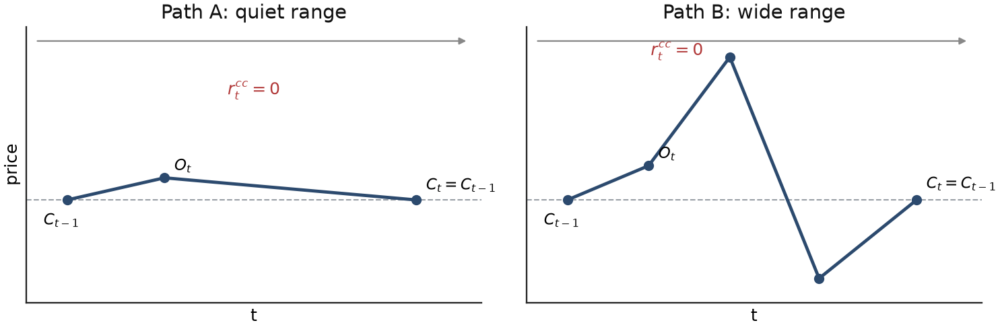
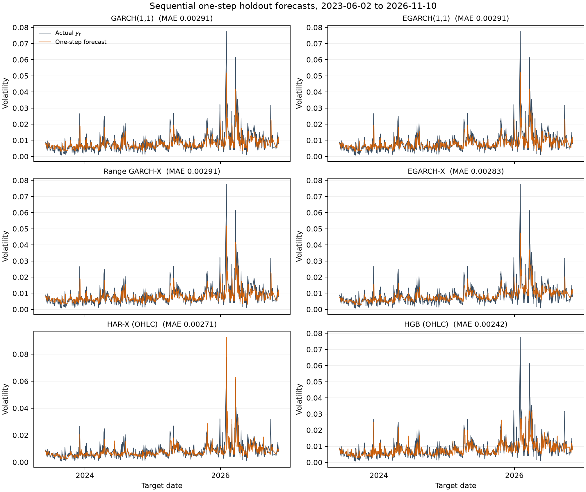

```{=latex}
\setstretch{1.5}
\sloppy
```

# Executive summary

We forecast the next trading day's unannualised Yang–Zhang volatility of continuous COMEX gold futures (`GCc1`).

Six models are shortlisted from a course ladder that runs from ARIMA through ARCH/GARCH/EGARCH and exogenous (-X) extensions to HAR-X and histogram gradient boosting (HGB). On 761 sequential one-step test dates (2023-06-02 to 2026-11-10), HGB has the lowest mean absolute error (MAE 0.002418). The MAE gap versus persistence is about 24% of the persistence MAE.

The main result is a residual pattern shared by all six models: when predicted volatility is extreme, forecast-error variance is high. All six miss the 2026-02-02 spike (actual $\approx 0.0775$; forecasts $\approx 0.01$–$0.015$).

# Data and forecast object

## Data source

The series is COMEX gold futures with daily OHLCV from LSEG Workspace (Refinitiv), ticker `GCc1`, exported for 2010-01-01 through 2026-11-10.

| Column | LSEG field | Role |
|---|---|---|
| `Date` | history index | Trading-session date of the daily bar |
| `TRDPRC_1` | LAST | Close proxy $C_t$ (last trade, not settlement) |
| `OPEN_PRC` | Open | Session open $O_t$ |
| `HIGH_1`, `LOW_1` | High, low | Daily range $H_t$, $L_t$ |

The dataset has 4,241 dated rows and 4,064 complete OHLC bars. Incomplete bars are dropped. The chronological 80/20 split is 3,040 train and 761 test dates (test: 2023-06-02 to 2026-11-10). Forecasts are sequential one-step refits. The future target is never a predictor at the origin. The origin $t$ produces $\hat y_{t+1\mid t}$: next-day unannualised Yang–Zhang volatility. Weekends and holidays are already skipped in original dataset.

@fig-price plots the last-trade continuation price. From 2010 through 2019 the contract mostly traded between about 1,050 and 1,900 USD/oz. The test period is a different price regime: the last trade rises from about 2,000 USD/oz to a peak above 5,000 USD/oz in 2026.

{#fig-price width=62% fig-align="center" fig-pos="H"}

## Why futures, not spot
- Spot gold and COMEX futures are different instruments. Spot is OTC; COMEX GC is the exchange-traded benchmark; futures prices embed carry.
- The object is the volatility of that futures price, the series faced by futures traders, hedgers, and options on futures. Spot and futures are never mixed.

## Why Yang–Zhang volatility

The object is daily realised volatility of the futures price. @tbl-vol-est compares the three natural estimators. Realised volatility from the full tick path is

$$
RV_t=\sum_{i=1}^{M_t} r_{t,i}^2,\qquad
\sigma_t^{\mathrm{HF}}=\sqrt{RV_t},
$$

where $r_{t,i}=\log P_{t,i}-\log P_{t,i-1}$ is the $i$-th tick log-return on day $t$, $P_{t,i}$ is the $i$-th transaction price, and $M_t$ is the number of ticks that day. This LSEG file has one OHLC bar per date, so $\sigma_t^{\mathrm{HF}}$ is not feasible.

| Estimator | Data required | What it uses | In this project |
|---|---|---|---|
| Intraday RV | High-frequency returns | Full session path | Not available in this LSEG file |
| Close-to-close | Two closes | Squared close-to-close return | Ignores range and open jump |
| Yang–Zhang | Daily OHLC | Overnight jump and high–low range | The $y_t$ we forecast |

: Daily volatility estimators compared. {#tbl-vol-est}

Two sessions can share the same close-to-close return and have very different volatility (@fig-two-path). Path A walks almost straight from open to close. Path B swings, but $C_t=C_{t-1}$ so $r^{cc}_t=0$. Close-to-close treats them as identical. Gold futures also gap overnight; close-to-close misses that jump.

{#fig-two-path width=60% fig-align="center" fig-pos="H"}

Yang and Zhang (2000) is drift-independent, accounts for opening jumps, and is more efficient than close-to-close. Let $O_t,H_t,L_t,C_t$ be open, high, low, and last. Overnight and open-to-close log returns and the Rogers–Satchell (RS) range term (Rogers & Satchell, 1991) are

$$
r_{o,t}=\log(O_t/C_{t-1}),\qquad
r_{c,t}=\log(C_t/O_t),
$$

$$
RS_t=
\log(H_t/O_t)\log(H_t/C_t)
+\log(L_t/O_t)\log(L_t/C_t).
$$

Rogers–Satchell (RS) is a drift-independent range estimator for the open-to-close session: high and low still count if the close is near the open. RS does not include the overnight jump $r_{o,t}$. The window $n$ is the number of complete OHLC bars used for the overnight and open-to-close sample variances and the RS average; those variances need $n\ge 2$, so we use $n=2$. The weight $k$ is the share of the open-to-close variance versus RS. Yang and Zhang (2000) set $k=0.34/(1.34+(n+1)/(n-1))$ so the estimator is independent of drift. At $n=2$, $k\approx 0.078341$, so most session weight $(1-k)$ sits on RS:

$$
\hat\sigma^{2}_{\mathrm{YZ},t}
=s^{2}_{o,t}+k\,s^{2}_{c,t}+(1-k)\overline{RS}_t,\qquad
y_t=\sqrt{\max(0,\hat\sigma^{2}_{\mathrm{YZ},t})}.
$$

$y_t$ is a proxy for latent daily volatility. Incomplete OHLC windows have no target.

{#fig-yz width=62% fig-align="center" fig-pos="H"}

# Model training

## Pre-model diagnostics

There are 3,801 valid targets. @fig-yz shows volatility clustering: quiet stretches near 0.003–0.01, training spikes of 0.04–0.06, and 0.0775 on 2026-02-02 in the test sample.

### Stationarity

Augmented Dickey–Fuller tests (Dickey & Fuller, 1979) use $H_0$: unit root versus $H_1$: stationarity. Lag length is chosen by AIC, with a constant.

| Series | ADF lag | ADF statistic | $p$-value | 5% critical | Reject $H_0$ at 5% |
|---|---:|---:|---:|---:|:--|
| YZ vol $y_t$ | 14 | $-7.95$ | $3.2\times10^{-12}$ | $-2.86$ | Yes |
| $\log y_t$ | 14 | $-7.43$ | $6.5\times10^{-11}$ | $-2.86$ | Yes |
| Last price | 0 | $-1.37$ | $0.594$ | $-2.86$ | No |
| $\Delta$ price | 0 | $-55.47$ | $<10^{-16}$ | $-2.86$ | Yes |

: Augmented Dickey–Fuller tests on the training sample. $H_0$: unit root; $H_1$: stationarity. Lag chosen by AIC. {#tbl-adf}

Yang–Zhang volatility and its log both reject a unit root. $y_t$ is persistent, but the ADF evidence is against a random walk in volatility.

### Persistence and seasonality

@fig-acf is computed on the 3,040 training observations. Training $y_t$ has ACF 0.647 at lag 1, 0.363 at lag 2, and about 0.14 at lag 30. The PACF is 0.647 at lag 1, then small after lag 3. That slow ACF decay is the clustering, or long-memory-like, pattern that motivates GARCH and HAR averages rather than a short AR(1).

{#fig-acf width=68% fig-align="center" fig-pos="H"}

Calendar-month means are highest in March (0.00899) and lowest in July (0.00694). Weekday means run only from 0.00766 (Wednesday) to 0.00819 (Monday). HAC joint tests do not reject a weekday effect ($p\approx 0.10$). A month-only Wald test is significant at 5 lags ($p=0.012$) and not at 10 or 20 lags ($p=0.068$, $0.122$). Month and weekday effects are therefore not treated as a robust forecasting feature. Adding eleven next-day month dummies to sequential HAR-X raises MAE from 0.002711 to 0.002739.

::: {layout-ncol=2}
{#fig-month width=100%}

{#fig-weekday width=100%}
:::

## Linear mean: ARIMA

On $z_t=\log y_t$, the Hyndman–Khandakar (2008) algorithm selects the training order: KPSS tests choose the differencing order $d$, then AICc selects $p$ and $q$ with $\max p=\max q=3$ and $\max d=2$. The saved order is ARIMA(1,1,3), locked before the test sample; each origin only refits the coefficients. Write the differenced series as $y_t^{(d)}=(1-B)^{d}z_t$:

$$
y_t^{(d)}=c+\epsilon_t+\sum_{i}\phi_i y_{t-i}^{(d)}+\sum_{j}\theta_j\epsilon_{t-j}.
$$

The point forecast is exponentiated back to the volatility scale. Linear ARIMA has no changing conditional variance, so it is a weak description of clustered gold-futures volatility. Test MAE for this family is about 0.0030–0.0033, against persistence 0.003190.

## Conditional variance: ARCH, GARCH, EGARCH

ARCH (Engle, 1982), GARCH (Bollerslev, 1986), and EGARCH (Nelson, 1991) model the innovation variance. The implemented fits use an AR(1) mean on a scaled target $x_t=100y_t$, $\epsilon_t=\sigma_t u_t$, and GARCH(1,1)

$$
\sigma_t^2=\omega+\alpha_1\epsilon_{t-1}^2+\beta_1\sigma_{t-1}^2.
$$

EGARCH models $\log\sigma_t^2$ and allows signed shocks to enter asymmetrically, keeping variance positive without inequality constraints. The one-step point forecast is the fitted conditional mean, scaled back to $y$ units. ARCH(1), GARCH(1,1), and EGARCH(1,1) are course specifications; $p$ and $q$ are not grid-searched.

## Exogenous predictors

A training-only screen starts with 11 LSEG predictors plus a current-volatility control. @tbl-pred reports the initial variance-inflation factor (VIF) and, after dropping collinear gold-IV tenors, the HAC(4) $t$-statistic (Newey & West, 1987). Gold IV 6M, 3M, and 2M are dropped by VIF. Holm (1979) adjustment on the remaining eight tests keeps gold IV 1M, gold IV 1Y, and the US Dollar Index (DXY).

| Predictor | VIF | HAC(4) $t$ |
|---|---:|---:|
| US Dollar Index (DXY) | 2.00 | $-2.89$ |
| S&P 500 log return | 1.08 | $-0.48$ |
| VIX | 2.43 | $1.09$ |
| 10-year Treasury yield | 1.16 | $1.32$ |
| Gold IV 1M | 51.59 | $8.16$ |
| Gold IV 2M | 135.74 | — |
| Gold IV 3M | 258.19 | — |
| Gold IV 6M | 310.57 | — |
| Gold IV 1Y | 103.36 | $-3.73$ |
| Gold 1M risk reversal | 1.35 | $1.45$ |
| Gold 1M butterfly | 1.53 | $2.13$ |

: Training predictor screen. VIF is the initial factor; HAC(4) $t$ is after VIF removal. A dash marks a predictor dropped by VIF. {#tbl-pred}

The three final predictors are gold IV 1M, gold IV 1Y, and DXY. Range GARCH-X puts the OHLC log-range and those three variables into the variance recursion. EGARCH-X puts the same three in an ARX mean.

## HAR-X and Histogram Gradient Boosting(HGB)

HAR (Corsi, 2009) uses daily, weekly ($\approx 5$ sessions), and monthly ($\approx 22$ sessions) averages as a linear approximation to long-memory-like dependence. Histogram gradient boosting (HGB) uses the same origin-known features with additive trees.

**HAR-X.** Daily lag; weekly and monthly averages of Yang–Zhang volatility; retained predictors.

$$
\begin{aligned}
\log y_{t+1}
&=\beta_0+\beta_d\log y_t
+\beta_w\overline{\log y}_{t}^{(5)}
+\beta_m\overline{\log y}_{t}^{(22)}
+\boldsymbol{\theta}^{\top}\mathbf{x}_t.
\end{aligned}
$$

**Histogram gradient boosting.** Same origin-known set; non-linear trees; thresholds and interactions.

$$
\log \hat y_{t+1}
=f_{\mathrm{HGB}}\bigl(
\log y_t,
\overline{\log y}_{t}^{(5)},
\overline{\log y}_{t}^{(22)},
\mathbf{x}_t\bigr).
$$

HGB uses squared error on log volatility, then exponentiates. Configured learning rate 0.05, at most 100 iterations, at most 15 leaves, seed 42.

## Test comparison and shortlist

Evaluation is sequential one-step on 761 common test dates. MAE is the headline loss because the target is already in volatility units. RMSE is complementary and outlier-sensitive.

| Model | Role on the ladder | Test MAE | Test RMSE |
|---|---|---:|---:|
| HGB (OHLC) | Trees on HAR-X features | 0.002418 | 0.004767 |
| HAR-X (OHLC) | Multi-horizon log-vol | 0.002711 | 0.005091 |
| EGARCH-X | Selected predictors in the mean | 0.002833 | 0.004860 |
| GARCH(1,1) | Persistent variance | 0.002912 | 0.005025 |
| EGARCH(1,1) | Asymmetry | 0.002912 | 0.005022 |
| Range GARCH-X | Range and -X in variance | 0.002914 | 0.005029 |
| ARIMA family | Linear mean of $\log y_t$ | 0.0030–0.0033 | — |
| Persistence | $\hat y_{t+1\mid t}=y_t$ | 0.003190 | 0.005447 |

: Sequential one-step test MAE and RMSE on 761 common dates. {#tbl-mae}

**The MAE gap versus persistence is about 24% of the persistence MAE** ($0.000772$ in unannualised daily volatility). Shortlist for residual work: GARCH, EGARCH, range GARCH-X, EGARCH-X, HAR-X, HGB. (Linear AR/ARIMA, plain HAR, Ridge, and Lasso are steps on the ladder and are not retained.)

@fig-seq plots the saved sequential one-step forecasts against test actuals. All six track quiet 2023–25 stretches. All six miss the scale of the 2026-02-02 spike (actual 0.0775; forecasts about 0.01–0.015).

{#fig-seq width=52% fig-align="center" fig-pos="H"}

# Residuals and proposed remedies

## Diagnosis

The residual is the out-of-sample forecast error $e_t=y_t-\hat y_{t\mid t-1}$. Positive $e_t$ means under-forecasting. Three facts are common to the six candidates:

1. **Positive mean error.** Mean $e_t$ is about $0.00064$ for GARCH, $0.00062$ for EGARCH, $0.00032$ for EGARCH-X, and $0.00087$ for HGB.
2. **Heteroskedasticity.** Residual dispersion rises with $\hat y$ (@fig-fan). Four-lag HAC regressions of squared errors on the forecast level have a positive slope for all six models.
3. **Outlier date 2026-02-02.** Actual $y=0.07752$; forecasts 0.0097–0.0145; absolute errors 0.063–0.068.

Q5 is the top 20% of that model's predicted volatility, known at the origin. Raw Q5/Q1 is $\mathrm{Var}(e_t\mid Q5)/\mathrm{Var}(e_t\mid Q1)$; relative Q5/Q1 uses $y_t/\hat y_t-1$; log-error Q5/Q1 uses $\log(y_t/\hat y_t)$. A ratio is used rather than a Q5$-$Q1 difference so the comparison is scale-free across models. Raw ratios are about 9 to 15 (@tbl-q5). Relative ratios are 0.96–1.33 and log-error ratios are 0.48–0.85, so much of the widening is scale. Calm-period point forecasts are more trustworthy. High predicted volatility is where they fail.

{#fig-fan width=52% fig-align="center" fig-pos="H"}

| Model | Raw Q5/Q1 | Relative Q5/Q1 | Log-error Q5/Q1 |
|---|---:|---:|---:|
| GARCH(1,1) | 9.19 | 1.04 | 0.84 |
| EGARCH(1,1) | 9.19 | 1.03 | 0.84 |
| Range GARCH-X | 9.33 | 1.07 | 0.85 |
| EGARCH-X | 15.05 | 1.33 | 0.79 |
| HAR-X (OHLC) | 11.55 | 1.28 | 0.48 |
| HGB (OHLC) | 12.28 | 0.96 | 0.51 |

: Forecast-Q5 versus Q1 residual-variance ratios on 761 common test dates. Q5 is the top 20% of that model's $\hat y$. {#tbl-q5}

{#fig-q5 width=68% fig-align="center" fig-pos="H"}

## Extreme event study: 2026-02-02 cluster

Q5 has 152 dates per model. @tbl-q5-drop and @fig-q5-drop keep the original forecast-Q5 set and drop the largest absolute misses. Raw Q5/Q1 falls as those dates are removed.

| Model | Original | Drop top 1 | Drop top 2 | Drop top 5 |
|---|---:|---:|---:|---:|
| GARCH(1,1) | 9.19 | 5.83 | 4.38 | 3.74 |
| EGARCH(1,1) | 9.19 | 5.83 | 4.38 | 3.74 |
| Range GARCH-X | 9.33 | 5.92 | 4.46 | 3.81 |
| EGARCH-X | 15.05 | 9.66 | 7.29 | 6.21 |
| HAR-X (OHLC) | 11.55 | 7.36 | 5.39 | 3.24 |
| HGB (OHLC) | 12.28 | 8.04 | 5.71 | 3.62 |

: Raw Q5/Q1 after dropping the largest 1, 2, or 5 absolute misses in the original forecast-Q5 set. {#tbl-q5-drop}

{#fig-q5-drop width=72% fig-align="center" fig-pos="H"}

The single date 2026-02-02 is the largest miss for every shortlisted model. Contemporaneous Reuters reporting described the 30 January gold fall as the steepest daily decline since 1983, following President Trump's nomination of Kevin Warsh as Federal Reserve chair. The 2 February report attributed the continuing precious-metals selloff to higher CME gold maintenance margins (raised from 6% to 8%) and a broader commodities reversal. These reports support an event explanation: nomination and margin-shock news coincided with the unusually large move. 23 March 2026 is the second-largest $y_t$ in the prepared sample ($0.061318$).

## Proposed remedies

1.**Student-$t$ MLE.** A natural response to heavy Q5 tails is a standardised Student-$t$ likelihood ($df>2$). All 761 origins $\times$ 6 models $\times$ 2 distributions converged. GARCH and EGARCH use `arch` with `dist='t'`; range GARCH-X and EGARCH-X use custom SLSQP likelihoods; HAR-X and HGB include DXY and gold IV. HGB keeps one point forecast; Normal versus $t$ changes only a training residual density.

```{=latex}
\begin{table}[H]
\centering
\small
\setlength{\tabcolsep}{4.5pt}
\caption{Normal versus standardised Student-$t$ on 761 common dates. HGB $df$ is a residual-density parameter only.}
\label{tbl-studentt}
\begin{tabular}{lrrrrr}
\toprule
Model & Normal MAE & $t$ MAE & Normal Q5/Q1 & $t$ Q5/Q1 & Median $df$ \\
\midrule
GARCH(1,1) & 0.002912 & 0.002921 & 9.19 & 9.49 & 4.14 \\
EGARCH(1,1) & 0.002912 & 0.002917 & 9.19 & 9.48 & 4.11 \\
Range GARCH-X & 0.002913 & 0.002925 & 9.21 & 9.49 & 4.36 \\
EGARCH-X & 0.002912 & 0.002916 & 9.48 & 9.47 & 4.41 \\
HAR-X & 0.002758 & 0.002726 & 18.55 & 15.76 & 4.38 \\
HGB & 0.002421 & 0.002421 & 13.39 & 13.39 & 3.51 \\
\bottomrule
\end{tabular}
\end{table}
```

Estimated $df$ near 4 confirms fat tails, and mean negative log scores improve under $t$, but Q5/Q1 stays about 9–16. A heavier-tailed innovation is a better density; it is not a Q5 point-forecast fix.

2. **Segmented / Q5-regime parameters.** Separate normal and extreme parameter sets are estimated for the six models. The threshold is the training-history 80th percentile of realised volatility. Two triggers select the set at each origin: a pilot full-history forecast, or the latest observed target. Each selected set is refit on prior observations whose lagged realised volatility is in that regime. All 12 combinations completed 761 dates with no fit failures.

| Model | Unsegmented MAE | Forecast trigger | Lagged-target trigger |
|---|---:|---:|---:|
| HGB | 0.002418 | 0.002680 | 0.002760 |
| HAR-X | 0.002711 | 0.002883 | 0.002879 |
| GARCH(1,1) | 0.002912 | 0.003238 | 0.003249 |

: Segmented versus unsegmented test MAE. {#tbl-seg}

Segmented MAE is worse than the unsegmented shortlist for these models (and for EGARCH, range GARCH-X, and EGARCH-X in the same run).

3. **Log $y$ plus $\exp(\hat\mu+\hat\sigma^{2}/2)$.** Each of the six models is fit to $\log y_t$ and mapped back by the conditional-mean correction if log errors are normal. All 761 dates succeeded.

| Model | Q5 residual-variance change |
|---|---:|
| HAR-X | $+13\%$ |
| EGARCH | $+5.4\%$ |
| EGARCH-X | $+4.3\%$ |
| GARCH | $+1.5\%$ |
| Range GARCH-X | $+1.4\%$ |
| HGB | $-0.2\%$ |

: Change in residual variance on baseline-Q5 dates after the Jensen reverse. {#tbl-log}

Mean bias moved toward zero for all six. MAE and RMSE versus each model's saved baseline were not significant at 5% after Holm-adjusted tests. The reverse reduced average under-forecasting and did not shrink Q5.

## Window length $n=2,5,10$

Retraining Yang–Zhang at $n=5$ and $n=10$ on the same last training date makes $y_t$ smoother: lag-1 ACF rises from 0.647 to 0.902 and 0.961, and last-value persistence then has the lowest MAE. A longer window averages more bars, so typical-day changes in $y_t$ are smaller and persistence is already accurate. The 2026 crash remains a Q5 observation while Q1 variance collapses on the smoother series, so Q5/Q1 rises (about 9–12 at $n=2$, 30–35 at $n=5$, and 58–63 at $n=10$). Lengthening $n$ is not a residual fix.

# Conclusion and limitations

The submitted analysis is next-day unannualised Yang–Zhang volatility of `GCc1`. The result we emphasise is residual: forecast-error variance inflates when predicted volatility is high.

1. **Versus persistence.** All six shortlisted models beat the last-value benchmark $\hat y_{t+1\mid t}=y_t$ (MAE 0.003190): HGB by about **24%** (0.002418), HAR-X by about 15%, EGARCH-X by about 11%, and GARCH, EGARCH, and range GARCH-X by about 9%.
2. **Heteroskedasticity.** Forecast errors fan out with $\hat y$ for every shortlisted model. A single MAE ranking does not describe that changing dispersion.
3. **High predicted volatility is the unreliable region.** Raw Q5/Q1 is about 9 to 15. The 2026-02-02 cluster accounts for much of the headline ratio; the remaining elevation is still in the high-$\hat y$ bin.

# Use of AI

- Code generation
- Idea realisation
- Chart generation
- Report draft
- Slide draft
- Git and project management

# Contributions

- **Li Hung Kui:** infrastructure — LSEG export and Yang–Zhang pipeline, sequential evaluation, repository workflow, and compilation of the report and slides.
- **Luo Pui Ki Enoch:** model development — the course ladder, GARCH/EGARCH and HAR specifications, and the predictor screen.
- **Siriasavakul Hok Sum:** model analysis — the residual diagnosis, the log-target reverse, the segmented-regime experiment, and the interpretation of those failed patches.

All three members discussed the residual-first headline and the limitations stated above.

# References {.unnumbered}

```{=latex}
{\setstretch{1.15}
\setlength{\parskip}{0.2em}
```

Bollerslev, T. (1986). Generalized autoregressive conditional heteroskedasticity. *Journal of Econometrics*, 31(3), 307–327.

Corsi, F. (2009). A simple approximate long-memory model of realized volatility. *Journal of Financial Econometrics*, 7(2), 174–196.

Dickey, D. A., & Fuller, W. A. (1979). Distribution of the estimators for autoregressive time series with a unit root. *Journal of the American Statistical Association*, 74(366), 427–431.

Engle, R. F. (1982). Autoregressive conditional heteroscedasticity with estimates of the variance of United Kingdom inflation. *Econometrica*, 50(4), 987–1007.

Holm, S. (1979). A simple sequentially rejective multiple test procedure. *Scandinavian Journal of Statistics*, 6(2), 65–70.

Hyndman, R. J., & Khandakar, Y. (2008). Automatic time series forecasting: The forecast package for R. *Journal of Statistical Software*, 27(3), 1–22.

Kwiatkowski, D., Phillips, P. C. B., Schmidt, P., & Shin, Y. (1992). Testing the null hypothesis of stationarity against the alternative of a unit root. *Journal of Econometrics*, 54(1–3), 159–178.

Nelson, D. B. (1991). Conditional heteroskedasticity in asset returns: A new approach. *Econometrica*, 59(2), 347–370.

Newey, W. K., & West, K. D. (1987). A simple, positive semi-definite, heteroskedasticity and autocorrelation consistent covariance matrix. *Econometrica*, 55(3), 703–708.

Reuters. (2026, January 30). Gold set for steepest daily drop since 1983; silver eyes worst day ever.

Reuters. (2026, February 2). Gold, silver extend fall as CME margin hikes compound sharp selloff.

Rogers, L. C. G., & Satchell, S. E. (1991). Estimating variance from high, low and closing prices. *Annals of Applied Probability*, 1(4), 504–512.

Yang, D., & Zhang, Q. (2000). Drift-independent volatility estimation based on high, low, open, and close prices. *Journal of Business*, 73(3), 477–492. https://doi.org/10.1086/209650

```{=latex}
}
```
