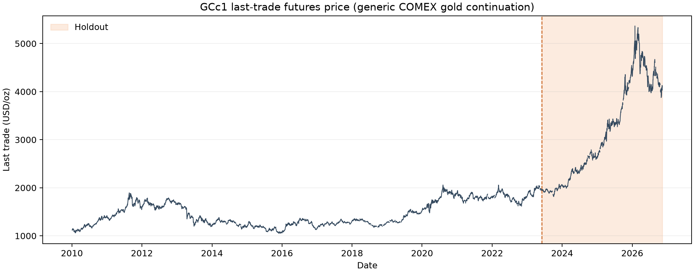
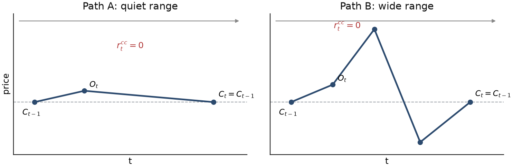
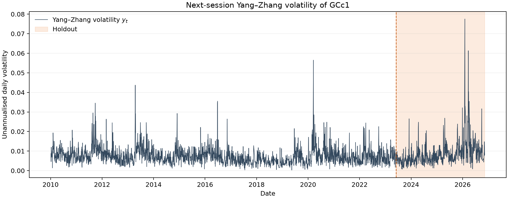
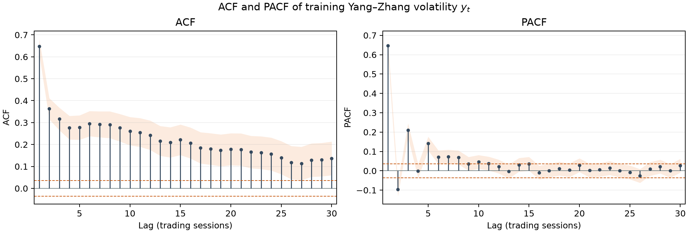
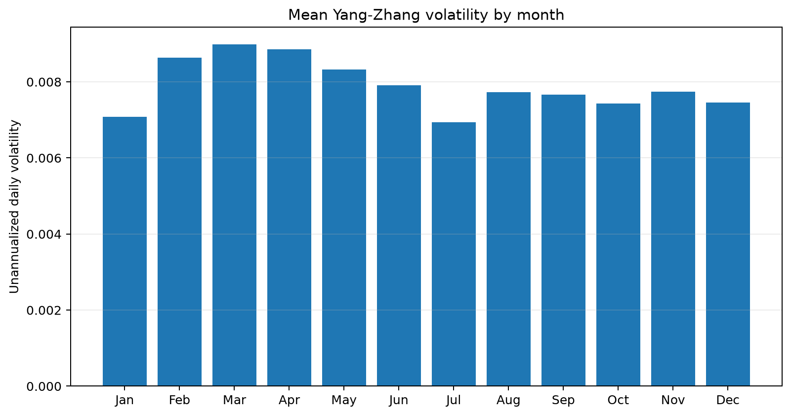
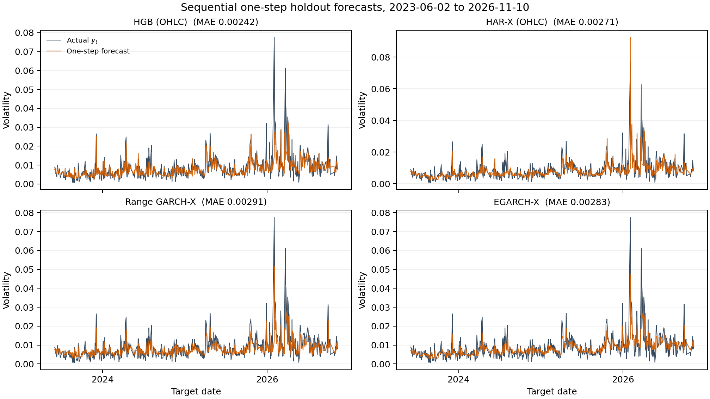
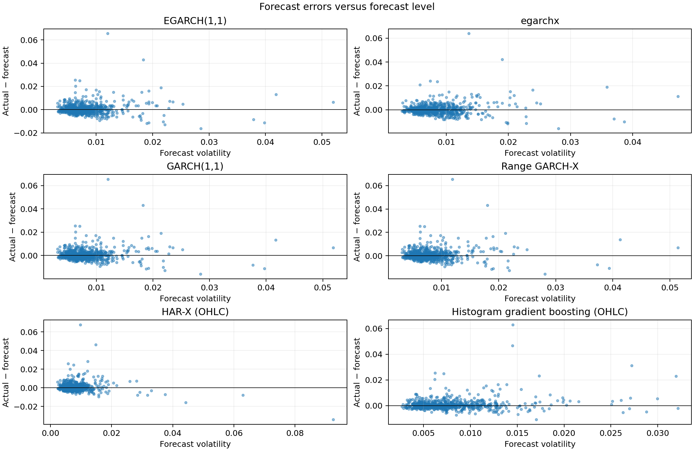
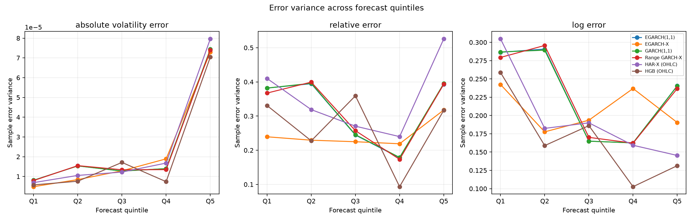
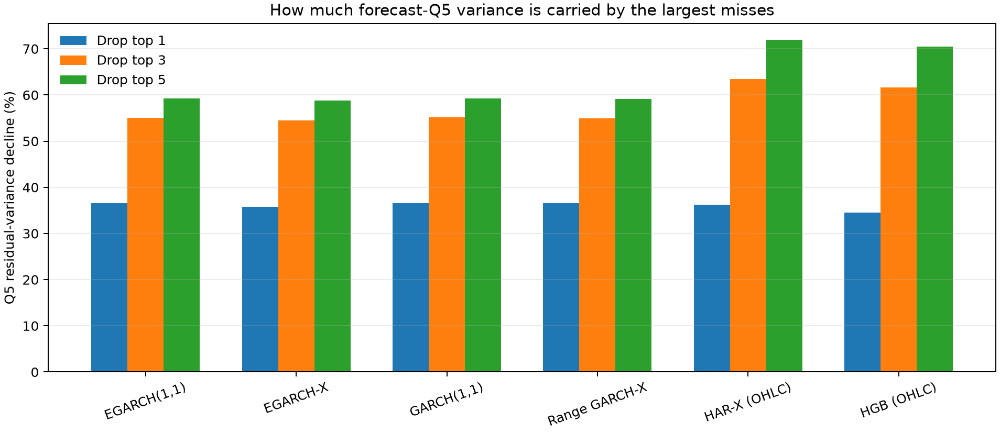

# Data

## What we are trying to estimate {#nav-data}

**Object:** next-day daily volatility of COMEX gold futures.

- Not the gold price level.
- One trading day; not annualised.

**Why this object**

- COMEX gold is the liquid exchange-traded gold contract.
- Daily volatility is the one-day risk of holding, hedging, or pricing options on that futures price.

**Who uses a forecast like this**

- Futures traders and hedgers
- Options-on-futures desks
- Risk and margin managers

::: notes
Do not name Yang–Zhang yet. The next slides say what data we have; then why YZ is the daily estimator.
:::

## Data: LSEG `GCc1`

COMEX gold futures, daily OHLC from LSEG Workspace, 2010-01-01 to 2026-11-10.

| Column | Role |
|---|---|
| `Date` | Trading-session date |
| `TRDPRC_1` | Close proxy $C_t$ (last trade) |
| `OPEN_PRC`, `HIGH_1`, `LOW_1` | Open $O_t$, high $H_t$, low $L_t$|

- 4,241 rows; **4,064** complete OHLC; incomplete bars dropped
- Chronological 80/20: **3,040 train / 761 test**
- Origin $t$ produces $\hat y_{t+1\mid t}$: next-day unannualised $y$
- Weekends and holidays are already skipped
- Spot gold and COMEX futures are different instruments; they are never mixed

## Test-period price regime

{width=86%}

::: notes
Training mostly 1,050–1,900 USD/oz. Test runs from about 2,000 to above 5,000.
:::

## First idea: tick-by-tick realised volatility

Our first thought: realised volatility from the **full tick path**.

$$
RV_t=\sum_{i=1}^{M_t} r_{t,i}^2,\qquad
\sigma_t^{\mathrm{HF}}=\sqrt{RV_t},
$$

$$
r_{t,i}=\log P_{t,i}-\log P_{t,i-1}.
$$

$r_{t,i}$ is the $i$-th tick log-return on day $t$; $P_{t,i}$ is the $i$-th transaction price; $M_t$ is the number of ticks that day.

**Limitation:** We do not have tick-level data. The LSEG file is one OHLC bar per date. Tick realised volatility is not feasible.

::: notes
Do not name Yang–Zhang yet. The story is: ticks first, then close-to-close, then YZ.
:::

## Next idea: close-to-close

With only daily bars, the naive estimator uses two closes:

$$
r^{cc}_t=\log(C_t/C_{t-1}).
$$

**Limitation:** the high, the low, and the overnight jump are thrown away. Path A is quiet; Path B swings but $C_t=C_{t-1}$.

{width=72%}

## Then Yang–Zhang Volatility

We asked AI for an estimator that uses the daily OHLC bar we do have. It pointed us to **Yang and Zhang** (2000).

- Uses **open, high, low, and close**
- Keeps the overnight jump and the high–low range
- Drift-independent
- more efficient than close-to-close

**That is the $y_t$ we forecast in this project.**

## Components of Yang–Zhang Volatility

1. Overnight jump:
$$
r_{o,t}=\log(O_t/C_{t-1})
$$

2. Session move:
$$
r_{c,t}=\log(C_t/O_t)
$$

3. Rogers–Satchell (RS) range (Rogers and Satchell, 1991):
$$
RS_t=\log(H_t/O_t)\log(H_t/C_t)+\log(L_t/O_t)\log(L_t/C_t).
$$

RS uses high and low inside the session. It does not include the overnight jump.

## Yang–Zhang formula

Then, we have Yang–Zhang volatility $\hat\sigma^{2}_{\mathrm{YZ},t}$:
$$
\hat{\sigma}^{2}_{\mathrm{YZ},t}
=
\underbrace{s^{2}_{o,t}}_{\text{overnight}}
+
\underbrace{k\, s^{2}_{c,t}}_{\text{open-to-close}}
+
\underbrace{(1-k)\overline{RS}_t}_{\text{RS range}},
\qquad
y_t = \sqrt{\max\bigl(0,\hat{\sigma}^{2}_{\mathrm{YZ},t}\bigr)}.
$$

Where:

- $s^{2}_{i,t}=\frac{1}{n-1}\sum_{j=t-n+1}^{t}(r_{i,j}-\bar r_{i,t})^{2}$ for $i\in\{o,c\}$
- $\overline{RS}_t=\frac{1}{n}\sum_{j=t-n+1}^{t} RS_j$
- **$n$:** rolling window of complete OHLC bars. Sample variances need $n\ge 2$. We use **$n=2$**.
- **$k$:** weight on the open-to-close variance. Yang and Zhang set
  $k=0.34/(1.34+(n+1)/(n-1))$
  so the estimator does not depend on drift. At $n=2$, $k\approx 0.078$; most session weight $(1-k)$ sits on RS.

## The Yang–Zhang series

{width=86%}

# Models

## Yang–Zhang volatility is mean-reverting and clustered {#nav-models}

- The **gold price level is not stationary**.
- Yang–Zhang volatility $y_t$ **and its logged value $\log y_t$ are
  stationary**.
- This volatility is a **mean-reverting, volatility-clustered series**.

Its autocorrelation is long-lasting: it is still **about 0.14 at lag 30**
(0.647 at lag 1 and 0.363 at lag 2).

1. **Construction effect.** Adjacent $n=2$ Yang–Zhang windows share one
   OHLC bar, mechanically inflating lag-1 correlation.
2. **Economic effect.** Volatility clustering keeps the autocorrelation
   positive at longer lags.

{width=50%}

::: notes
Do not interpret the first lag as pure market dependence. The longer
positive tail remains evidence of clustered volatility, but the overlapping
target complicates its magnitude.
:::

## Calendar patterns: descriptive, but weak after adjustment

HAC joint tests find **no statistically reliable weekday effects**.

Across the 3,801 targets, February–April are elevated:

- **March:** highest mean, $0.00899$
- **July:** lowest mean, $0.00694$

With broader HAC lags, the evidence is too weak ($p=0.068$ at lag 10;
$p=0.122$ at lag 20) to confirm a reliable month effect.

{width=48%}

::: notes
The February-April elevation is real descriptively. Because adjacent
windows overlap, uncertainty needs broad HAC correction. This is not a
basis for adding deterministic month dummies to the forecasting model.
:::

## Baseline and linear mean model

**Baseline: persistence**

$$
\hat y_{t+1\mid t}=y_t.
$$

**Linear mean: ARIMA(1,1,3)**, selected by the Hyndman–Khandakar
algorithm.

For $w_t=\log y_t$:

$$
\Delta w_t=c+\phi_1\Delta w_{t-1}
+\varepsilon_t-\theta_1\varepsilon_{t-1}
-\theta_2\varepsilon_{t-2}
-\theta_3\varepsilon_{t-3}.
$$

| Candidate | AICc |
|---|---:|
| **ARIMA(1,1,3)** | **3352.52** |
| ARIMA(1,1,2) | 3353.54 |
| ARIMA(3,1,1) | 3354.00 |

::: notes
The ARIMA model supplies a linear conditional-mean specification, not a
complete model of the changing variance. GARCH-family models are the next
layer because their innovations need not have constant variance.
:::

## Conditional variance: GARCH and EGARCH

- **GARCH(1,1):** today’s conditional variance depends on yesterday’s
  squared forecast error and yesterday’s variance.
- **EGARCH(1,1):** the same persistence is modelled in log variance, while
  allowing positive and negative shocks to have different effects.

The mean and variance equations are

$$
y_t=\mu_t+\varepsilon_t,\qquad
\varepsilon_t=\sigma_t z_t.
$$

$$
\text{GARCH:}\quad
\sigma_t^2=\omega+\alpha\varepsilon_{t-1}^2+\beta\sigma_{t-1}^2.
$$

$$
\text{EGARCH:}\quad
\log \sigma_t^2=\omega+\beta\log\sigma_{t-1}^2
+\gamma z_{t-1}+\alpha\left(|z_{t-1}|-E|z_{t-1}|\right).
$$

::: notes
EGARCH permits different responses to positive and negative shocks.
Neither specification alone uses information beyond the target series.
The next step adds observed origin-known predictors.
:::

## Predictors retained for GARCH-X and EGARCH-X

Eleven LSEG predictors were screened. The retained external signals are:

- **Gold implied volatility: 1 month**
- **Gold implied volatility: 1 year**
- **U.S. Dollar Index (DXY)**

Origin-known OHLC features are also available:

- lagged Yang–Zhang volatility, range, gaps, and rolling summaries
- information dated no later than the forecast origin
- no future target-window values enter the predictor set

These inputs extend the variance/mean specifications to
**GARCH-X** and **EGARCH-X**.

$$
\text{GARCH-X:}\quad
\sigma_t^2=\omega+\alpha\varepsilon_{t-1}^2+\beta\sigma_{t-1}^2
+\delta R_{t-1}+\boldsymbol{\lambda}^{\top}\mathbf{x}_{t-1}.
$$

$$
\text{EGARCH-X mean:}\quad
y_t=c+\phi y_{t-1}
+\boldsymbol{\eta}^{\top}\mathbf{x}_{t-1}+\varepsilon_t.
$$

::: notes
The IV tenors and DXY enter jointly after the screen. Do not infer that
each component causes future volatility, or that this proves a deployable
predictor ranking.
:::

## Advanced forecasts: HAR-X and HGB

::: columns
::: {.column width="49%"}
**HAR-X**

- Daily lag
- weekly average of Yang–Zhang volatility ($\approx 5$ trading days)
- monthly average of Yang–Zhang volatility ($\approx 22$ trading days)
- retained predictors

\small
\begin{align*}
\log y_{t+1}={}&\beta_0+\beta_d\log y_t\\
&+\beta_w\overline{\log y}_{t}^{(5)}
+\beta_m\overline{\log y}_{t}^{(22)}\\
&+\boldsymbol{\theta}^{\top}\mathbf{x}_t.
\end{align*}
\normalsize

Linear regression approximation to long-memory-like dependence.
:::
::: {.column width="49%"}
**Histogram Gradient Boosting**

- Same origin-known predictor set
- Non-linear tree-based machine learning
- Allows thresholds and feature interactions

\small
\begin{align*}
\log \hat y_{t+1}=f_{\mathrm{HGB}}\big(&
\log y_t,\overline{\log y}_{t}^{(5)},\\
&\overline{\log y}_{t}^{(22)},\mathbf{x}_t\big).
\end{align*}
\normalsize

Tests whether non-linearity improves out-of-sample forecasts.
:::
:::

::: notes
HAR-X follows a multi-horizon lag-aggregation idea; it does not formally
estimate a fractional-integration parameter. HGB uses the same predictor
information, so it is a comparison of functional form.
:::

## Compare all five models

Holdout: 761 common origins, expanding one-step forecasts.

| Model | Main forecasting role | MAE |
|---|---|---:|
| **HGB** | Non-linear trees and interactions | **0.002418** |
| HAR-X | Multi-horizon linear regression | 0.002711 |
| EGARCH-X | Asymmetric variance / external inputs | 0.002833 |
| GARCH(1,1) | Persistent conditional variance | 0.002912 |
| Persistence | Last observed volatility | 0.003190 |

HGB improves on persistence by $0.000772$, a **24\% MAE reduction**.

::: notes
These are the five models used in the direct comparison requested here.
The ranking is descriptive for this holdout; it does not by itself establish
a universal winner.
:::

## Diebold–Mariano tests

**Purpose:** test whether one model is reliably more accurate, allowing for overlapping windows.

**Absolute loss / MAE**

HGB's gains are overwhelmingly statistically significant:

| Comparator | DM $p$-value |
|---|---:|
| Persistence | $7.95\times10^{-14}$ |
| HAR | $1.15\times10^{-13}$ |
| GARCH(1,1) | $1.78\times10^{-9}$ |

**Squared loss / RMSE**

- HGB is still better descriptively.
- The gain is **not statistically significant against GARCH(1,1)**.
- Large shocks keep the RMSE test from showing HGB is better on tails.

::: notes
RMSE heavily weights the largest misses. The disagreement between MAE and
RMSE is an informative distinction: HGB wins on ordinary accuracy; it
does not prove better control of extreme spike error.
:::

## HGB leads on ordinary days, but all models miss the spike

HGB versus persistence: $0.003190-0.002418=0.000772$.

::: columns
::: {.column width="52%"}
- **Quiet 2023–2025 periods:** all shortlisted models track normal,
  calm conditions closely.
- **HGB tightness:** HGB remains closest to realised values on ordinary
  days, matching its lower MAE.
- **2026-02-02 extreme:** realised volatility reaches $0.0775$, while
  the forecasts are roughly $0.01$–$0.015$: a five- to seven-fold miss.
- **HAR-X:** produces a pronounced spike near the volatile cluster,
  but still falls far below the $0.0775$ peak.
:::
::: {.column width="47%"}
{width=100%}
:::
:::

::: notes
The MAE gain is economically useful in the typical regime. It is not a
promise of accurate tail forecasts. The shared spike miss explains why
the residual and Q5 analysis remains central.
:::

# Residuals

## Residual diagnosis {#nav-residuals}

$e_t=y_t-\hat y_{t\mid t-1}$. Positive $e_t$ = under-forecast.

1. **Positive mean error** (about $0.0003$–$0.0009$).
2. **Heteroskedasticity:** residual dispersion rises with $\hat y$.
3. **Outlier 2026-02-02:** actual $0.07752$; forecasts $0.01$–$0.015$.

Q5 = top 20% of that model's $\hat y$. Raw Q5/Q1 $=\mathrm{Var}(e\mid Q5)/\mathrm{Var}(e\mid Q1)$.

| Model | Raw | Relative | Log-error |
|---|---:|---:|---:|
| GARCH / EGARCH | 9.19 | 1.04 / 1.03 | 0.84 |
| Range GARCH-X | 9.33 | 1.07 | 0.85 |
| EGARCH-X | 15.05 | 1.33 | 0.79 |
| HAR-X | 11.55 | 1.28 | 0.48 |
| HGB | 12.28 | 0.96 | 0.51 |

Raw ratios **9–15**. Relative and log-error ratios stay near or below 1.

## Forecast errors versus $\hat y$

Fan shape. Positive values are under-forecasts. Isolated miss is 2026-02-02.

{fig-align="center" width="62%"}

## Error variance by forecast quintile

{width=90%}

## Extreme event: 2026-02-02

2026-02-02 is the largest miss for every model.

- 30 Jan: steepest gold drop since 1983 after the Warsh Fed-chair nomination (Reuters).
- 2 Feb: CME gold maintenance margins $6\%\to 8\%$.

Raw Q5/Q1 after dropping the largest misses (original Q5 set kept):

| Model | Original | Drop 1 | Drop 2 | Drop 5 |
|---|---:|---:|---:|---:|
| GARCH / EGARCH | 9.19 | 5.83 | 4.38 | 3.74 |
| HAR-X | 11.55 | 7.36 | 5.39 | 3.24 |
| HGB | 12.28 | 8.04 | 5.71 | 3.62 |

## Q5/Q1 falls as the largest misses are dropped

{width=88%}

## Three remedies, none fix Q5

**Student-$t$** ($df\approx 4$): density scores improve; Q5/Q1 stays about 9–16.

**Segmented high-vol parameters:** MAE worse (HGB 0.002418 $\to$ 0.002680 / 0.002760).

**Log $y$ + Jensen reverse** $\exp(\hat\mu+\hat\sigma^{2}/2)$: bias down; Q5 residual variance **rose** for five models (HGB $-0.2\%$).

**Window $n=2,5,10$:** longer windows raise lag-1 ACF $0.65\to 0.90\to 0.96$ and **raise** Q5/Q1 (about 9–12, 30–35, 58–63). Persistence then has the lowest MAE.

A heavier tail is a better density. It is not a Q5 point-forecast fix.

# Conclusion

## Conclusion {#nav-conclusion}

The result we emphasise is residual, not a unique winner.

1. **Versus persistence.** All six shortlisted models beat last-value persistence (MAE 0.003190). HGB **24%**; HAR-X 15%; EGARCH-X 11%; GARCH, EGARCH, and range GARCH-X about 9%.
2. **Heteroskedasticity.** Errors fan out with $\hat y$ for every shortlisted model.
3. **High predicted volatility is the unreliable region.** Raw Q5/Q1 about 9 to 15. The 2026-02-02 cluster accounts for much of that ratio.

## AI and contributions

:::: {.columns}

::: {.column width="48%"}
**AI:**

- code generation  
- idea realisation  
- report and slide drafts  
- chart generation  
- git / project management  
- Quoted numbers come from saved CSVs.
:::

::: {.column width="52%"}
**Contributions**

- **Li Hung Kui:** infrastructure, LSEG/YZ pipeline, evaluation, report and slides
- **Luo Pui Ki Enoch:** model development, ladder, predictor screen
- **Siriasavakul Hok Sum:** residual diagnosis, log reverse, segmented experiment
:::

::::
