# Executive summary

This draft brings together three related, but non-identical, pieces of evidence:

1. A Stage 1 rolling-origin comparison of seven univariate variance baselines
   freshly evaluated on the exact 445 Stage 3 origins.
2. A Stage 2 training-only screen of seven Yahoo/FRED predictors, followed by
   a separate 596-origin holdout comparison of HistGradientBoosting against
   simple benchmarks.
3. A Stage 3 comparison of those baselines with 12 additional HAR, HARX,
   penalized, and BIC-selected VAR forecasts, attempted on the same 445
   weekly origins.

In the aligned Stage 1/Stage 3 comparison, GARCH(1,1) had the lowest point-
estimate MSE and RMSE, but failed to converge at 10 of the 445 forecast
dates. All-model comparisons therefore use the 435 dates where every model
has a forecast. In the Stage 2 conditional association screen, only VIX
remained significant after Holm correction. HistGradientBoosting did not
outperform expanding variance on the separate Stage 2 holdout. No model
significantly beat the historical-variance benchmark after Holm correction
for MSE or QLIKE on the aligned sample; the VAR had significantly larger
MSE and QLIKE than the benchmark after correction.

These are exploratory results, not a final model choice. Samples, forecast
origin spacing, and in some cases input panels differ; comparisons across
those sections are descriptive rather than head-to-head rankings.

# Evaluation map and comparability

| Evidence block | Data and evaluation | What it answers |
|---|---|---|
| Stage 1 baselines | Yahoo `GC=F`; seven baselines refit on the exact 445 Stage 3 weekly origins; 2018-01-05 to 2026-11-03 | How do return-only volatility forecasts compare on the same sample as Stage 3? |
| Stage 2 predictor screen | Yahoo/FRED panel; chronological 80/20 split; 2,376 training rows after purging 4 overlapping labels; HAC lag 4 | Which predictors are conditionally associated with log forward realized variance in training data? |
| Stage 2 holdout | Yahoo/FRED panel; 596 origins from 2024-06-24 to 2026-11-03 | Does the all-predictor gradient-boosting forecast beat simple benchmarks on this holdout? |
| LSEG screen | Separate `GCc1` panel; 3,241 training and 812 holdout rows | Exploratory conditional associations in the available alternative panel |
| Stage 3 common-origin comparison | Yahoo/FRED panel; seven freshly refit Stage 1 baselines, 11 reused advanced forecasts, and one BIC-selected VAR; 435 complete weekly origins from the 445 Stage 3 dates | How do baselines and advanced forecasts compare on identical origins? |

The target is five-session-ahead realized variance, calculated as the sum of
squared daily log returns over the next five observed price sessions. It is
not spot-gold volatility: the working series is Yahoo Finance `GC=F`, a
continuous COMEX gold futures series. Stage 1 and Stage 3 now share the same
445 forecast origins; Stage 2 used a separate fixed chronological holdout.
Do not rank metrics from the Stage 2 holdout against Stage 1/3 as if they
were measured on one common sample.

# Stage 1: baseline model performance

All seven Stage 1 models were freshly attempted at the exact same 445 weekly
forecast dates used by Stage 3. GARCH(1,1) converged on 435 dates and failed
on 10; the final all-model comparison uses the 435-origin intersection so
each reported model is scored on the same dates. The expanding-variance benchmark, rolling
variance, fixed-decay EWMA (0.94), AR(1) on squared returns, MA(1) on squared
returns, ARCH(1), and GARCH(1,1) use only returns through each origin.
Convergence failures are retained as missing forecasts and shown through the
per-model sample count rather than silently removed from the record.

```{python}
import pandas as pd
from IPython.display import display

stage1_metrics = pd.read_csv(
    "../data/processed/stage1_on_stage3_origins_metrics.csv"
)
stage1_display = stage1_metrics[
    ["model", "n", "MAE", "RMSE", "QLIKE", "DM_MSE_p_holm", "DM_QLIKE_p_holm"]
].copy()
stage1_display.columns = [
    "Model", "N", "MAE", "RMSE", "QLIKE", "Holm DM p (MSE)", "Holm DM p (QLIKE)"
]
display(
    stage1_display.style.format(
        {
            "MAE": "{:.6g}",
            "RMSE": "{:.6g}",
            "QLIKE": "{:.4f}",
            "Holm DM p (MSE)": "{:.4g}",
            "Holm DM p (QLIKE)": "{:.4g}",
        }
    ).hide(axis="index")
)
```

The Stage 1 baseline errors below are now directly comparable with the Stage 3
models. A lower point loss is descriptive evidence; the paired tests and
their multiple-testing correction should be considered before interpreting
small differences.

```{python}
import matplotlib.pyplot as plt
import numpy as np
import pandas as pd

baseline = stage1_metrics.sort_values("RMSE", ascending=True).copy()
baseline["Model"] = baseline["model"].map(
    {
        "historical_variance": "Expanding historical variance",
        "rolling_variance": "Rolling variance",
        "ewma_fixed": "EWMA (fixed decay 0.94)",
        "ar1_squared_return": "AR(1), squared returns",
        "ma1_squared_return": "MA(1), squared returns",
        "arch1": "ARCH(1)",
        "garch11": "GARCH(1,1)",
    }
)

fig, ax = plt.subplots(figsize=(8.5, 4.6))
colors = ["#d97941" if name == "GARCH(1,1)" else "#527f89" for name in baseline["Model"]]
ax.barh(baseline["Model"], baseline["RMSE"] * 1e3, color=colors)
ax.invert_yaxis()
ax.set_xlabel(r"RMSE ($\times 10^{-3}$ realized-variance units)")
ax.set_title("Stage 1: baseline errors on the Stage 3 origins")
ax.grid(axis="x", alpha=0.22)
ax.set_axisbelow(True)
for y, value in enumerate(baseline["RMSE"] * 1e3):
    ax.text(value + 0.012, y, f"{value:.3f}", va="center", fontsize=8)
fig.tight_layout()
plt.show()
```

# Stage 2: predictor significance

The Yahoo/FRED screen regresses `log1p` five-session realized variance on all
seven standardized predictors in the training period. HAC standard errors use
four lags to reflect the overlapping five-session labels; Holm correction is
applied across the seven coefficient tests. Predictors are standardized using
training-period moments only.

| Predictor | Coefficient per training SD ($\times 10^{-4}$) | HAC t | HAC p | Holm p | Significant after Holm? |
|---|---:|---:|---:|---:|---|
| DXY close | -0.050 | -0.180 | 0.8573 | 1.0000 | No |
| S&P 500 log return | -0.132 | -0.704 | 0.4813 | 1.0000 | No |
| VIX close | 2.681 | 4.096 | 0.0000435 | 0.000305 | **Yes** |
| 10-year Treasury yield | 0.277 | 0.717 | 0.4733 | 1.0000 | No |
| 10-year breakeven inflation | -1.180 | -2.001 | 0.0455 | 0.2731 | No |
| WTI spot | -0.017 | -0.036 | 0.9714 | 1.0000 | No |
| Gold volume | 0.265 | 0.934 | 0.3504 | 1.0000 | No |

VIX is positively associated with the transformed target conditional on the
other included predictors in this training sample. Breakeven inflation is
nominally significant before correction but not after Holm adjustment. This is
an association screen, not proof that other predictors have no out-of-sample
value or a basis for automatically dropping them.

```{python}
sig = pd.DataFrame(
    {
        "Predictor": [
            "DXY close",
            "S&P 500 log return",
            "VIX close",
            "10-year Treasury yield",
            "10-year breakeven inflation",
            "WTI spot",
            "Gold volume",
        ],
        "Coefficient": [
            -4.9577617e-06,
            -1.3231538e-05,
            2.6812461e-04,
            2.7669820e-05,
            -1.1801888e-04,
            -1.7341942e-06,
            2.6461138e-05,
        ],
        "Holm p": [1.0, 1.0, 0.00030453524, 1.0, 0.27311905, 1.0, 1.0],
    }
).sort_values("Coefficient")

fig, ax = plt.subplots(figsize=(8.5, 4.5))
colors = ["#d97941" if p < 0.05 else "#8a9b9f" for p in sig["Holm p"]]
ax.barh(sig["Predictor"], sig["Coefficient"] * 1e4, color=colors)
ax.axvline(0, color="#26383c", linewidth=0.8)
ax.set_xlabel(r"Coefficient per training SD ($\times 10^{-4}$)")
ax.set_title("Stage 2: training-only conditional coefficients")
ax.text(
    0.99,
    0.02,
    "Orange: Holm-adjusted p < 0.05",
    transform=ax.transAxes,
    ha="right",
    va="bottom",
    fontsize=8,
)
ax.grid(axis="x", alpha=0.2)
ax.set_axisbelow(True)
fig.tight_layout()
plt.show()
```

## Separate LSEG predictor screen

The LSEG `GCc1` analysis is a different panel and must not be merged into the
Yahoo/FRED significance table. Its exploratory training-only screen recorded
DXY as negatively associated and VIX as positively associated, both
individually significant after Holm correction. The five gold implied-
volatility tenors were significant jointly, but highly collinear (maximum
absolute pairwise correlation 0.991); individual tenor importance was
unresolved. These data have incomplete candidate coverage and an unverified
one-weekday availability proxy and quote units.

| LSEG predictor/group | Coefficient or test | HAC p | Holm-adjusted p | Interpretation |
|---|---:|---:|---:|---|
| DXY | -0.000122 per training SD | 0.000094 | 0.00103 | Individually significant |
| VIX | +0.000137 per training SD | 0.00124 | 0.0124 | Individually significant |
| Five gold IV tenors, joint test | F = 17.42 | — | $9.26 \times 10^{-17}$ | Significant as a block; individual effects unresolved |
| Risk reversal + butterfly, joint test | — | — | 0.386 | Not significant as a block |

# Stage 2: advanced holdout model

HistGradientBoosting used all seven Yahoo/FRED predictors and was evaluated on
the 596-origin holdout. The expanding-variance benchmark had lower MAE and
RMSE; all three reported holdout R-squared values were negative, indicating
worse squared-error performance than the holdout-mean reference under the
usual R-squared definition.

| Model | MAE | RMSE | Holdout $R^2$ |
|---|---:|---:|---:|
| Expanding-variance benchmark | 0.000762 | 0.001833 | -0.120 |
| Training-mean benchmark | 0.000787 | 0.001855 | -0.148 |
| HistGradientBoosting, all predictors | 0.000813 | 0.001883 | -0.183 |

```{python}
stage2_holdout = pd.DataFrame(
    {
        "Model": [
            "Expanding variance",
            "Training mean",
            "HistGradientBoosting",
        ],
        "RMSE": [0.00183267, 0.00185520, 0.00188303],
    }
)
fig, ax = plt.subplots(figsize=(7.8, 3.2))
bars = ax.bar(
    stage2_holdout["Model"],
    stage2_holdout["RMSE"] * 1e3,
    color=["#527f89", "#8a9b9f", "#d97941"],
)
ax.set_ylabel(r"RMSE ($\times 10^{-3}$)")
ax.set_title("Stage 2: separate 596-origin holdout")
ax.tick_params(axis="x", rotation=12)
ax.grid(axis="y", alpha=0.2)
ax.set_axisbelow(True)
for bar, value in zip(bars, stage2_holdout["RMSE"] * 1e3, strict=True):
    ax.text(bar.get_x() + bar.get_width() / 2, value + 0.008, f"{value:.3f}", ha="center", fontsize=8)
fig.tight_layout()
plt.show()
```

# Stage 3: advanced model performance

The seven Stage 1 baselines above were refit at the exact Stage 3 origin dates;
11 Stage 3 forecasts are reused from the completed evaluation, and a
BIC-selected VAR is refit at each origin. This VAR uses log daily squared
returns and log VIX, selects up to five lags by BIC using data through the
forecast origin, and sums the five exponentiated forecasts of daily variance.
It succeeded at all 445 requested origins. GARCH(1,1) failed at 10 dates, so
the final table compares all 19 models on the 435 shared usable origins, a
common subset of Stage 3's 445 weekly dates. The paired comparisons use the
expanding historical-variance baseline and Holm-adjusted Diebold-Mariano
p-values. VAR's MSE and QLIKE are both higher than the benchmark, with
Holm-adjusted DM p-values of 0.000071 and 1.42e-7, respectively.

```{python}
import pandas as pd
from IPython.display import display

stage3_summary = pd.read_csv(
    "../data/processed/evaluation_summary_with_stage1_common_origins.csv"
)
stage3_display = stage3_summary[
    [
        "model",
        "n",
        "MSE",
        "RMSE",
        "MAE",
        "QLIKE",
        "DM_MSE_p_holm",
        "DM_QLIKE_p_holm",
    ]
].copy()
stage3_display.columns = [
    "Model", "N", "MSE", "RMSE", "MAE", "QLIKE",
    "Holm DM p (MSE)", "Holm DM p (QLIKE)",
]
display(
    stage3_display.style.format(
        {
            "MSE": "{:.6g}",
            "RMSE": "{:.6g}",
            "MAE": "{:.6g}",
            "QLIKE": "{:.4f}",
            "Holm DM p (MSE)": "{:.4g}",
            "Holm DM p (QLIKE)": "{:.4g}",
        }
    ).hide(axis="index")
)
```

The RMSE figure includes the refit Stage 1 baselines alongside the advanced
forecasts. Point rankings are not themselves a final model choice; use the
paired tests and the evaluation limitations when interpreting small gaps.

```{python}
stage3 = stage3_summary.copy()
stage3["Model"] = stage3["model"].map(
    {
        "ewma": "EWMA (estimated)",
        "ewma_fixed": "EWMA (fixed)",
        "ewma_variance": "EWMA (fixed)",
        "har": "HAR",
        "lasso_vix": "Lasso (VIX)",
        "ridge_vix": "Ridge (VIX)",
        "harx_vix": "HARX (VIX)",
        "lasso_full": "Lasso (full)",
        "harx_dxy_vix": "HARX (DXY+VIX)",
        "lasso_dxy_vix": "Lasso (DXY+VIX)",
        "ridge_dxy_vix": "Ridge (DXY+VIX)",
        "rolling_variance": "Rolling variance",
        "ridge_full": "Ridge (full)",
        "ar1_squared_return": "AR(1), squared returns",
        "ma1_squared_return": "MA(1), squared returns",
        "arch1": "ARCH(1)",
        "historical_variance": "Expanding variance",
        "garch11": "GARCH(1,1)",
        "harx_full": "HARX (full)",
        "var": "VAR (BIC-selected)",
    }
)
stage3["Group"] = stage3["model"].map(
    lambda name: (
        "Baseline"
        if name in {
            "historical_variance", "rolling_variance", "ewma_fixed",
            "ar1_squared_return", "ma1_squared_return", "arch1", "garch11",
        }
        else "HAR" if name == "har"
        else "HARX" if name.startswith("harx")
        else "Penalized" if name.startswith(("lasso", "ridge"))
        else "VAR" if name == "var"
        else "EWMA"
    )
)
stage3 = stage3.sort_values("RMSE", ascending=True)
palette = {
    "Baseline": "#8a9b9f",
    "HAR": "#527f89",
    "HARX": "#3e7480",
    "Penalized": "#d97941",
    "EWMA": "#8064a2",
    "VAR": "#b05a5a",
}

fig, ax = plt.subplots(figsize=(8.5, 6.3))
ax.barh(stage3["Model"], stage3["RMSE"] * 1e3, color=stage3["Group"].map(palette))
ax.invert_yaxis()
ax.set_xlabel(r"RMSE ($\times 10^{-3}$ realized-variance units)")
ax.set_title("Stage 3: 19 models on 435 shared usable origins")
ax.grid(axis="x", alpha=0.2)
ax.set_axisbelow(True)
fig.tight_layout()
plt.show()
```

## Appendix: forecasts vs actuals for all models

The following charts show forecast and actual five-session realized variance
for every one of the 19 models at all 445 requested Stage 3 evaluation dates.
GARCH(1,1) forecast gaps correspond to its 10 failed fits. The charts retain
the full set of attempted origins; the main comparison table uses the
435-origin complete-case intersection. Regenerate the VAR forecasts and
comparison tables with `python scripts/evaluate_stage3_var.py`, then regenerate
all charts with `python scripts/plot_stage3_all_model_forecasts.py`.

### Expanding historical variance

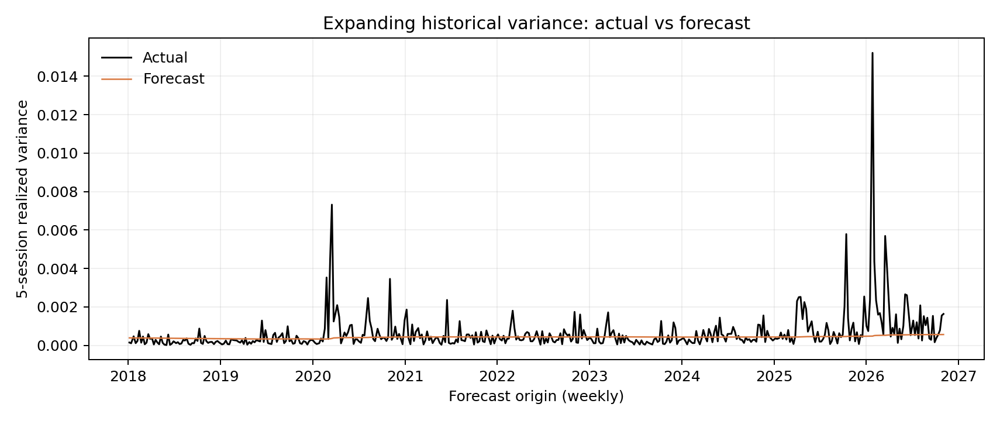{fig-alt="Line chart of actual and expanding historical variance forecasts over Stage 3 origin dates"}

\newpage

### Rolling variance

{fig-alt="Line chart of actual and rolling variance forecasts over Stage 3 origin dates"}

\newpage

### EWMA, fixed decay 0.94

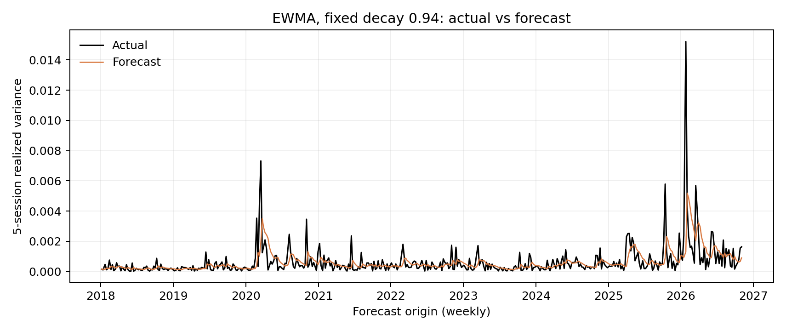{fig-alt="Line chart of actual and fixed-decay EWMA forecasts over Stage 3 origin dates"}

\newpage

### AR(1) on squared returns

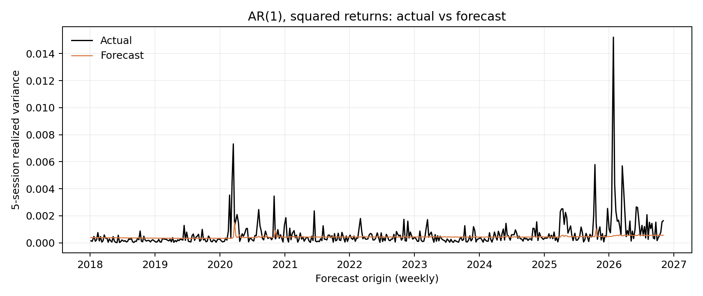{fig-alt="Line chart of actual and AR(1) squared-return forecasts over Stage 3 origin dates"}

\newpage

### MA(1) on squared returns

{fig-alt="Line chart of actual and MA(1) squared-return forecasts over Stage 3 origin dates"}

\newpage

### ARCH(1)

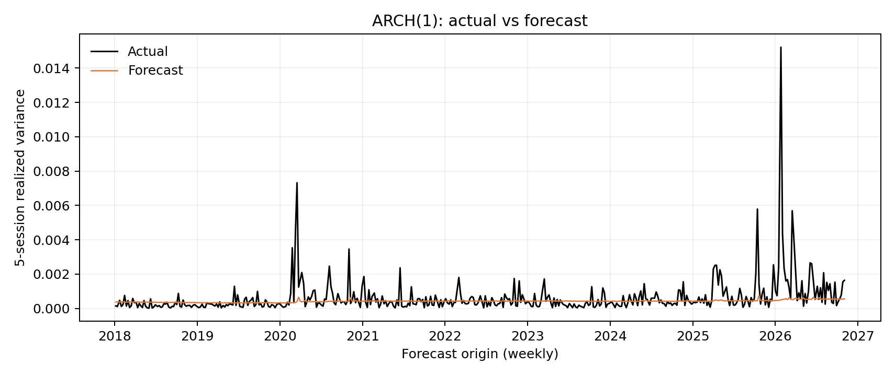{fig-alt="Line chart of actual and ARCH(1) forecasts over Stage 3 origin dates"}

\newpage

### GARCH(1,1)

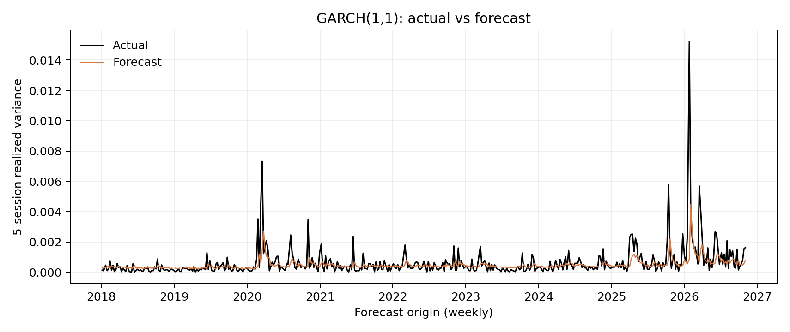{fig-alt="Line chart of actual and GARCH(1,1) forecasts over Stage 3 origin dates, with gaps at failed fits"}

\newpage

### VAR, BIC-selected

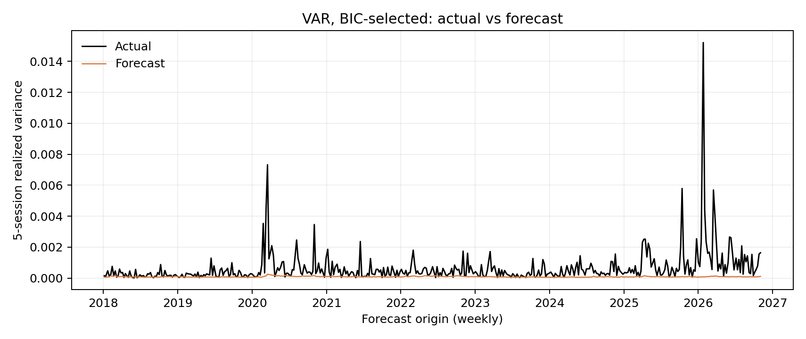{fig-alt="Line chart of actual and BIC-selected VAR forecasts over Stage 3 origin dates"}

\newpage

### EWMA, estimated decay

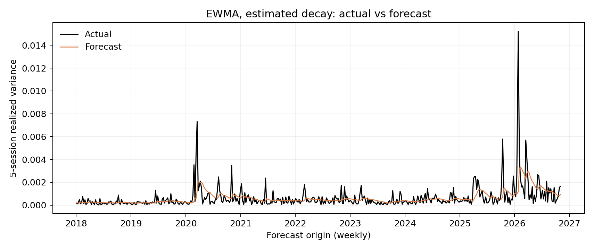{fig-alt="Line chart of actual and estimated-decay EWMA forecasts over Stage 3 origin dates"}

\newpage

### HAR

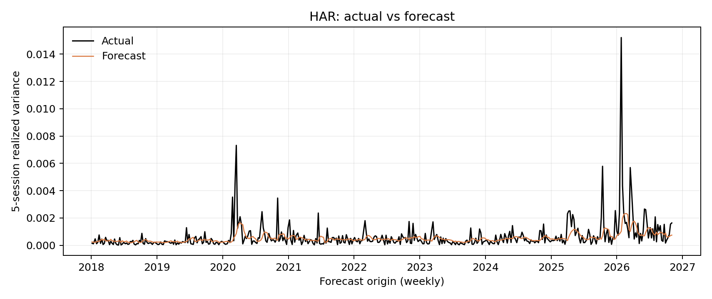{fig-alt="Line chart of actual and HAR forecasts over Stage 3 origin dates"}

\newpage

### HARX, VIX

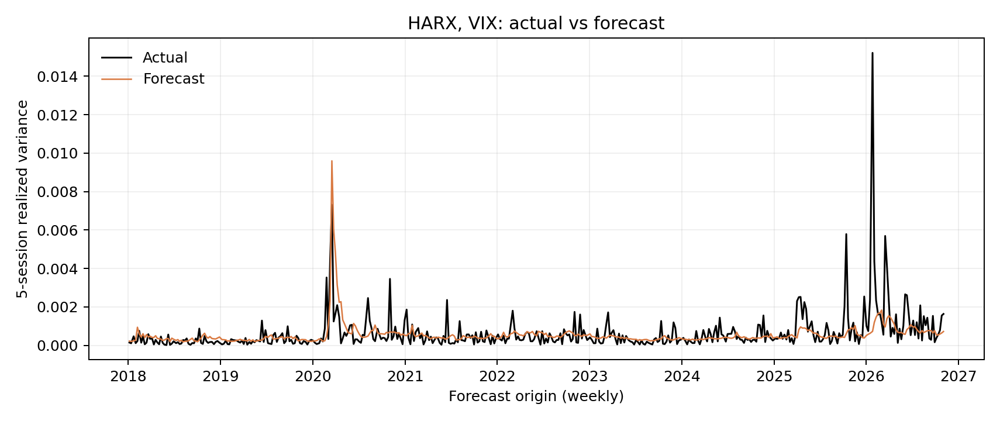{fig-alt="Line chart of actual and HARX VIX forecasts over Stage 3 origin dates"}

\newpage

### HARX, DXY and VIX

{fig-alt="Line chart of actual and HARX DXY and VIX forecasts over Stage 3 origin dates"}

\newpage

### HARX, full predictor set

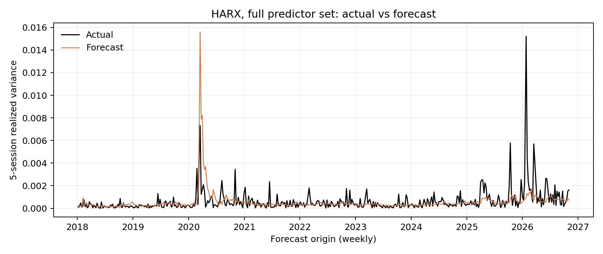{fig-alt="Line chart of actual and full-predictor HARX forecasts over Stage 3 origin dates"}

\newpage

### Lasso, VIX

{fig-alt="Line chart of actual and VIX lasso forecasts over Stage 3 origin dates"}

\newpage

### Lasso, DXY and VIX

{fig-alt="Line chart of actual and DXY-plus-VIX lasso forecasts over Stage 3 origin dates"}

\newpage

### Lasso, full predictor set

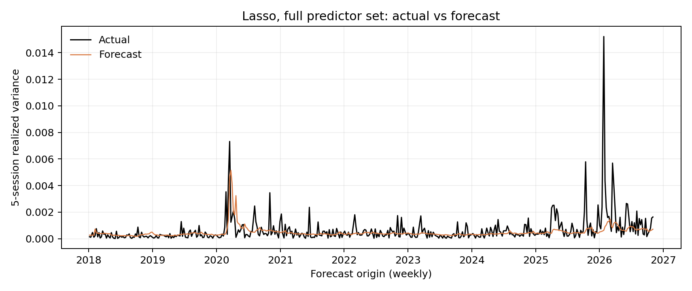{fig-alt="Line chart of actual and full-predictor lasso forecasts over Stage 3 origin dates"}

\newpage

### Ridge, VIX

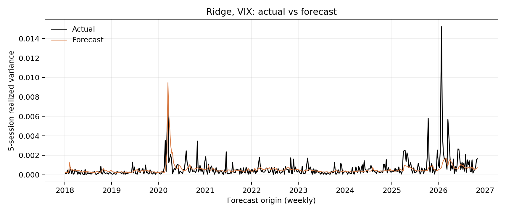{fig-alt="Line chart of actual and VIX ridge forecasts over Stage 3 origin dates"}

\newpage

### Ridge, DXY and VIX

{fig-alt="Line chart of actual and DXY-plus-VIX ridge forecasts over Stage 3 origin dates"}

\newpage

### Ridge, full predictor set

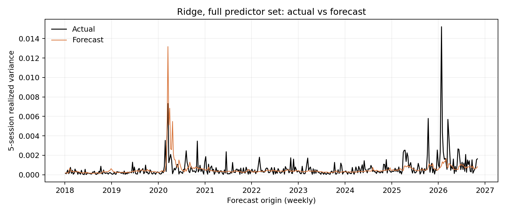{fig-alt="Line chart of actual and full-predictor ridge forecasts over Stage 3 origin dates"}

## Scope and limitations

- The Stage 3 run excluded repeated auto-ARIMA, GJR-GARCH, asymmetric EGARCH,
  Student-t GARCH, and GARCH-X fits to meet the requested short runtime.
  Their exclusion is not evidence that they perform poorly. VAR was added in
  a separate origin-wise run using the existing BIC-selected implementation.
- GARCH(1,1) failed to converge at 10 of the 445 requested Stage 3 dates.
  The combined model ranking uses the 435 dates with successful forecasts
  from every model; the appendix retains all 445 attempted dates.
- Appendix forecasts show GARCH(1,1) gaps where estimation failed; those
  actual observations are not silently interpolated. VAR produced valid
  forecasts at all 445 requested origins.
- Five-session targets overlap. Paired Diebold-Mariano tests use a horizon
  adjustment and Holm correction, but inference still depends on this
  evaluation design.
- FRED availability is approximated by a one-weekday lag and is based on
  current-vintage downloads, not historical real-time vintages. LSEG fields
  and their availability assumptions need verification.
- The predictor screen tests conditional association; it does not, by itself,
  establish incremental out-of-sample forecasting value.
- No final model-selection criterion or team recommendation is asserted.

# Evidence sources

This report uses the local prepared files and documented analyses:

- Stage 1: `data/processed/stage1_on_stage3_origins_forecasts.csv`,
  `data/processed/stage1_on_stage3_origins_metrics.csv`, and
  `scripts/evaluate_stage1_on_stage3_origins.py`. The older recent-sample
  metrics are retained separately in
  `data/processed/stage1_baseline_500_origin_metrics.csv`.
- Stage 2 Yahoo/FRED: `notebooks/05_advanced_models.ipynb`,
  `data/processed/stage2_multivariate.csv`, and its manifest.
- Stage 2 LSEG screen: the exploratory findings recorded in
  `.ai/SESSION_LOG.md`; treat these as a separate, qualified evidence source.
- Stage 3: `data/processed/evaluation_summary_with_stage1_common_origins.csv`,
  `data/processed/predictor_set_comparison.csv`,
  `data/processed/stage3_var_forecasts.csv`,
  `data/processed/stage3_var_manifest.json`, and the manifest beside the saved
  forecast rows.
