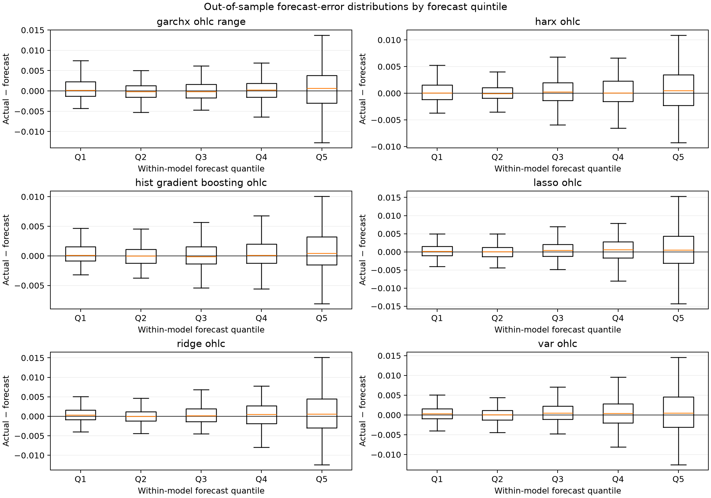
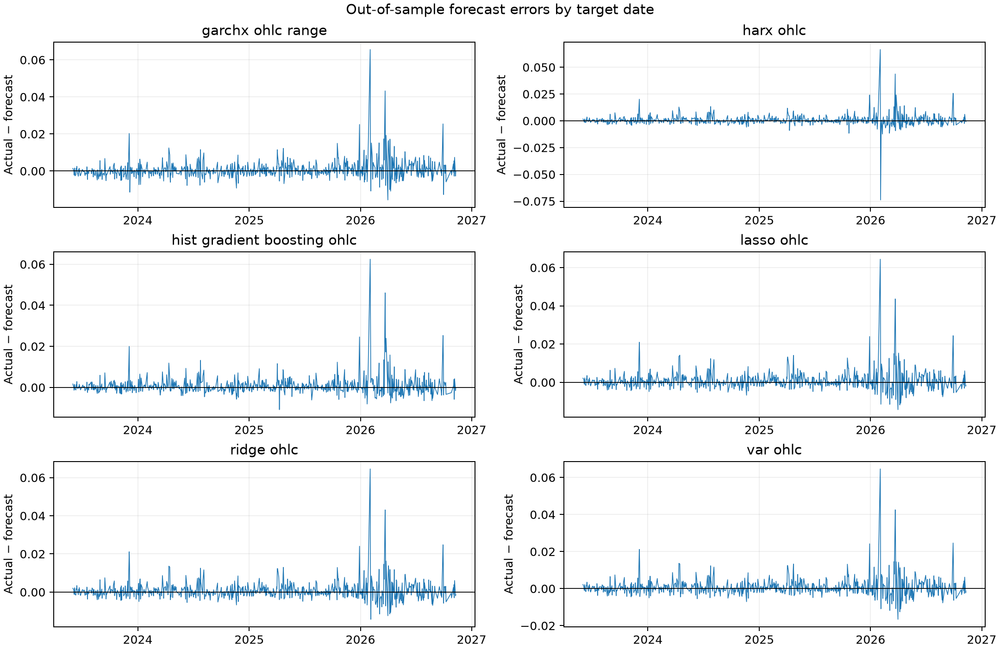
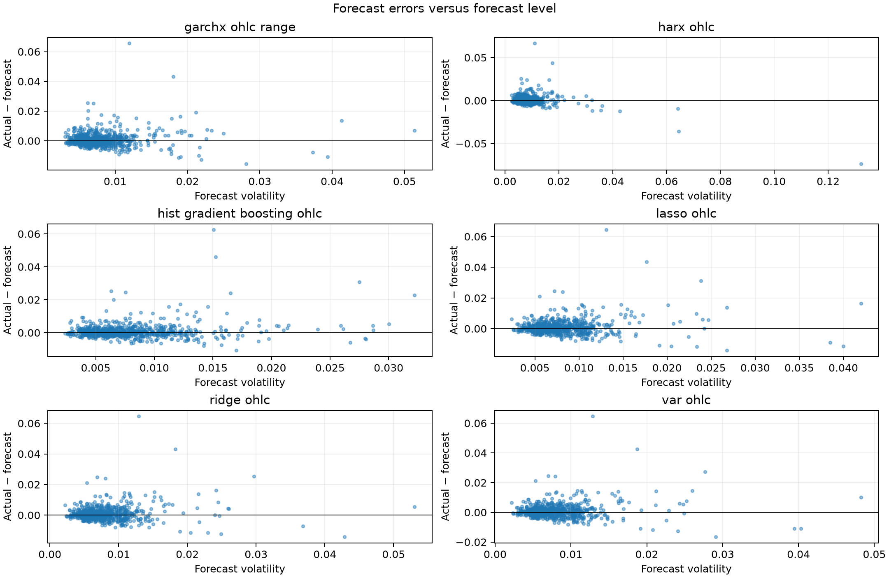
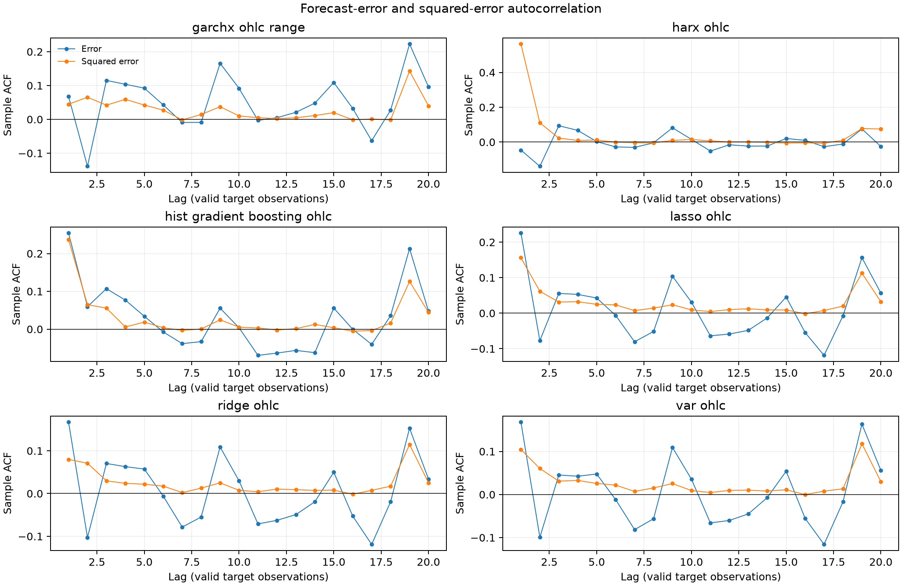
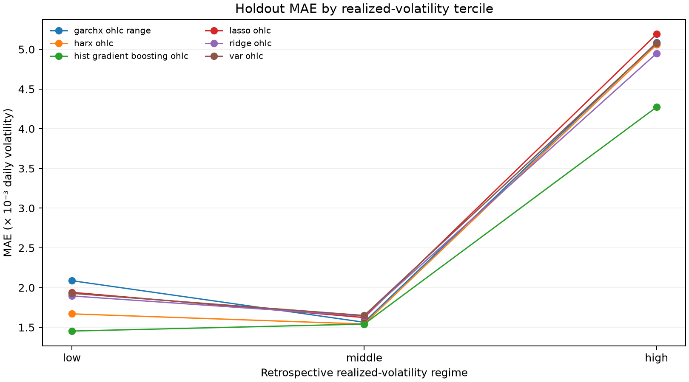

# Executive summary

This report studies the saved sequential one-step holdout forecasts for the
six joint-predictor models: HARX, Ridge, Lasso, histogram gradient boosting,
range GARCH-X, and VAR. It defines each **forecast error** as
$e_t=y_t-\widehat y_{t|t-1}$, so a positive value means the model
under-forecast the observed unannualized two-observation Yang–Zhang
volatility. All six models have 761 common successful errors from
2023-06-02 through 2026-11-10.

The errors have positive average bias for every model, substantial tail
heaviness, and visible serial dependence. Histogram gradient boosting has
the smallest MAE and RMSE in this holdout, but its errors remain biased,
heavy-tailed, and autocorrelated. These diagnostics do not establish which
model is statistically best. Adjacent Yang–Zhang targets overlap, so the
error series is dependent by construction; the reported Ljung–Box values are
exploratory flags, not confirmatory inference.

Sorting forecasts separately within each model into five equal-count groups
shows positive mean forecast errors in every quintile. For histogram
gradient boosting, mean error rises from $0.637\times10^{-3}$ in Q1 to
$2.025\times10^{-3}$ in Q5; Q5 errors are also strongly right-skewed
(skewness 4.01) and heavy-tailed (excess kurtosis 22.68). This is consistent
with under-response among the model's highest forecasts, but is descriptive
and sensitive to a few extreme observations.

# Test-branch assessment

The two-observation Yang–Zhang target uses OHLC information and is relevant
to next-valid-day volatility monitoring. It is an estimator of volatility,
not observed latent volatility, and the adjacent two-observation windows
overlap. The 761 holdout targets offer a useful descriptive sample, but
sample size alone does not establish robustness or real-time utility.

The training-sample VIF/HAC/Holm screen reported conditional associations
for DXY, gold implied volatility 1M, and gold implied volatility 1Y after
controlling for current volatility. This does not demonstrate causal effects
or out-of-sample forecast value. Although the screen uses training responses,
the predictors were selected after earlier holdout results had been seen;
the current holdout therefore is not fully untouched by model design.

The following scores are from the same test-branch target and 761 forecast
dates. The no-external-predictor models and the persistence/HAR baselines
come from the earlier test-branch run; the three selected external variables
were added jointly in the current run. Values are in $10^{-3}$ daily
volatility units.

| Test-branch model | MAE | RMSE |
|---|---:|---:|
| HistGradientBoosting, no external predictors | 2.418 | 4.767 |
| HistGradientBoosting, DXY + gold IV 1M/1Y | 2.423 | 4.736 |
| HAR baseline | 2.995 | 5.397 |
| Yang–Zhang persistence | 3.190 | 5.447 |

HistGradientBoosting ranks first among the six models in the joint-predictor
run and has lower point losses than these simple test-branch benchmarks.
However, adding the external predictors changes its MAE slightly for the
worse (+0.24%) and RMSE slightly for the better (-0.66%). These mixed,
small changes and the descriptive cross-model ranking have not been tested
with paired forecast-loss inference. They do not establish the external
variables' net predictive value or HistGradientBoosting's superiority.

HistGradientBoosting is therefore a promising provisional test-branch
candidate, not a validated operational tool or settled decision model. Next,
use a pre-specified later chronological holdout with predictor selection and
tuning confined to training data, and compare against persistence and HAR
with paired loss inference that accounts for target overlap, origin spacing,
and multiple comparisons. Saving fitted conditional variances and
innovations per estimation origin is also required for standardized
GARCH-residual analysis.

# Scope and definitions

The input is `data/processed/stage2_yz_selected/stage2_yz_forecasts.csv`,
the saved six-model evaluation for LSEG Workspace `GCc1`, a generic COMEX
gold-futures series. Forecasts are sequential and one step ahead. The
diagnostic pipeline retains only successful observations on target dates
shared by all six models and checks that all models report the same actual
for each date.

The sign convention is actual minus forecast:

$$
e_t=y_t-\widehat y_{t|t-1}.
$$

These are **out-of-sample forecast errors**, not in-sample equation
innovations. In particular, the saved evaluation does not include fitted
conditional variances and per-origin GARCH innovations, so it cannot support
a standardized-residual or remaining-ARCH analysis of the GARCH-X fit itself.

# Descriptive error summaries

The table expresses mean error, MAE, and RMSE in $10^{-3}$ unannualized daily
volatility units. Positive mean errors indicate average under-forecasting.
Skewness and excess kurtosis describe the marginal error distribution; large
positive excess kurtosis indicates heavy tails relative to a normal
distribution, but does not identify their cause.

| Model | Mean error | MAE | RMSE | Skewness | Excess kurtosis |
|---|---:|---:|---:|---:|---:|
| HARX | 0.623 | 2.758 | 5.625 | -0.18 | 73.57 |
| Ridge | 0.832 | 2.830 | 4.948 | 4.57 | 47.50 |
| Lasso | 0.898 | 2.920 | 5.089 | 4.39 | 43.35 |
| Histogram gradient boosting | 0.821 | 2.423 | 4.736 | 5.63 | 56.42 |
| Range GARCH-X | 0.716 | 2.914 | 5.037 | 4.43 | 46.05 |
| VAR | 0.840 | 2.886 | 5.005 | 4.39 | 45.39 |

All six means are positive, between $0.623\times10^{-3}$ and
$0.898\times10^{-3}$. Histogram gradient boosting has the lowest holdout
MAE and RMSE in this run, consistent with the forecast-comparison table, but
its mean error is still $0.821\times10^{-3}$ and its tail statistics are
large. The skewness is positive for five models, while HARX has modest
negative skewness; HARX also has the largest excess kurtosis.

# Serial-dependence diagnostics

The following unadjusted Ljung–Box p-values test the null of no serial
correlation through lag 10 in the error and squared-error sequences. Lags
count valid target observations, not calendar days.

| Model | Error p-value | Squared-error p-value |
|---|---:|---:|
| HARX | 0.00023 | < 0.00001 |
| Ridge | < 0.00001 | 0.349 |
| Lasso | < 0.00001 | 0.0059 |
| Histogram gradient boosting | < 0.00001 | < 0.00001 |
| Range GARCH-X | < 0.00001 | 0.275 |
| VAR | < 0.00001 | 0.157 |

The lag-10 test flags error autocorrelation for all six models. It also flags
squared-error autocorrelation for HARX, Lasso, and histogram gradient
boosting, but not for Ridge, range GARCH-X, or VAR at the conventional 5%
threshold. These p-values are neither adjusted for testing multiple models
and sequences nor calibrated for the dependence created by overlapping
two-observation targets. Non-rejection for squared errors is not proof that
conditional heteroskedasticity is absent.

The ACFs below are descriptive sample correlations; conventional white-noise
confidence bands are omitted because they would not account for dependence
induced by the overlapping target windows.

## Forecast-level quintiles (Q1–Q5)

To check whether error behavior changes as expected volatility rises, each
model's successful common-date forecasts are ranked separately from lowest
to highest, then divided into five equal-count groups. Q1 is the lowest
forecast group and Q5 the highest; groups contain 152 or 153 targets. When
forecast values tie, target date determines their order. The boundaries
therefore differ by model and are relative to this holdout, not fixed
operational thresholds. The saved row-level errors include the group label,
and `forecast_error_forecast_quantiles.csv` records forecast ranges and
distribution summaries for all five groups.

The tables show mean error in $10^{-3}$ daily volatility units and sample
skewness of the forecast-error distribution. Positive errors indicate
under-forecasting. Quintiles are formed from predictions, unlike the
retrospective realized-volatility regimes below; however, using full-holdout
rank boundaries is still descriptive and should not be treated as a
pre-specified deployable classification rule.

Mean forecast error ($10^{-3}$ daily volatility units):

| Model | Q1 | Q2 | Q3 | Q4 | Q5 |
|---|---:|---:|---:|---:|---:|
| HARX | 0.485 | 0.595 | 0.609 | 0.726 | 0.702 |
| Ridge | 0.598 | 0.412 | 0.741 | 0.672 | 1.740 |
| Lasso | 0.397 | 0.453 | 0.859 | 0.923 | 1.861 |
| Histogram gradient boosting | 0.637 | 0.322 | 0.697 | 0.426 | 2.025 |
| Range GARCH-X | 0.802 | 0.425 | 0.445 | 0.521 | 1.388 |
| VAR | 0.544 | 0.376 | 0.971 | 0.761 | 1.551 |

Forecast-error skewness:

| Model | Q1 | Q2 | Q3 | Q4 | Q5 |
|---|---:|---:|---:|---:|---:|
| HARX | 0.99 | 3.88 | 1.89 | 2.04 | -0.44 |
| Ridge | 1.00 | 2.80 | 2.67 | 1.61 | 3.36 |
| Lasso | 1.06 | 2.67 | 2.65 | 1.40 | 3.15 |
| Histogram gradient boosting | 1.36 | 1.81 | 3.74 | 0.86 | 4.01 |
| Range GARCH-X | 1.08 | 3.11 | 2.72 | 1.60 | 3.52 |
| VAR | 1.04 | 2.82 | 2.65 | 1.43 | 3.24 |

Mean error is positive in all 30 model-by-quantile cells, indicating
under-forecasting throughout the forecast range. Five models have higher
mean error in Q5 than Q1; HARX is the exception, with similar mean errors
across its quintiles. Q5 mean errors increase notably for histogram gradient
boosting, Ridge, Lasso, and VAR. The skewness pattern is not uniformly
increasing across Q1–Q5, but Q5 is strongly right-skewed for five models;
HARX Q5 has negative skewness despite positive mean error. For histogram
gradient boosting, Q5's high mean error and skewness point to asymmetric
misses at high predicted volatility, while its excess kurtosis indicates
that a few large errors materially shape the group distribution. This
supports a descriptive under-response concern, not a significance claim.

The boxplots suppress individual fliers for readability; the saved
quantile-summary CSV retains forecast ranges, skewness, excess kurtosis, and
error tail quantiles. Group means and skewness are not tests of
conditional calibration, and no quintile-specific inference is reported.
The same adjacent target windows overlap, and groups inherit dependence and
extreme-event sensitivity from the holdout.

## Volatility regimes and extreme days

The holdout targets are split into low, middle, and high terciles using
realized Yang–Zhang volatility. These labels are retrospective diagnostics
based on the outcomes, not forecast-origin information or a deployable
regime classifier. The cutoffs and full model-by-regime results are saved
with the diagnostic outputs. MAE below is in $10^{-3}$ daily volatility
units.

| Model | Low MAE | Middle MAE | High MAE |
|---|---:|---:|---:|
| HARX | 1.670 | 1.542 | 5.057 |
| Ridge | 1.895 | 1.642 | 4.949 |
| Lasso | 1.941 | 1.623 | 5.191 |
| HGB (joint predictors) | 1.453 | 1.541 | 4.273 |
| Range GARCH-X | 2.087 | 1.564 | 5.084 |
| VAR | 1.928 | 1.649 | 5.077 |

For HistGradientBoosting, mean error moves from $-1.177\times10^{-3}$ in
the low-volatility tercile, to $0.045\times10^{-3}$ in the middle tercile,
to $3.593\times10^{-3}$ in the high tercile. Thus it tends to over-forecast
in the low regime and under-forecast in the high regime. It has the lowest
MAE among these six in each retrospective tercile, but this is descriptive
and does not establish regime-specific significance.

The largest HistGradientBoosting misses are concentrated on extreme
realized-volatility dates:

| Target date | Actual volatility | Forecast | Actual − forecast |
|---|---:|---:|---:|
| 2026-02-02 | 77.521 | 15.057 | 62.464 |
| 2026-03-23 | 61.318 | 15.253 | 46.065 |
| 2026-02-03 | 58.403 | 27.504 | 30.899 |

Values are in $10^{-3}$ daily volatility units. The largest absolute miss
across the six models is HARX on 2026-02-03: it forecast 132.225 when the
actual was 58.403, an error of $-73.822\times10^{-3}$ (an over-forecast).
The table of the five largest absolute errors for each model is in
`forecast_error_extremes.csv`; these episodes merit inspection, not
post-hoc exclusion.

