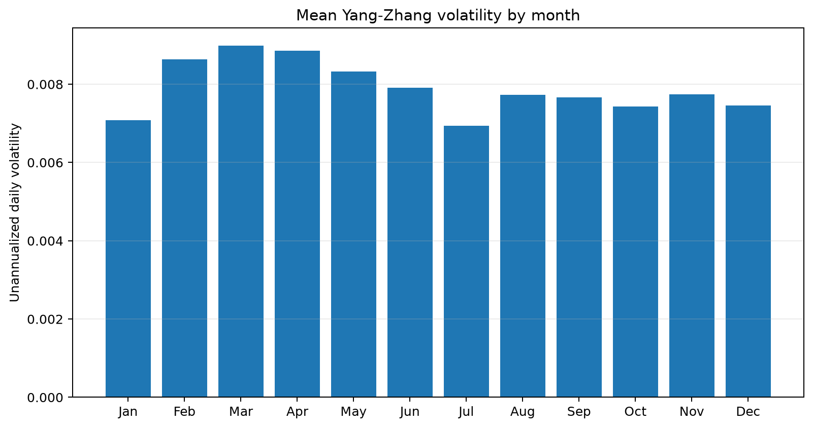
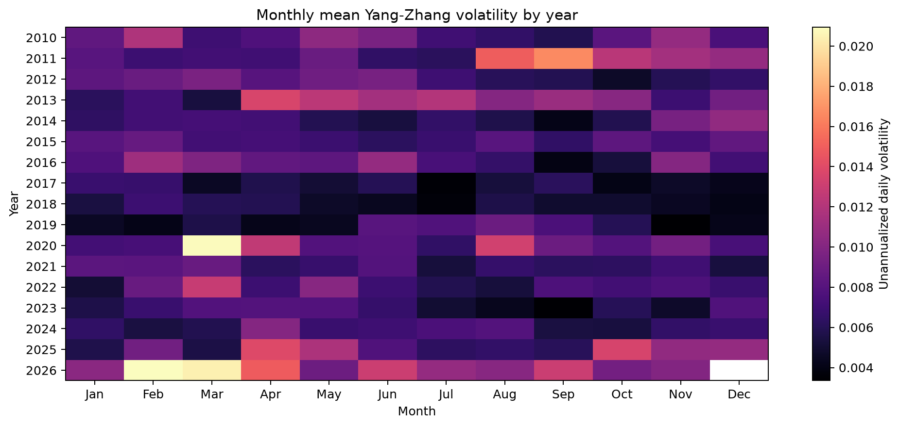
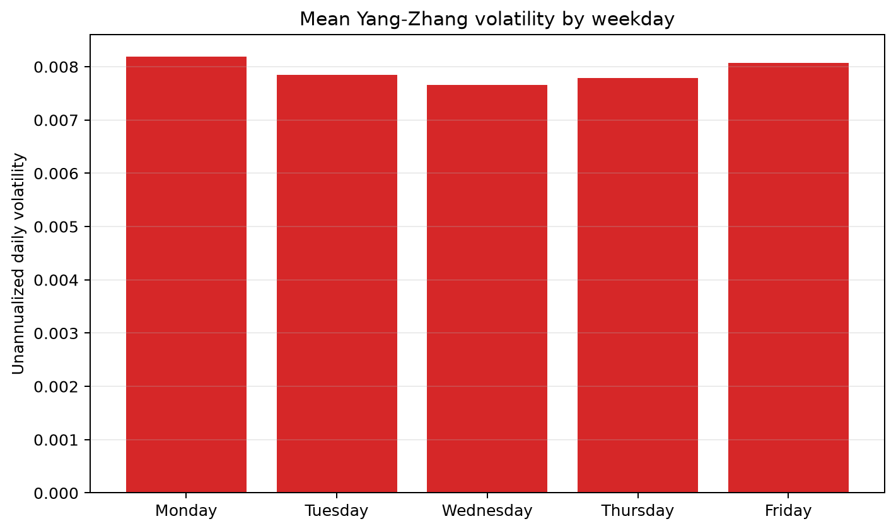

# Executive summary

This report checks calendar seasonality in the original LSEG/Refinitiv
`GCc1.csv` OHLC series, a generic COMEX gold futures series. It recomputes
the unannualized square root of the two-observation Yang-Zhang variance for
3,801 valid targets from 2010-01-06 to 2026-11-10.

The pooled monthly means rise from 0.00708 in January to 0.00899 in March,
with February and April also above 0.0086. July has the lowest mean,
0.00694. Weekday means range only from 0.00766 on Wednesday to 0.00819 on
Monday.

No weekday result rejects stable weekday effects after HAC adjustment.
Month-only fixed effects reject at 5 lags (p = 0.0122) but weaken as the HAC
lag increases: p = 0.0681 at 10 lags and p = 0.1225 at 20 lags. With the
previous valid volatility as a lag control, the p-values are 0.0359, 0.0605,
and 0.0876 at 5, 10, and 20 lags. Thus, the month pattern is descriptive and
suggestive, not robust under conservative dependence adjustment.

The unadjusted Kruskal-Wallis test strongly flags monthly distributions
(p < 0.0001), but it ignores serial dependence and overlapping target
windows. It should not be treated as confirmatory evidence.

# Data and method

The target uses:

$$
y_t=\sqrt{\max(0,\widehat{\sigma}_{YZ,t}^{\,2})},
$$

where $\widehat{\sigma}_{YZ,t}^{\,2}$ follows the project’s two-observation
overnight, open-to-close, and Rogers-Satchell Yang-Zhang construction.
Incomplete OHLC bars are not imputed. The source has 4,241 rows, 4,064
complete-OHLC rows, and 440 unavailable target observations.

Monthly and weekday summaries use pooled observations across the full sample,
2010-2026. Joint fixed-effect Wald tests compare:

$$
y_t=\alpha+\sum_{m=2}^{12}\gamma_m I(\text{month}=m)+u_t
$$

and the same specification with 1-4 weekday dummies, using Monday and January
as reference categories. Lag-adjusted specifications add
$y_{t-1}^{(\text{valid})}$. HAC standard errors use 5, 10, and 20 lags for
sensitivity.

Adjacent two-observation windows overlap, so serial dependence and the HAC
choice materially affect inference. The tests are exploratory rather than
calendar-trading recommendations.

# Monthly pattern

| Month | N | Mean | Median | 5th percentile | 95th percentile |
|---|---:|---:|---:|---:|---:|
| January | 299 | 0.007083 | 0.006410 | 0.002715 | 0.013411 |
| February | 323 | 0.008630 | 0.007564 | 0.003348 | 0.015834 |
| March | 320 | 0.008987 | 0.007200 | 0.002838 | 0.021686 |
| April | 345 | 0.008858 | 0.007614 | 0.003713 | 0.019545 |
| May | 274 | 0.008328 | 0.008068 | 0.003039 | 0.015292 |
| June | 350 | 0.007915 | 0.007145 | 0.003159 | 0.014832 |
| July | 318 | 0.006944 | 0.006260 | 0.002470 | 0.014016 |
| August | 370 | 0.007733 | 0.006744 | 0.003040 | 0.016583 |
| September | 261 | 0.007660 | 0.006352 | 0.002022 | 0.018516 |
| October | 327 | 0.007430 | 0.006395 | 0.002585 | 0.015206 |
| November | 282 | 0.007742 | 0.007225 | 0.002115 | 0.014797 |
| December | 332 | 0.007456 | 0.006792 | 0.002575 | 0.013263 |

The pooled monthly distribution is highest in March and lowest in July.
February-April are consistently above the annual pooled January-to-December
range, but the heatmap should be inspected before interpreting the pattern
as recurring.

# Weekday pattern

| Weekday | N | Mean | Median | 5th percentile | 95th percentile |
|---|---:|---:|---:|---:|---:|
| Monday | 716 | 0.008191 | 0.006967 | 0.002890 | 0.015805 |
| Tuesday | 783 | 0.007846 | 0.006901 | 0.002688 | 0.015015 |
| Wednesday | 776 | 0.007663 | 0.006865 | 0.002723 | 0.015585 |
| Thursday | 774 | 0.007785 | 0.006970 | 0.002830 | 0.016097 |
| Friday | 752 | 0.008069 | 0.007314 | 0.002787 | 0.015492 |

Weekday HAC p-values range from 0.0622 to 0.1067 without the lag and from
0.0622 to 0.0958 with the lag term. None is below 5%, and the descriptive
spread is modest. The Kruskal-Wallis p-value is 0.0601. There is no strong
evidence of a persistent within-week pattern.

# HAC sensitivity

| Calendar group | Specification | HAC lag | N | Wald statistic | p-value |
|---|---|---:|---:|---:|---:|
| Month | Month only | 5 | 3,801 | 24.139 | 0.0122 |
| Month | Month + lag | 5 | 3,800 | 20.764 | 0.0359 |
| Month | Month only | 10 | 3,801 | 18.628 | 0.0681 |
| Month | Month + lag | 10 | 3,800 | 19.031 | 0.0605 |
| Month | Month only | 20 | 3,801 | 16.533 | 0.1225 |
| Month | Month + lag | 20 | 3,800 | 17.750 | 0.0876 |
| Weekday | Weekday only | 5 | 3,801 | 7.616 | 0.1067 |
| Weekday | Weekday + lag | 5 | 3,800 | 8.954 | 0.0622 |
| Weekday | Weekday only | 10 | 3,801 | 7.669 | 0.1045 |
| Weekday | Weekday + lag | 10 | 3,800 | 8.498 | 0.0750 |
| Weekday | Weekday only | 20 | 3,801 | 7.887 | 0.0958 |
| Weekday | Weekday + lag | 20 | 3,800 | 8.461 | 0.0761 |

# Conclusions and next steps

The observed pattern is **month-sensitive, not conclusively seasonal**:
February-April and March in particular have higher pooled means, while
January and July are lower. The evidence is reduced after allowing 10-20
lags for serial dependence and disappears from the 5% significance threshold
in the most conservative reported specifications.

There is no robust weekday seasonality. Monday and Friday means are somewhat
higher than Tuesday-Thursday, but the joint weekday tests do not reject at 5%.

Before using calendar effects in forecasting, test month and weekday
dummies only after fitting and tuning on pre-2010 or earlier training periods,
validate on a later untouched period, and use block/bootstrap or
overlap-aware calendar regression standard errors. The present report is
descriptive and diagnostic, not a trading or model-selection claim.

The output is reproducible from `scripts/analyze_yang_zhang_seasonality.py`;
saved samples and source hash are in
`data/processed/yang_zhang_seasonality/manifest.json`.
