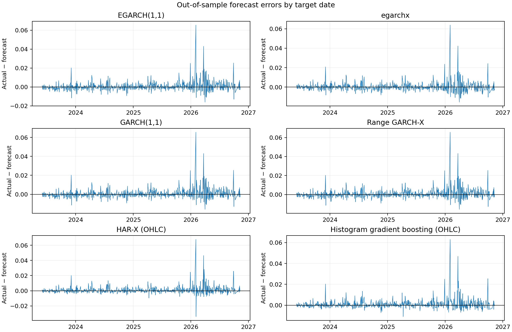
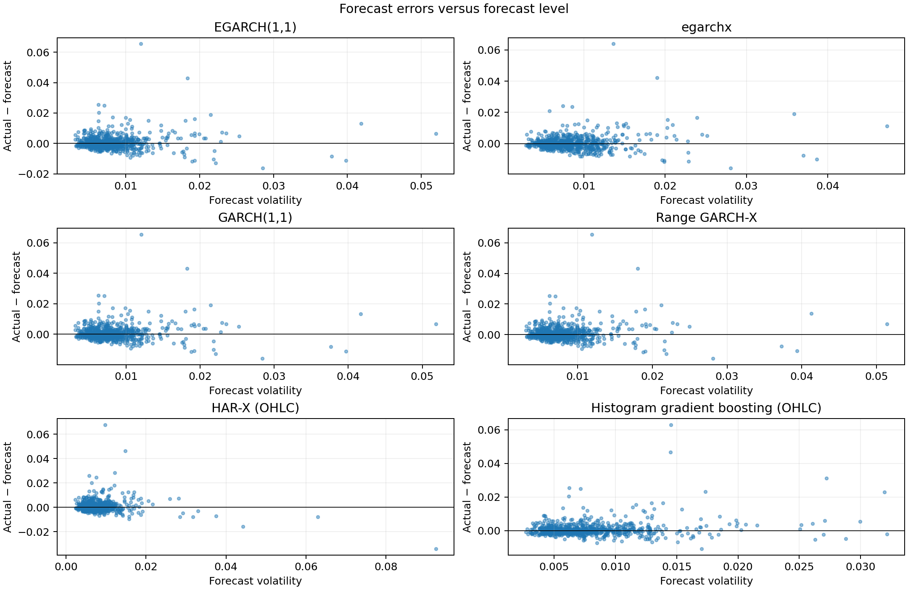
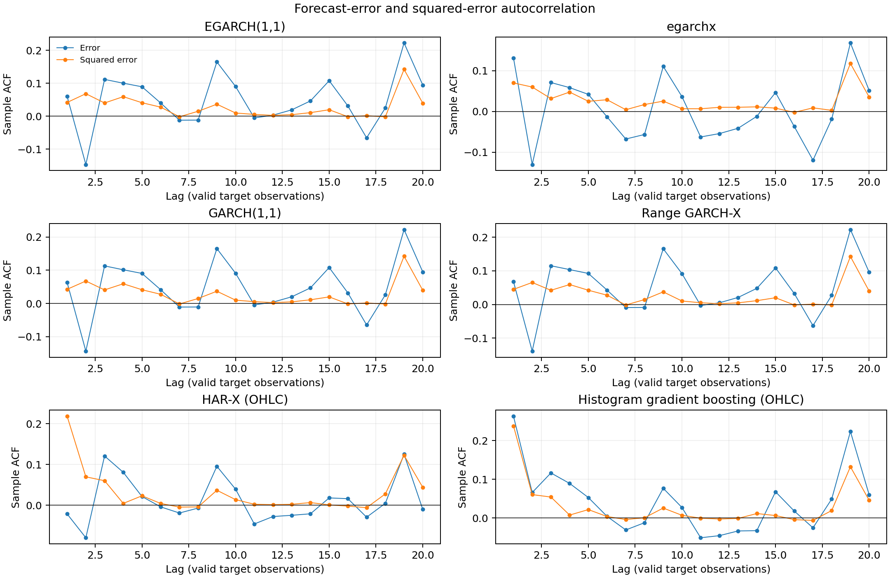
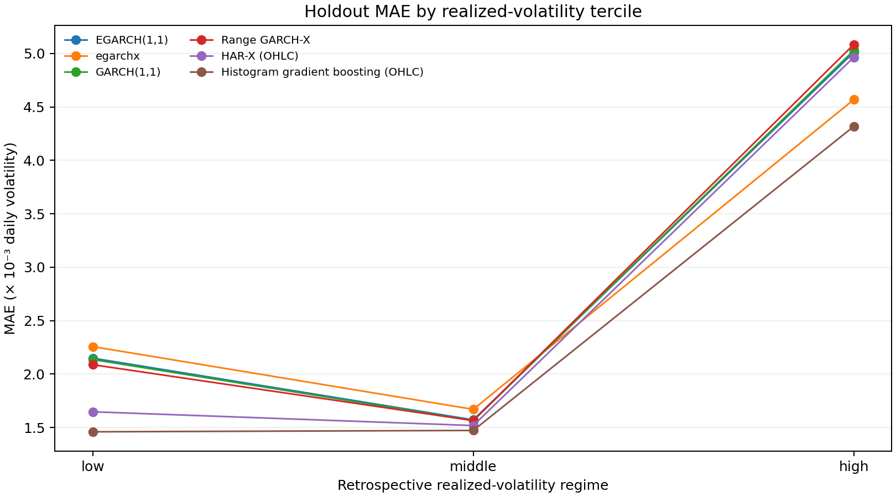

# Summary

This report compares six saved sequential one-step forecasts of unannualized
two-observation Yang–Zhang volatility for LSEG Workspace `GCc1`, a generic
COMEX gold-futures series: GARCH(1,1), EGARCH(1,1), range GARCH-X with the selected DXY and gold
implied-volatility predictors, HAR-X with OHLC predictors, EGARCH-X with the
same selected external predictors, and histogram gradient boosting with OHLC
predictors. GARCH(1,1), EGARCH(1,1), HAR-X and histogram gradient boosting
use the no-external-predictor Stage 2 run. All six share
761 successful test targets from 2023-06-02 through 2026-11-10, with no
recorded fit failures. In EGARCH-X, the selected predictors enter the ARX
conditional-mean equation and the innovation process is EGARCH(1,1).

Here, a **forecast residual** means the out-of-sample forecast error
$e_t=y_t-\widehat y_{t|t-1}$. Positive values mean under-forecasting. These
are not in-sample equation innovations or standardized GARCH residuals; the
saved forecast file does not contain per-origin fitted conditional variances
or innovations. The diagnostics therefore describe predictive errors, not
the adequacy of the fitted GARCH innovation distributions.

# Residual summaries

Mean residual, MAE, RMSE, median residual, and the 5th/95th percentiles are
shown in $10^{-3}$ unannualized daily-volatility units. Skewness and excess
kurtosis are dimensionless. Positive mean residuals indicate average
under-forecasting.

| Model | Mean | Median | MAE | RMSE | Skewness | Excess kurtosis |
|---|---:|---:|---:|---:|---:|---:|
| GARCH(1,1) | 0.644 | -0.010 | 2.912 | 5.025 | 4.42 | 46.04 |
| EGARCH(1,1) | 0.621 | -0.026 | 2.912 | 5.022 | 4.41 | 45.98 |
| EGARCH-X | 0.321 | -0.158 | 2.833 | 4.860 | 4.50 | 47.58 |
| Range GARCH-X | 0.716 | 0.057 | 2.914 | 5.037 | 4.43 | 46.05 |
| HAR-X (OHLC) | 0.854 | 0.129 | 2.711 | 5.091 | 4.55 | 55.35 |
| Histogram gradient boosting (OHLC) | 0.866 | 0.044 | 2.418 | 4.767 | 5.72 | 57.30 |

All six error distributions are strongly right-skewed and heavy-tailed.
Histogram gradient boosting has the lowest MAE and RMSE in this descriptive
comparison, while its mean error remains positive and its tail statistics are
the largest. EGARCH-X has lower MAE and RMSE than the three no-external-
predictor GARCH-family specifications, but this is not an isolated predictor
effect because its predictor set and model specification differ. These
descriptive differences are not evidence of statistical superiority or a
model-selection decision.

## Training-origin information criteria

The following AIC and BIC values are calculated from the initial training
sample at the forecast split, not from the out-of-sample residuals. GARCH,
EGARCH, and EGARCH-X use the native Gaussian likelihood from `arch`; HAR-X
uses a Gaussian OLS likelihood on the log-volatility target; and range GARCH-X
uses its custom constrained Gaussian quasi-likelihood. AIC and BIC are not
reported for histogram gradient boosting because it does not specify a
likelihood. Values are not directly comparable across different target
transformations or likelihood definitions.

| Model | Training n | Log likelihood | Parameters | AIC | BIC | Criterion |
|---|---:|---:|---:|---:|---:|---|
| GARCH(1,1) | 3040 | -640.878 | 5 | 1291.756 | 1321.852 | Native Gaussian likelihood |
| EGARCH(1,1) | 3040 | -637.314 | 6 | 1286.628 | 1322.744 | Native Gaussian likelihood |
| EGARCH-X | 3040 | -487.052 | 9 | 992.104 | 1046.277 | Native Gaussian likelihood |
| Range GARCH-X | 3039 | -3702.770 | 9 | 7423.540 | 7477.713 | Custom constrained Gaussian quasi-likelihood |
| HAR-X (OHLC) | 3018 | -1503.420 | 9 | 3024.841 | 3078.952 | Gaussian OLS on log-volatility |
| Histogram gradient boosting (OHLC) | — | — | — | — | — | No specified likelihood |

## Tests of zero mean residual

For each model, the two-sided one-sample t-test has null hypothesis
$H_0:\mathbb{E}[e_t]=0$ and alternative $H_A:\mathbb{E}[e_t]\ne0$.
The classical test treats observations as independent. Its p-values are
shown with Holm adjustments across the six models.

Because residual autocorrelation is detected below and the Yang–Zhang target
windows overlap, independence is doubtful. We therefore also report
Newey–West HAC tests of the same mean, using a Bartlett kernel and 10
observation lags, with p-values separately Holm-adjusted across the six
models. The HAC results are preferable to the classical t-test as a
dependence-aware check, but remain approximate for overlapping targets.

| Model | Classical t | t-test p | t-test Holm p | HAC p | HAC Holm p |
|---|---:|---:|---:|---:|---:|
| GARCH(1,1) | 3.562 | 0.000391 | 0.000882 | 0.002423 | 0.006394 |
| EGARCH(1,1) | 3.434 | 0.000626 | 0.001252 | 0.003248 | 0.008525 |
| EGARCH-X | 1.824 | 0.0686 | 0.0686 | 0.0967 | 0.0967 |
| Range GARCH-X | 3.961 | 0.0000818 | 0.000327 | 0.000852 | 0.003408 |
| HAR-X (OHLC) | 4.688 | 0.00000327 | 0.0000163 | 0.0000143 | 0.0000857 |
| Histogram gradient boosting (OHLC) | 5.095 | 0.000000441 | 0.00000265 | 0.000265 | 0.001324 |

Both procedures reject a zero mean for five of the six models at the 5% level
after the stated Holm adjustments. The estimated mean residuals are all
positive, indicating average under-forecasting in this holdout; EGARCH-X's
mean is not statistically distinguishable from zero under either adjustment.
The classical t-test
results should not be treated as reliable independent-sample inference; the
HAC tests also do not eliminate uncertainty from target overlap, lag choice,
extreme observations, or prior use of this holdout during model development.

# Serial dependence

The table gives unadjusted Ljung–Box p-values through lag 10 for residuals
and squared residuals. Lags count valid target observations, not calendar
days.

| Model | Residual p-value | Squared-residual p-value |
|---|---:|---:|
| GARCH(1,1) | < 0.00001 | 0.286 |
| EGARCH(1,1) | < 0.00001 | 0.287 |
| EGARCH-X | < 0.00001 | 0.368 |
| Range GARCH-X | < 0.00001 | 0.275 |
| HAR-X (OHLC) | 0.00078 | 0.000003 |
| Histogram gradient boosting (OHLC) | < 0.00001 | 0.0000004 |

The lag-10 results flag residual autocorrelation in all six models and
squared-residual autocorrelation for HAR-X and histogram gradient boosting.
These are exploratory, unadjusted tests: adjacent two-observation
Yang–Zhang targets overlap, which induces dependence, and the tests do not
account for multiple comparisons. Non-rejection for squared residuals in the
GARCH-family models does not prove that conditional heteroskedasticity is
absent.

# Large misses and volatility regimes

The largest absolute miss for each model occurs on 2026-02-02, when realized
Yang–Zhang volatility is 77.521 in $10^{-3}$ units. Residuals on that date
range from approximately 62.989 to 65.588 in the same units across these
models, indicating a substantial common under-forecast. These episodes are
retained rather than excluded post hoc.

The accompanying regime figure groups test targets into retrospective
realized-volatility terciles. These groups use outcomes unavailable at each
forecast origin and are descriptive only; they are not deployable regime
classifications.

# Reproducibility and limitations

The combined forecast input is
`data/processed/stage2_yz_diagnostics/model_residuals/stage2_yz_forecasts.csv`;
it contains four baseline rows from `data/processed/stage2_yz_forecasts.csv`,
EGARCH-X rows from `data/processed/stage2_yz_egarchx/`, and joint-predictor
range GARCH-X rows from `data/processed/stage2_yz_selected/`. The
selected-model diagnostic tables, information criteria, exact input hash, sample definition, and
regime cutoffs are written under
`data/processed/stage2_yz_diagnostics/model_residuals/`; figures are under
`reports/figures/model_residual_diagnostics/`. The underlying forecasts are
sequential one-step predictions after the chronological split, and their
Yang–Zhang targets overlap. This holdout was used in prior model development
and is not an untouched final evaluation sample.
