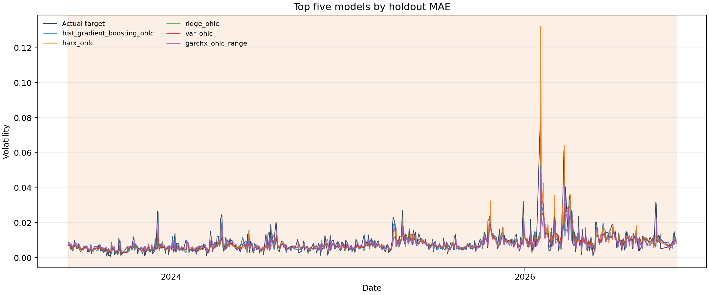
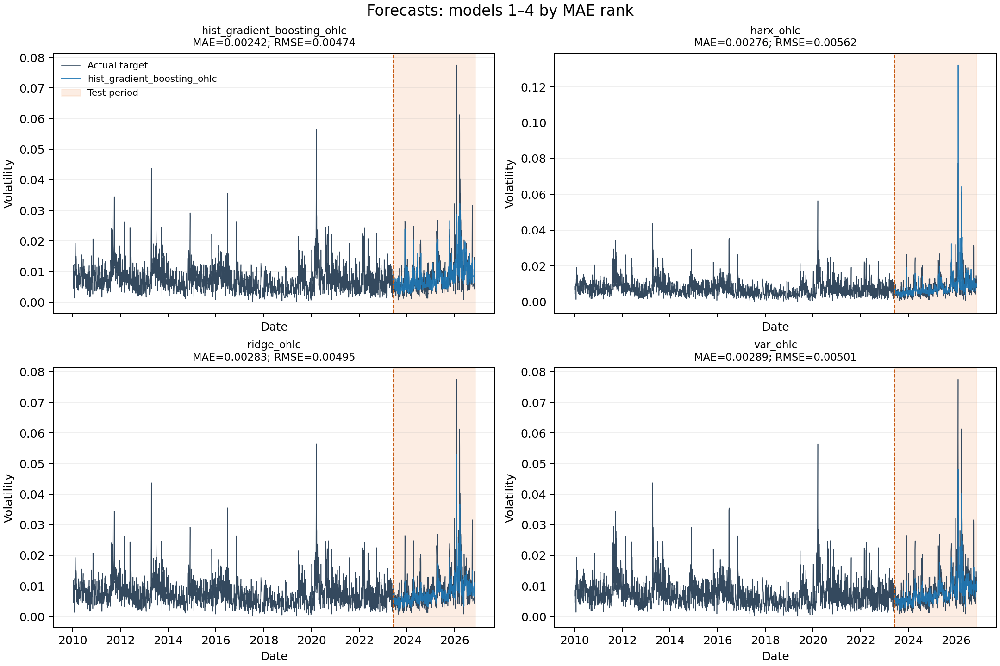
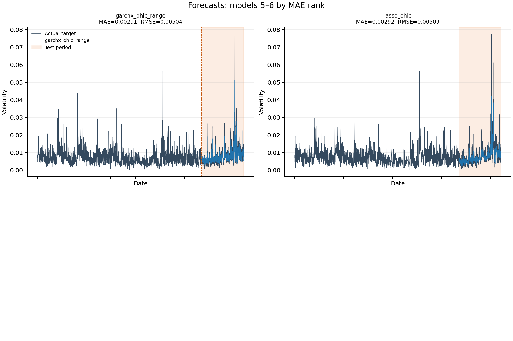
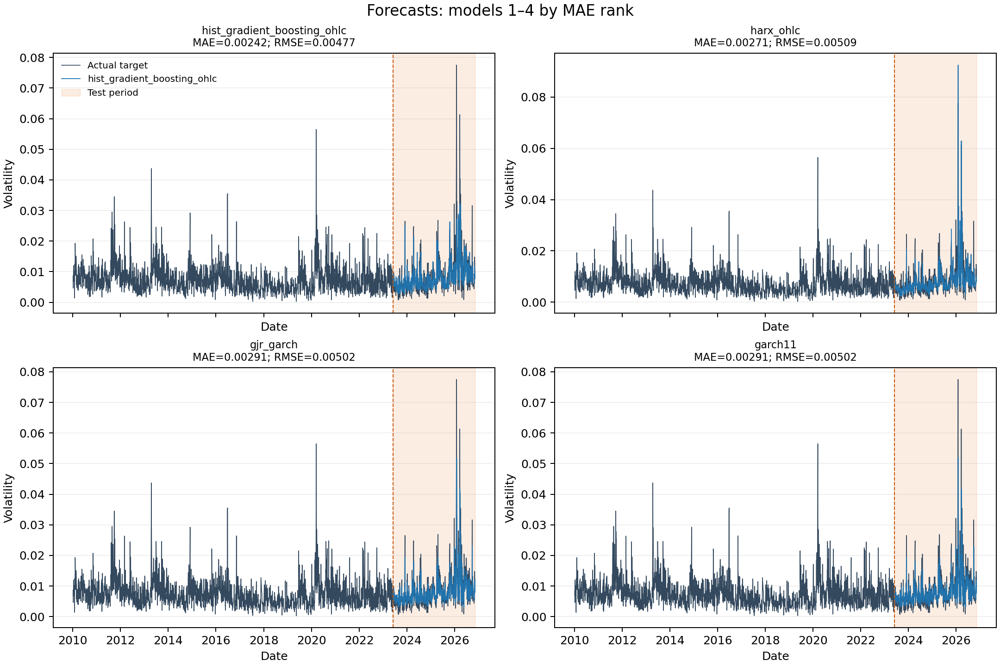
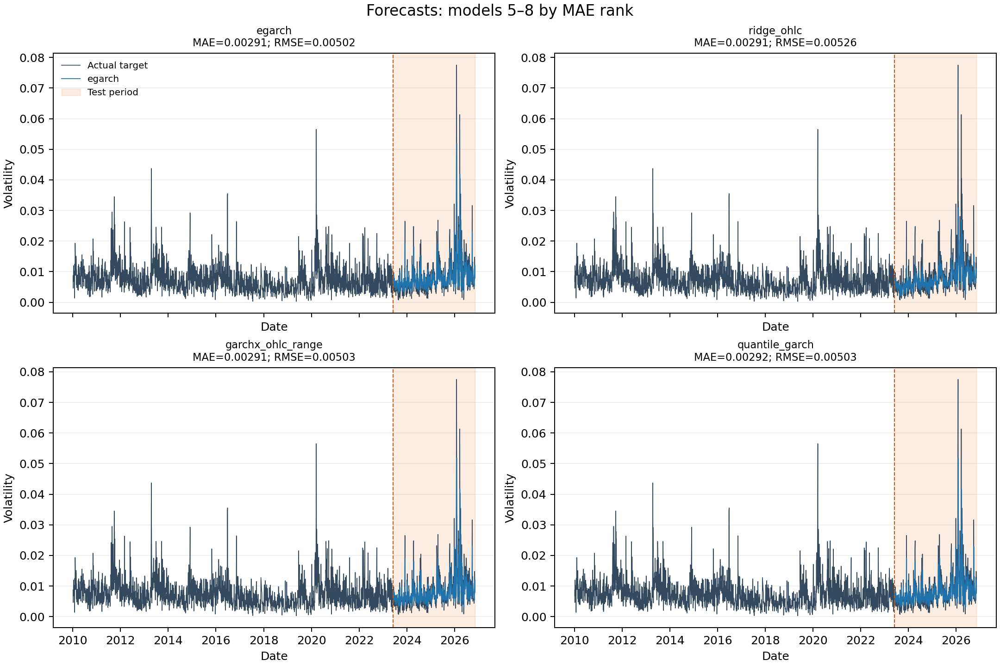
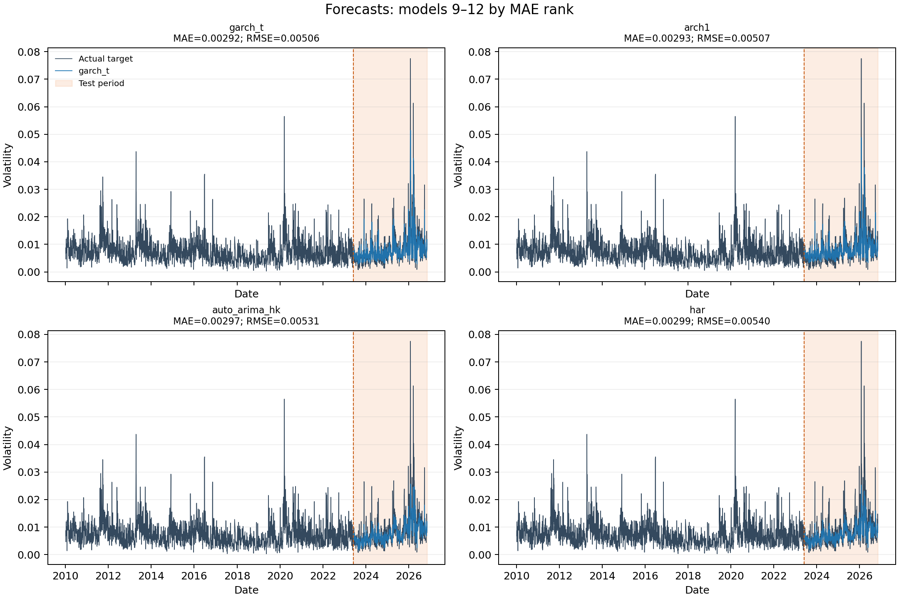
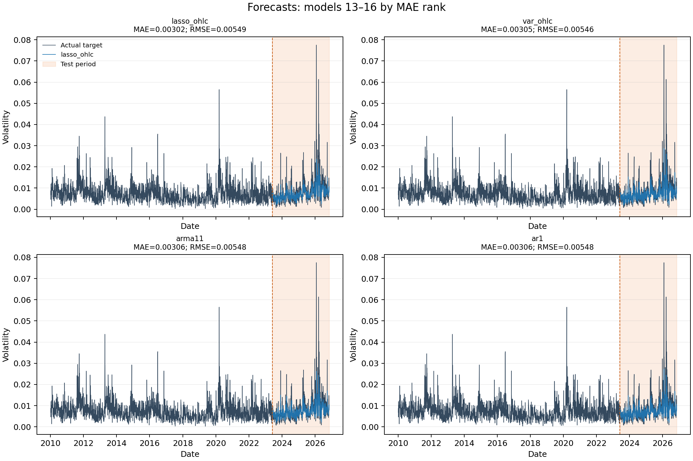

# Executive summary

This report compares six sequential one-step forecasts of unannualized daily
gold-futures volatility with and without three jointly added predictors.
The target is the square root of the two-observation
Yang–Zhang variance estimate calculated from LSEG Workspace `GCc1.csv` OHLC
bars. The chronological split contains 3,040 training targets and 761 test
targets, spanning 2023-06-02 through 2026-11-10. All six models produced
forecasts for all 761 test dates; the saved run records zero fit failures.

HistGradientBoosting with the three predictors has the smallest holdout MAE
(0.0024235) and RMSE (0.0047356) among the six. This is a descriptive
ranking, not a model-selection decision:
target windows overlap, forecast-comparison significance tests were not run, and
optimizer/convergence warnings occurred in some model fits.

# Data, target, and split

The source contains 4,241 dated rows, of which 4,064 have complete OHLC. No
prices are imputed. A target is unavailable whenever its required rolling
observations are incomplete. This leaves 3,801 targets. The source is a
generic COMEX gold futures series (`GCc1`), not spot gold or Yahoo `GC=F`.

Let $O_t,H_t,L_t,C_t$ denote open, high, low, and close. For each bar, define
the overnight and open-to-close log returns and the Rogers–Satchell term:

$$
r_{o,t}=\log\left(\frac{O_t}{C_{t-1}}\right),\qquad
r_{c,t}=\log\left(\frac{C_t}{O_t}\right),
$$

$$
RS_t =
\log\left(\frac{H_t}{O_t}\right)\log\left(\frac{H_t}{C_t}\right)
+\log\left(\frac{L_t}{O_t}\right)\log\left(\frac{L_t}{C_t}\right).
$$

For an endpoint $t$ and window size $n=2$, the two sample variances and
Rogers–Satchell average are

$$
s^2_{o,t}=\frac{1}{n-1}\sum_{j=t-n+1}^{t}(r_{o,j}-\bar r_{o,t})^2,\qquad
s^2_{c,t}=\frac{1}{n-1}\sum_{j=t-n+1}^{t}(r_{c,j}-\bar r_{c,t})^2,
$$

$$
\overline{RS}_t=\frac{1}{n}\sum_{j=t-n+1}^{t}RS_j,\qquad
k=\frac{0.34}{1.34+(n+1)/(n-1)}
=\frac{0.34}{4.34}\approx 0.078341.
$$

The target variance and daily volatility are

$$
\widehat{\sigma}_{YZ,t}^{\,2}
=s^2_{o,t}+k\,s^2_{c,t}+(1-k)\overline{RS}_t,\qquad
y_t=\widehat{\sigma}_{YZ,t}
=\sqrt{\max(0,\widehat{\sigma}_{YZ,t}^{\,2})}.
$$

The **Yang–Zhang estimator** is the variance expression
$\widehat{\sigma}_{YZ,t}^{\,2}$: it combines variation in overnight
open-to-previous-close returns, open-to-close returns, and the intraday
high–low range. The dependent variable forecast by the models is its square
root, $y_t$, so the forecasts and error metrics are on the **volatility**
scale, not the variance scale. Neither is annualized. This two-observation
estimate is a proxy for latent daily volatility, not directly observed
future variance and not a one-observation estimator. Adjacent windows
overlap and thus adjacent target values and losses are dependent.

If $N=3{,}801$ valid targets in chronological order, the split index is

$$
N_{\mathrm{train}}=\lfloor 0.8N\rfloor=3{,}040,\qquad
N_{\mathrm{test}}=N-N_{\mathrm{train}}=761.
$$

At each test origin $t$, each model uses the initial training observations
plus previously observed test targets, then forecasts the next valid target:

$$
\widehat y_{t+1|t}=f(y_1,\ldots,y_t,\mathbf{x}_1,\ldots,\mathbf{x}_t).
$$

The actual $y_{t+1}$ is not in its own forecast history. Because incomplete
OHLC windows have no target, successive test observations may be separated by
more than one market session.

The three external predictors are DXY close, gold 1M implied volatility and
gold 1Y implied volatility. Each source observation is treated as available
on the following weekday; the latest available value at each gold forecast
origin is carried forward, and source and availability dates are retained
in the prepared file. This proxy does not reconstruct actual publication
timestamps. Verify the units and option quote conventions with LSEG.


# Stage 1: Training-only predictor significance

The screen starts with 11 available LSEG predictors and the current
volatility control. For each variable, its variance inflation factor is
$\operatorname{VIF}_j=1/(1-R_j^2)$, where $R_j^2$ comes from regressing
that variable on the other active variables with an intercept. Using the
same complete training pairs throughout, the highest-VIF candidate is
removed and VIFs are recomputed until all active variables, including the
control, have VIF at most 5. The control is retained throughout; ties
follow the original candidate order.

| Removal order | Predictor | VIF at removal |
|---:|---|---:|
| 1 | Gold IV 6M | 310.57 |
| 2 | Gold IV 3M | 166.47 |
| 3 | Gold IV 2M | 72.23 |

The eight retained predictors are jointly tested in an OLS regression of
next valid Yang–Zhang volatility on current volatility and the predictors:

$$
y_{t+1}=a+\rho y_t+\sum_{j\in S}\beta_j x_{j,t}+\epsilon_{t+1},
\qquad |S|=8.
$$

Regressors are standardized on the 3,039 complete training pairs. The last
response is 2023-06-01; the held-out target period begins 2023-06-02. Each
predictor is aligned to the latest observation available by the origin under
the next-weekday proxy. Missing target labels mean a step may skip market
sessions. Individual $H_0:\beta_j=0$ tests use HAC(4) standard errors and
Holm correction across the eight retained predictor coefficients; the
volatility control is not included in the correction. Final VIFs include
the control and have a maximum of 4.31.

| Predictor | Final VIF | Coefficient per training SD | Raw p | Holm p |
|---|---:|---:|---:|---:|
| DXY close | 1.822 | -0.000227 | 0.003897 | 0.023384 |
| S&P 500 log return | 1.077 | -0.000050 | 0.629347 | 0.629347 |
| VIX close | 2.424 | 0.000167 | 0.276789 | 0.586758 |
| 10-year Treasury yield | 1.148 | 0.000083 | 0.188027 | 0.586758 |
| Gold IV 1M | 4.276 | 0.001193 | 4.92e-16 | 3.94e-15 |
| Gold IV 1Y | 4.310 | -0.000540 | 0.000197 | 0.001379 |
| Gold 1M risk reversal | 1.353 | 0.000106 | 0.146689 | 0.586758 |
| Gold 1M butterfly | 1.452 | 0.000152 | 0.033301 | 0.166503 |
| Current volatility control | 1.504 | — | — | — |

Gold IV 1M, gold IV 1Y and DXY are significant at 5% after Holm correction;
VIX is not. These are exploratory conditional associations following
data-dependent selection on the same training sample, not causal evidence
or proof of out-of-sample predictive value. VIF screening does not remove all
collinearity, and HAC(4) does not guarantee all dependence is captured.
The predictor screen was performed after earlier holdout results were
observed. Selection and this evaluation are therefore not a fully untouched
holdout experiment.

# Stage 2: Forecast models and formulas

The candidate formulas below include the six current models and other
baseline models from the earlier no-external-predictor comparison. The
current six models are re-estimated at each forecast origin; the earlier
auto-ARIMA order was selected once on its initial training sample.
For log-target models define

$$
z_t=\log(\max(y_t,10^{-12})),\qquad
\widehat y_{t+1|t}=\exp(\widehat z_{t+1|t}).
$$

## Benchmarks

### Yang–Zhang persistence

Yang–Zhang persistence forecasts the latest observed target:

$$
\widehat y_{t+1|t}=y_t.
$$

### Expanding mean

The expanding-mean forecast is

$$
\widehat y_{t+1|t}=\frac{1}{t}\sum_{i=1}^{t}y_i.
$$

### Exponentially weighted moving average (EWMA)

The exponentially weighted moving average uses $\lambda=0.94$:

$$
m_1=y_1,\qquad m_i=\lambda m_{i-1}+(1-\lambda)y_i,\qquad
\widehat y_{t+1|t}=m_t.
$$

## ARIMA family

The AR, MA, ARMA, and HK-selected models are fitted to $z_t$. Their common
nonseasonal ARIMA form is

$$
\phi(B)(1-B)^d z_t=c_t+\theta(B)\varepsilon_t,
$$

where $B$ is the backshift operator and $c_t$ follows the implementation's
trend convention.

### AR(1)

The autoregressive candidate uses $(p,d,q)=(1,0,0)$.

### MA(1)

The moving-average candidate uses $(p,d,q)=(0,0,1)$.

### ARMA(1,1)

The autoregressive moving-average candidate uses $(p,d,q)=(1,0,1)$.

### Hyndman–Khandakar auto-ARIMA

The Hyndman–Khandakar procedure selects
the differencing order using KPSS tests and performs a bounded stepwise AICc
search on the training sample. It selected $(p,d,q)=(1,1,3)$ for this run;
that order is held fixed during the test sequence, while coefficients are
refit at each origin.

For each candidate order with $K$ estimated parameters and $T$ observations,
the stepwise search compares the small-sample corrected Akaike criterion

$$
\operatorname{AICc}=\operatorname{AIC}
+\frac{2K(K+1)}{T-K-1}.
$$

## ARCH and GARCH family

These models fit an AR(1) conditional mean to $x_t=100y_t$:

$$
x_t=\mu+\varphi x_{t-1}+\epsilon_t,\qquad
\epsilon_t=\sigma_t u_t,\qquad E(u_t)=0,\quad E(u_t^2)=1.
$$

The one-step forecast is the fitted conditional mean divided by 100.

### ARCH(1)

ARCH(1) uses

$$
\sigma_t^2=\omega+\alpha_1\epsilon_{t-1}^2.
$$

### GARCH(1,1)

GARCH(1,1) uses

$$
\sigma_t^2=\omega+\alpha_1\epsilon_{t-1}^2+\beta_1\sigma_{t-1}^2.
$$

### GJR-GARCH

GJR-GARCH adds a negative-shock response:

$$
\sigma_t^2=\omega+\alpha_1\epsilon_{t-1}^2
+\gamma_1\epsilon_{t-1}^2\mathbb{1}(\epsilon_{t-1}<0)
+\beta_1\sigma_{t-1}^2.
$$

### EGARCH

EGARCH models log variance and allows signed shocks to have an asymmetric
effect:

$$
\log\sigma_t^2=\omega+\beta_1\log\sigma_{t-1}^2
+\alpha_1\left(|u_{t-1}|-E|u_{t-1}|\right)+\gamma_1u_{t-1}.
$$

### Student-t GARCH

Student-t GARCH has the same GARCH(1,1) conditional-variance equation, with
$u_t$ following a standardized Student-t rather than a Gaussian distribution.

## Range-augmented and threshold conditional-variance models

The two custom models fit an AR(1) mean directly to $y_t$, with residuals
scaled by $s=\operatorname{sd}(\Delta y_t)$:

$$
e_t=\frac{y_t-a-\phi y_{t-1}}{s},\qquad
h_t=\omega+\alpha e_{t-1}^2+\beta h_{t-1}+g_t.
$$

### GARCH-X with OHLC range and the three predictors

Let $R_t=\log(H_t/L_t)$ and $\widetilde R_t=R_t/\overline R$ within the
current fit sample. Let $\widetilde x_{j,t}=x_{j,t}/\overline{x}_j$ denote
each selected predictor divided by its fit-sample mean. The extra variance
term is

$$
g_t=\delta\widetilde R_{t-1}+\sum_{j=1}^{3}\xi_j\widetilde x_{j,t-1}.
$$

### Threshold (quantile) GARCH

For the threshold-GARCH candidate, let
$q_{.95}$ be the 95th percentile of absolute scaled first differences
$|\Delta y_t|/s$ in the fit sample. Its extra variance term compares the
previous AR residual with that threshold:

$$
g_t=\eta e_{t-1}^2\mathbb{1}(|e_{t-1}|>q_{.95}).
$$

Both use the Gaussian quasi-likelihood objective (up to an additive
constant)

$$
\mathcal L=\frac12\sum_t\left(\log h_t+\frac{e_t^2}{h_t}\right).
$$

Parameters satisfy $\omega>0$, $\alpha,\beta,\delta,\xi_j,\eta\geq0$; for GARCH-X
$\alpha+\beta\leq0.999$, and for threshold-GARCH
$\alpha+\beta+\eta\leq0.999$ (subject to numerical tolerance).

The one-step point forecast from either custom model is the fitted AR(1)
conditional mean, $\widehat y_{t+1|t}=\widehat a+\widehat\phi y_t$; the
variance recursion is used for fitting, not substituted for the volatility
target.

## HAR, regularized regression, and tree model

The HAR feature vector uses current log volatility, its trailing five-target
mean, and its trailing 22-target mean:

$$
\mathbf h_t=
\left[
z_t,\ 
\frac{1}{5}\sum_{j=0}^{4}z_{t-j},\
\frac{1}{22}\sum_{j=0}^{21}z_{t-j}
\right]^\mathsf T.
$$

The five- and 22-observation averages, $h_5$ and $h_{22}$, approximate
weekly and monthly volatility components and represent persistence at
different horizons. They are conventional HAR features, not a claim that
either term is statistically significant in this sample. Because missing
targets are skipped, these are averages over valid observations rather than
necessarily five or 22 consecutive market sessions.

### HAR

HAR regresses $z_{t+1}$ on an intercept and $\mathbf h_t$.

### HARX with OHLC and the three predictors

HARX appends the four origin-known OHLC-derived predictors and the
three selected predictors $D_t,I_{1m,t},I_{1y,t}$:

$$
\mathbf x_t=
\left[
r^{cc}_t,\ r_{o,t},\ r_{c,t},\ \log(H_t/L_t),\
D_t,\ I_{1m,t},\ I_{1y,t}
\right]^\mathsf T,
\qquad
z_{t+1}=b_0+\mathbf b_h^\mathsf T\mathbf h_t
+\mathbf b_x^\mathsf T\mathbf x_t+\epsilon_{t+1}.
$$

### Ridge with OHLC and the three predictors

Ridge uses the HARX features and log-volatility response. Its coefficients
minimize

$$
\sum_i(z_{i+1}-b_0-\mathbf b^\mathsf T\mathbf v_i)^2
+\alpha\|\mathbf b\|_2^2,\quad \alpha=1,
$$

### Lasso with OHLC and the three predictors

Lasso uses the same features and minimizes

$$
\frac{1}{2m}\sum_i(z_{i+1}-b_0-\mathbf b^\mathsf T\mathbf v_i)^2
+\alpha\|\mathbf b\|_1,\quad \alpha=0.01.
$$

Features are not standardized, so the regularization penalty is sensitive to
their units, including the DXY and implied-volatility quote units.

### Histogram gradient boosting with OHLC and the three predictors

The histogram gradient-boosting regressor uses the same HARX features and
target and forms an additive tree prediction:

$$
\widehat z_{t+1|t}=F_M(\mathbf v_t)
=F_0(\mathbf v_t)+\sum_{m=1}^{M}\nu T_m(\mathbf v_t).
$$

The configured learning rate is $\nu=0.05$, maximum iterations $M=100$,
maximum leaf nodes per tree is 15, and random seed is 42.

## VAR

### VAR(1) with the three predictors

The model named `var_ohlc` in the output is implemented as a VAR(1) in log
volatility, close-to-close log return, and the three selected predictors; it
does not include the other OHLC features:

$$
\mathbf w_t=
\begin{bmatrix}z_t\\r^{cc}_t\\D_t\\I_{1m,t}\\I_{1y,t}\end{bmatrix},\qquad
\mathbf w_t=\mathbf c+A_1\mathbf w_{t-1}+\boldsymbol\varepsilon_t.
$$

The first component of the one-step forecast is exponentiated to return to
the daily-volatility scale.

# Evaluation and model comparison

For actual targets $y_i$ and forecasts $\widehat y_i$, the reported errors
are

$$
\operatorname{MAE}=\frac1m\sum_{i=1}^{m}|\widehat y_i-y_i|,\qquad
\operatorname{RMSE}=
\sqrt{\frac1m\sum_{i=1}^{m}(\widehat y_i-y_i)^2}.
$$

All six models share 761 successful test dates, matching the original
no-external-predictor baseline. The table shows descriptive errors before
and after adding DXY, gold IV 1M and gold IV 1Y together; smaller is better.
The baseline already includes the original OHLC-derived inputs.

| Model | Baseline MAE | Joint MAE | Baseline RMSE | Joint RMSE |
|---|---:|---:|---:|---:|
| HARX | 0.0027112 | 0.0027579 | 0.0050913 | 0.0056250 |
| Ridge | 0.0029126 | 0.0028301 | 0.0052572 | 0.0049478 |
| Lasso | 0.0030210 | 0.0029199 | 0.0054931 | 0.0050886 |
| Histogram gradient boosting | 0.0024176 | 0.0024235 | 0.0047672 | 0.0047356 |
| Range GARCH-X | 0.0029138 | 0.0029136 | 0.0050293 | 0.0050372 |
| VAR | 0.0030520 | 0.0028863 | 0.0054574 | 0.0050055 |

Ridge, Lasso and VAR improve on both metrics; HARX worsens on both.
Gradient boosting and GARCH-X have mixed changes. These are joint,
descriptive changes, not separate predictor effects or tests of statistical
significance. The GARCH-X point forecast is its conditional mean; its
predictor terms enter the variance recursion and affect the fitted mean
indirectly.

## Drift, retransformation, and variance-loss experiments

The existing sequential expanding-history forecasts remain the baseline. The
optional experiment below compares shorter rolling histories, a past-error
bias correction, HGB log-target smearing, and HGB Gamma loss without replacing
or overwriting the baseline artifacts:

```bash
OPENBLAS_NUM_THREADS=1 OMP_NUM_THREADS=1 PYTHONPATH=src \
  python scripts/evaluate_yang_zhang_volatility.py --predictor-dir data/refinitiv \
  --external-models-only --rolling-windows 252,504,756 --bias-window 252 \
  --hgb-transform-experiments \
  --output-dir data/processed/stage2_yz_diagnostics
```

Rolling windows are counts of valid target observations, and each variant
still refits at every origin. The additive correction uses only prior
sequential holdout errors (actual minus forecast), with a positive floor on
the adjusted forecast; the first forecast has no prior error and is unchanged.
HGB smearing uses the mean exponentiated in-sample log-target residual within
each training window. HGB Gamma loss instead fits raw positive volatility and
is a separate alternative. These are exploratory variants, not assumed
improvements.

The summary adds QLIKE computed on variance proxies $y_t^2$ and
$\widehat y_t^2$ as
$r_t-\log(r_t)-1$, where $r_t=y_t^2/\widehat y_t^2$; a tiny positive floor is
used if an actual target is zero. It also reports MAE and forecast-minus-actual
bias within low, middle, and high retrospective actual-volatility terciles on
the common successful dates. Those terciles use realized outcomes and are
diagnostic only, not forecast-time information. The log-target approach does
not require constant variance in raw forecast errors.

All 32 baseline and experimental candidates produced forecasts for the same
761 origins with zero recorded failures. The table compares HGB transforms and
calibration with the expanding-history HGB baseline; errors and high-tercile
MAE are in $10^{-3}$ daily-volatility units.

| HGB specification | MAE | RMSE | Mean forecast − actual | QLIKE | High-tercile MAE |
|---|---:|---:|---:|---:|---:|
| Expanding-history log target | 2.423 | 4.736 | −0.821 | 0.4514 | 4.273 |
| Log target + smearing | 2.432 | 4.652 | −0.400 | 0.4105 | 4.008 |
| Raw target + Gamma loss | 2.455 | 4.701 | −0.408 | 0.3991 | 4.028 |
| Expanding HGB + 252-origin bias correction | 2.489 | 4.667 | −0.184 | 0.3956 | 3.922 |
| 252-target rolling log target | 2.907 | 5.277 | −0.714 | 0.5919 | 5.042 |
| 504-target rolling log target | 2.751 | 5.163 | −0.811 | 0.5669 | 4.777 |
| 756-target rolling log target | 2.683 | 5.131 | −0.783 | 0.5558 | 4.692 |

The 252-origin correction reduced HGB's mean forecast-minus-actual error in
magnitude, but its MAE rose. Smearing and Gamma loss lowered RMSE and QLIKE
while slightly raising MAE. None of the rolling-window variants beat the
expanding HGB baseline on overall MAE or RMSE. The smearing, Gamma, and
bias-corrected variants have lower high-tercile MAE than baseline but higher
low-tercile MAE; rolling-window high-tercile results vary by window length.
These are descriptive results from the same previously examined holdout, not
independent confirmation, forecast-loss significance tests, or a
model-selection decision.

### Forecast-error mean and variance-scaling tests

Using the saved 32 candidates and their 761 common successful holdout dates,
define $e_t=y_t-\widehat y_t$. An intercept-only regression tests zero
unconditional mean error using HAC(10) standard errors. As a *specific*
variance-scaling diagnostic, regress $(e_t-\overline e)^2$ on the forecast
and test a zero slope with HAC(10) standard errors. The test detects a linear
relationship in centered squared errors with forecast levels; it is not an
omnibus test for all forms of heteroskedasticity, and a changing conditional
mean can also affect the squared-error slope. Both use two-sided $t$
references and separate Holm corrections across all 32 models within each
test family.

| Model | Mean $e_t$ ($10^{-3}$) | Mean Holm p | Squared-error slope Holm p |
|---|---:|---:|---:|
| HARX | 0.623 | 0.0207 | 0.0740 |
| Ridge | 0.832 | 0.0015 | 0.0116 |
| Lasso | 0.898 | 0.0012 | 0.0048 |
| HGB baseline | 0.821 | 0.0081 | 0.0885 |
| Range GARCH-X | 0.716 | 0.0162 | 0.0018 |
| VAR | 0.840 | 0.0010 | 0.0116 |
| HGB + smearing | 0.400 | 0.5233 | 0.0885 |
| HGB + Gamma loss | 0.408 | 0.5233 | 0.0885 |
| HGB + 252-origin bias correction | 0.184 | 1.0000 | 0.0885 |

At the 5% adjusted level, all six baseline models reject zero mean error.
HGB with smearing, Gamma loss, and rolling bias correction does not reject
zero mean error, but this does not prove unbiasedness or that bias reduction
is statistically significant. The squared-error slope is positive for all
32 candidates and significant for 21 after Holm correction, including four
of the six baselines. The HGB and HARX baseline slope tests do not reject at
5% after correction; this does not establish constant variance. Before Holm
adjustment, all 32 slopes have $p<0.05$.

Sensitivity checks using HAC lags 4 and 20 yield 20 and 19 mean rejections,
and 20 and 28 slope rejections, respectively. In particular, range GARCH-X's
mean adjusted $p$ is 0.0502 at lag 20, and HGB's slope adjusted $p$ is 0.0510.
The targets overlap, forecast errors are serially dependent, and large
outliers, model selection on this holdout, choice of HAC lag, and approximate
finite-sample inference limit the conclusions. The tests do not compare
differences in bias across models and do not imply that raw forecast errors
must have constant variance.

Reproduce the tests with:

```bash
PYTHONPATH=src python scripts/diagnose_yang_zhang_forecast_errors.py
```

The script saves full adjusted and unadjusted results and an input-hash
manifest under `data/processed/stage2_yz_diagnostics/error_tests/`. Pass
`--hac-lags 4` or `--hac-lags 20` and a distinct `--output-dir` to reproduce
the sensitivity checks.

### Sequential empirical error-distribution calibration

This separate experiment post-processes the six expanding-history forecasts;
it does not alter their fitted in-sample residuals or assume normally
distributed errors. At each origin, the previous 252 available sequential
forecasts for that model provide relative errors
$r_i=(y_i-\widehat y_i)/\widehat y_i$. Their sample mean $\overline r_t$
and sample standard deviation $s_{r,t}$ are computed strictly before the
current target is observed:

$$
\widetilde y_t=\widehat y_t(1+\overline r_t),\qquad
\widehat s_t=\widehat y_t\,s_{r,t},\qquad
z_t=(y_t-\widetilde y_t)/\widehat s_t.
$$

The nominal 90% interval uses the 5th and 95th percentiles of those past
relative errors, multiplied by the current baseline forecast:
$[\widehat y_t(1+q_{.05,t}),\widehat y_t(1+q_{.95,t})]$.
This assumes the past relative-error distribution and forecast-proportional
scale are useful for the next origin. The first 252 forecasts are warm-up;
the comparison below uses the remaining 509 common target dates, from
2024-07-12 to 2026-11-10, without fitting to their current or future errors.

| Model | Baseline mean error | Calibrated mean error | Baseline MAE | Calibrated MAE | 90% interval coverage |
|---|---:|---:|---:|---:|---:|
| HARX | 0.688 | −0.301 | 3.196 | 3.374 | 89.2% |
| Ridge | 0.975 | −0.013 | 3.227 | 3.277 | 89.4% |
| Lasso | 1.071 | 0.024 | 3.342 | 3.379 | 88.8% |
| HGB | 1.016 | 0.077 | 2.839 | 2.918 | 88.6% |
| Range GARCH-X | 1.225 | 0.297 | 3.321 | 3.270 | 87.6% |
| VAR | 0.989 | −0.048 | 3.296 | 3.341 | 89.0% |

Errors and MAE are in $10^{-3}$ daily-volatility units, with error defined
as actual minus forecast. All six calibrated raw-error means fail to reject
zero using HAC(10) with Holm adjustment over the 12 baseline and calibrated
models; this does not prove unbiasedness or establish a significant
improvement. MAE increases for five models, and the HARX RMSE also increases.
The estimated interval coverage is descriptive, not a guarantee of
conditional or future coverage.

All six calibrated **raw** squared-error slopes versus the calibrated
forecast still reject zero after Holm correction, so the intervention has
not made raw errors homoskedastic. When errors are standardized by the
forecast-relative scale, none of six targeted squared-error slope tests
versus the baseline forecast rejects after separate Holm adjustment; this is
not proof that standardized errors have constant conditional variance. The
standardized mean for range GARCH-X remains significant (adjusted $p=0.031$).
The standardized distributions remain right-skewed and heavy-tailed: for HGB,
sample skewness is 3.65 and excess kurtosis is 23.13. Ljung–Box results in
the output are descriptive and unadjusted; overlapping targets and estimated
scales complicate their null calibration. No distributional or variance
assumption is established by failure to reject these tests. The holdout has
already informed model exploration, so a later independent period is needed.

Reproduce the separate post-processing experiment after generating the
saved baseline forecasts:

```bash
PYTHONPATH=src python scripts/evaluate_empirical_error_model.py
```

The local output contains date-level calibrated forecasts, standardized
errors and intervals, a distribution/coverage summary, HAC/Holm test results
and an input-hash manifest. It is not a replacement for the existing model
forecasts or a team model-selection decision.



# Forecast graphs

Each panel below plots the observed target and its sequential one-step
forecasts. The orange shaded area is the test period; forecasts are shown
only there. All panels use the same time axis to show the training history
and holdout together.





## Original 20-model baseline

The earlier no-external-predictor run contains 20 model candidates on the
same 761 test dates; it remains a separate baseline, not a 20-model rerun
with the three new predictors. The following panels preserve the forecasts
for all 20 original models.










# Interpretation and limitations

- HistGradientBoosting ranks first among the six on both metrics in this run; this does not
  establish that it is statistically superior or the team's preferred model.
- The two-observation estimator is the user-selected minimum valid window.
  Its adjacent targets overlap, increasing serial dependence in the target
  and forecast losses.
- The result depends on the LSEG `GCc1` continuous-futures series and does not
  transfer directly to spot gold, a fixed-expiry contract, or the legacy Yahoo
  `GC=F` realized-variance results.
- Incomplete OHLC rows are not filled; some consecutive valid targets skip
  market sessions.
- The fit log contained optimizer/convergence warnings even though all six
  candidates have finite forecasts at all test dates. Successful forecasts
  do not prove global optimizer convergence or model adequacy.
- No forecast-comparison significance tests or uncertainty intervals were
  computed. Confirm LSEG data-use permissions before redistributing source
  observations.
- These predictors were chosen after earlier holdout results were observed;
  this compromises a strictly untouched holdout interpretation.

# Reproduction and artifacts

From the repository root, regenerate the forecast figures and render this
report:

```bash
python scripts/plot_yang_zhang_report.py \
  --processed-dir data/processed/stage2_yz_selected \
  --output-dir reports/figures/stage2_yz_selected
quarto render reports/yang-zhang-volatility.qmd
```

The forecast experiment is reproduced separately with:

```bash
OPENBLAS_NUM_THREADS=1 OMP_NUM_THREADS=1 PYTHONPATH=src \
  python scripts/evaluate_yang_zhang_volatility.py --predictor-dir data/refinitiv \
  --external-models-only --output-dir data/processed/stage2_yz_selected
PYTHONPATH=src python scripts/compare_selected_predictors.py
```

The predictor screen is reproduced with:

```bash
PYTHONPATH=src python scripts/screen_yang_zhang_predictors.py
```

The report uses the prepared target, forecasts, summary, and manifest in
`data/processed/stage2_yz_selected/`. The manifest records input SHA-256
hashes, the estimator window, split, model list, and fit-failure counts.
The numerical results in this report are a snapshot of this run; after any
new experiment, update the results text and table from its saved summary
before rendering.
