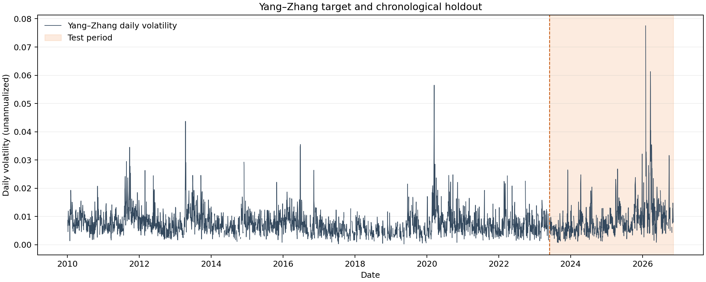
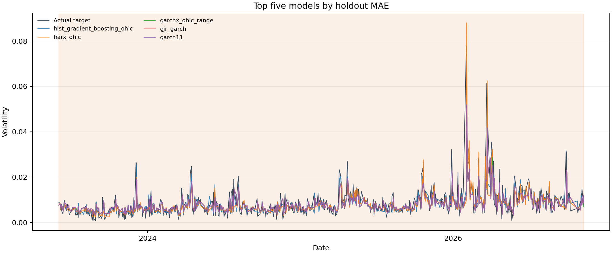
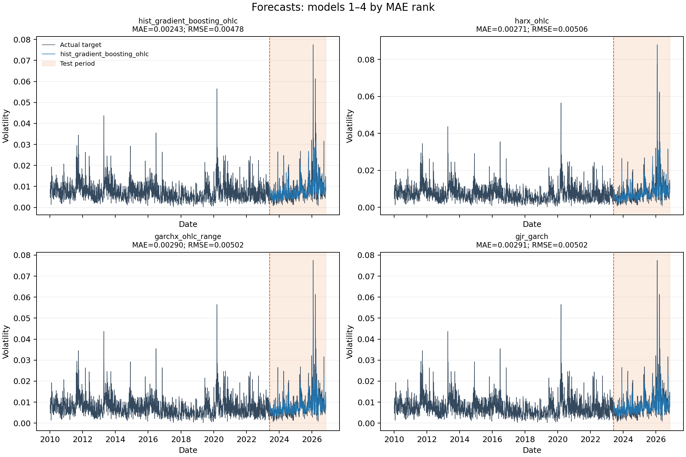
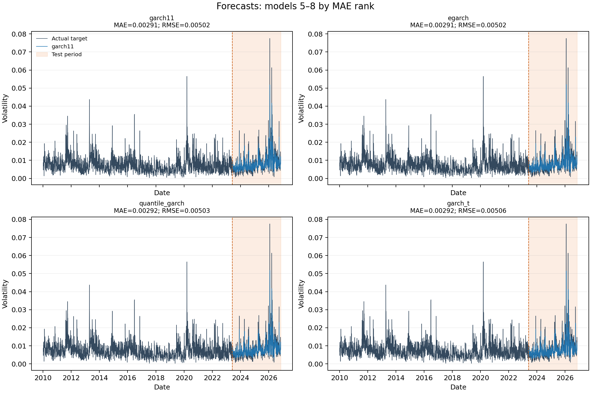
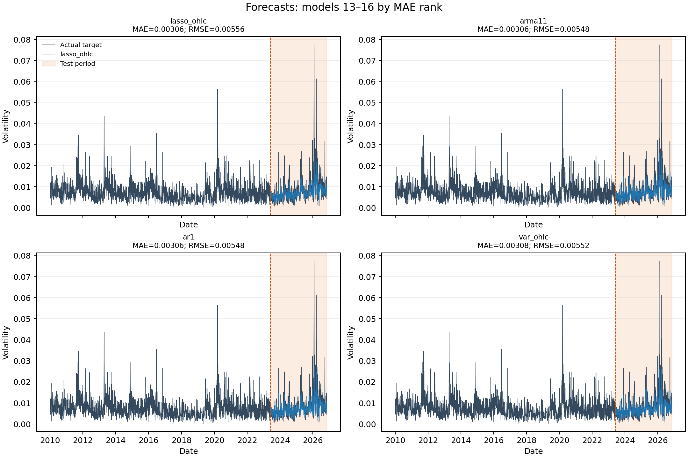
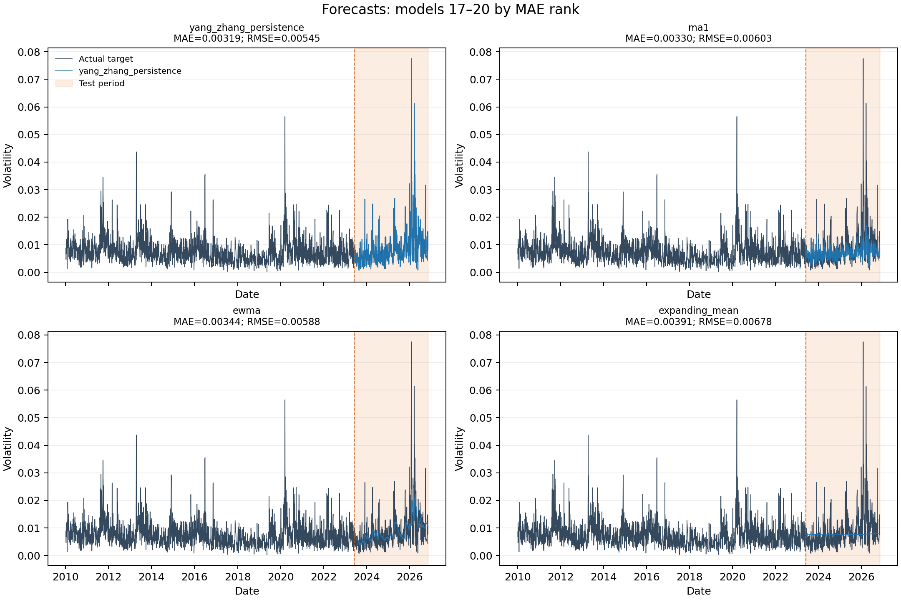

# Executive summary

This report compares 20 sequential one-step forecasts of unannualized daily
gold-futures volatility. The target is the square root of the two-observation
Yang–Zhang variance estimate calculated from LSEG Workspace `GCc1.csv` OHLC
bars. The chronological split contains 3,040 training targets and 761 test
targets, spanning 2023-06-02 through 2026-11-10. All candidates produced
forecasts for all 761 test dates; the saved run records zero fit failures.

HistGradientBoosting with VIX has the smallest holdout MAE (0.0024264) and RMSE
(0.0047809). This is a descriptive ranking, not a model-selection decision:
target windows overlap, statistical significance tests were not run, and
optimizer/convergence warnings occurred in some model fits.

# Data, target, and split

The source contains 4,241 dated rows, of which 4,064 have complete OHLC. No
prices are imputed. A target is unavailable whenever its required rolling
observations are incomplete. This leaves 3,801 targets. The source is a
generic COMEX gold futures series (`GCc1`), not spot gold or Yahoo `GC=F`.

Let $O_t,H_t,L_t,C_t$ denote open, high, low, and close. For each bar, define
the overnight and open-to-close log returns and the Rogers–Satchell term:

$$
r_{o,t}=\log\left(\frac{O_t}{C_{t-1}}\right),\qquad
r_{c,t}=\log\left(\frac{C_t}{O_t}\right),
$$

$$
RS_t =
\log\left(\frac{H_t}{O_t}\right)\log\left(\frac{H_t}{C_t}\right)
+\log\left(\frac{L_t}{O_t}\right)\log\left(\frac{L_t}{C_t}\right).
$$

For an endpoint $t$ and window size $n=2$, the two sample variances and
Rogers–Satchell average are

$$
s^2_{o,t}=\frac{1}{n-1}\sum_{j=t-n+1}^{t}(r_{o,j}-\bar r_{o,t})^2,\qquad
s^2_{c,t}=\frac{1}{n-1}\sum_{j=t-n+1}^{t}(r_{c,j}-\bar r_{c,t})^2,
$$

$$
\overline{RS}_t=\frac{1}{n}\sum_{j=t-n+1}^{t}RS_j,\qquad
k=\frac{0.34}{1.34+(n+1)/(n-1)}
=\frac{0.34}{4.34}\approx 0.078341.
$$

The target variance and daily volatility are

$$
\widehat{\sigma}_{YZ,t}^{\,2}
=s^2_{o,t}+k\,s^2_{c,t}+(1-k)\overline{RS}_t,\qquad
y_t=\widehat{\sigma}_{YZ,t}
=\sqrt{\max(0,\widehat{\sigma}_{YZ,t}^{\,2})}.
$$

The **Yang–Zhang estimator** is the variance expression
$\widehat{\sigma}_{YZ,t}^{\,2}$: it combines variation in overnight
open-to-previous-close returns, open-to-close returns, and the intraday
high–low range. The dependent variable forecast by the models is its square
root, $y_t$, so the forecasts and error metrics are on the **volatility**
scale, not the variance scale. Neither is annualized. This two-observation
estimate is a proxy for latent daily volatility, not directly observed
future variance and not a one-observation estimator. Adjacent windows
overlap and thus adjacent target values and losses are dependent.

If $N=3{,}801$ valid targets in chronological order, the split index is

$$
N_{\mathrm{train}}=\lfloor 0.8N\rfloor=3{,}040,\qquad
N_{\mathrm{test}}=N-N_{\mathrm{train}}=761.
$$

At each test origin $t$, each model uses the initial training observations
plus previously observed test targets, then forecasts the next valid target:

$$
\widehat y_{t+1|t}=f(y_1,\ldots,y_t,\mathbf{x}_1,\ldots,\mathbf{x}_t).
$$

The actual $y_{t+1}$ is not in its own forecast history. Because incomplete
OHLC windows have no target, successive test observations may be separated by
more than one market session.

The external VIX predictor $V_t$ uses the LSEG `VIX.csv` close. Each source
observation is treated as available on the following weekday; the most recent
available value at each gold forecast origin is carried forward, and source
and availability dates are retained in the prepared file. This proxy does not
reconstruct actual publication timestamps. VIX was previously significant
in a training-only LSEG screen of a *different five-session realized-variance
target*; that finding does not establish significance for this target. The
earlier screen's training sample extended through 2023-06-09, overlapping the
start of this holdout on 2023-06-02. Consequently, this VIX feature choice is
not independent of all observations in the present holdout.



# Forecast models and formulas

The candidate formulas below describe the implementations used in this
comparison. Parameters are re-estimated at each forecast origin except for
the auto-ARIMA order, which is selected once on the initial training sample.
For log-target models define

$$
z_t=\log(\max(y_t,10^{-12})),\qquad
\widehat y_{t+1|t}=\exp(\widehat z_{t+1|t}).
$$

## Benchmarks

### Yang–Zhang persistence

Yang–Zhang persistence forecasts the latest observed target:

$$
\widehat y_{t+1|t}=y_t.
$$

### Expanding mean

The expanding-mean forecast is

$$
\widehat y_{t+1|t}=\frac{1}{t}\sum_{i=1}^{t}y_i.
$$

### Exponentially weighted moving average (EWMA)

The exponentially weighted moving average uses $\lambda=0.94$:

$$
m_1=y_1,\qquad m_i=\lambda m_{i-1}+(1-\lambda)y_i,\qquad
\widehat y_{t+1|t}=m_t.
$$

## ARIMA family

The AR, MA, ARMA, and HK-selected models are fitted to $z_t$. Their common
nonseasonal ARIMA form is

$$
\phi(B)(1-B)^d z_t=c_t+\theta(B)\varepsilon_t,
$$

where $B$ is the backshift operator and $c_t$ follows the implementation's
trend convention.

### AR(1)

The autoregressive candidate uses $(p,d,q)=(1,0,0)$.

### MA(1)

The moving-average candidate uses $(p,d,q)=(0,0,1)$.

### ARMA(1,1)

The autoregressive moving-average candidate uses $(p,d,q)=(1,0,1)$.

### Hyndman–Khandakar auto-ARIMA

The Hyndman–Khandakar procedure selects
the differencing order using KPSS tests and performs a bounded stepwise AICc
search on the training sample. It selected $(p,d,q)=(1,1,3)$ for this run;
that order is held fixed during the test sequence, while coefficients are
refit at each origin.

For each candidate order with $K$ estimated parameters and $T$ observations,
the stepwise search compares the small-sample corrected Akaike criterion

$$
\operatorname{AICc}=\operatorname{AIC}
+\frac{2K(K+1)}{T-K-1}.
$$

## ARCH and GARCH family

These models fit an AR(1) conditional mean to $x_t=100y_t$:

$$
x_t=\mu+\varphi x_{t-1}+\epsilon_t,\qquad
\epsilon_t=\sigma_t u_t,\qquad E(u_t)=0,\quad E(u_t^2)=1.
$$

The one-step forecast is the fitted conditional mean divided by 100.

### ARCH(1)

ARCH(1) uses

$$
\sigma_t^2=\omega+\alpha_1\epsilon_{t-1}^2.
$$

### GARCH(1,1)

GARCH(1,1) uses

$$
\sigma_t^2=\omega+\alpha_1\epsilon_{t-1}^2+\beta_1\sigma_{t-1}^2.
$$

### GJR-GARCH

GJR-GARCH adds a negative-shock response:

$$
\sigma_t^2=\omega+\alpha_1\epsilon_{t-1}^2
+\gamma_1\epsilon_{t-1}^2\mathbb{1}(\epsilon_{t-1}<0)
+\beta_1\sigma_{t-1}^2.
$$

### EGARCH

EGARCH models log variance and allows signed shocks to have an asymmetric
effect:

$$
\log\sigma_t^2=\omega+\beta_1\log\sigma_{t-1}^2
+\alpha_1\left(|u_{t-1}|-E|u_{t-1}|\right)+\gamma_1u_{t-1}.
$$

### Student-t GARCH

Student-t GARCH has the same GARCH(1,1) conditional-variance equation, with
$u_t$ following a standardized Student-t rather than a Gaussian distribution.

## Range-augmented and threshold conditional-variance models

The two custom models fit an AR(1) mean directly to $y_t$, with residuals
scaled by $s=\operatorname{sd}(\Delta y_t)$:

$$
e_t=\frac{y_t-a-\phi y_{t-1}}{s},\qquad
h_t=\omega+\alpha e_{t-1}^2+\beta h_{t-1}+g_t.
$$

### GARCH-X with OHLC range and VIX

Let $R_t=\log(H_t/L_t)$ and $\widetilde R_t=R_t/\overline R$ within the
current fit sample. Let $\widetilde V_t=V_t/\overline V$ denote the available
VIX divided by its fit-sample mean. The extra variance term is

$$
g_t=\delta\widetilde R_{t-1}+\xi\widetilde V_{t-1}.
$$

### Threshold (quantile) GARCH

For the threshold-GARCH candidate, let
$q_{.95}$ be the 95th percentile of absolute scaled first differences
$|\Delta y_t|/s$ in the fit sample. Its extra variance term compares the
previous AR residual with that threshold:

$$
g_t=\eta e_{t-1}^2\mathbb{1}(|e_{t-1}|>q_{.95}).
$$

Both use the Gaussian quasi-likelihood objective (up to an additive
constant)

$$
\mathcal L=\frac12\sum_t\left(\log h_t+\frac{e_t^2}{h_t}\right).
$$

Parameters satisfy $\omega>0$, $\alpha,\beta,\delta,\xi,\eta\geq0$; for GARCH-X
$\alpha+\beta\leq0.999$, and for threshold-GARCH
$\alpha+\beta+\eta\leq0.999$ (subject to numerical tolerance).

The one-step point forecast from either custom model is the fitted AR(1)
conditional mean, $\widehat y_{t+1|t}=\widehat a+\widehat\phi y_t$; the
variance recursion is used for fitting, not substituted for the volatility
target.

## HAR, regularized regression, and tree model

The HAR feature vector uses current log volatility, its trailing five-target
mean, and its trailing 22-target mean:

$$
\mathbf h_t=
\left[
z_t,\ 
\frac{1}{5}\sum_{j=0}^{4}z_{t-j},\
\frac{1}{22}\sum_{j=0}^{21}z_{t-j}
\right]^\mathsf T.
$$

The five- and 22-observation averages, $h_5$ and $h_{22}$, approximate
weekly and monthly volatility components and represent persistence at
different horizons. They are conventional HAR features, not a claim that
either term is statistically significant in this sample. Because missing
targets are skipped, these are averages over valid observations rather than
necessarily five or 22 consecutive market sessions.

### HAR

HAR regresses $z_{t+1}$ on an intercept and $\mathbf h_t$.

### HARX with OHLC and VIX

HARX appends the four origin-known OHLC-derived predictors and VIX

$$
\mathbf x_t=
\left[
r^{cc}_t,\ r_{o,t},\ r_{c,t},\ \log(H_t/L_t),\ V_t
\right]^\mathsf T,
\qquad
z_{t+1}=b_0+\mathbf b_h^\mathsf T\mathbf h_t
+\mathbf b_x^\mathsf T\mathbf x_t+\epsilon_{t+1}.
$$

### Ridge with OHLC and VIX

Ridge uses the HARX features and log-volatility response. Its coefficients
minimize

$$
\sum_i(z_{i+1}-b_0-\mathbf b^\mathsf T\mathbf v_i)^2
+\alpha\|\mathbf b\|_2^2,\quad \alpha=1,
$$

### Lasso with OHLC and VIX

Lasso uses the same features and minimizes

$$
\frac{1}{2m}\sum_i(z_{i+1}-b_0-\mathbf b^\mathsf T\mathbf v_i)^2
+\alpha\|\mathbf b\|_1,\quad \alpha=0.01.
$$

Features are not standardized, so the regularization penalty is sensitive to
their units, including VIX index points.

### Histogram gradient boosting with OHLC and VIX

The histogram gradient-boosting regressor uses the same HARX features and
target and forms an additive tree prediction:

$$
\widehat z_{t+1|t}=F_M(\mathbf v_t)
=F_0(\mathbf v_t)+\sum_{m=1}^{M}\nu T_m(\mathbf v_t).
$$

The configured learning rate is $\nu=0.05$, maximum iterations $M=100$,
maximum leaf nodes per tree is 15, and random seed is 42.

## VAR

### VAR(1) with VIX

The model named `var_ohlc` in the output is implemented as a VAR(1) in log
volatility, close-to-close log return, and available VIX; it does not include
the other OHLC features:

$$
\mathbf w_t=
\begin{bmatrix}z_t\\r^{cc}_t\\V_t\end{bmatrix},\qquad
\mathbf w_t=\mathbf c+A_1\mathbf w_{t-1}+\boldsymbol\varepsilon_t.
$$

The first component of the one-step forecast is exponentiated to return to
the daily-volatility scale.

# Evaluation and model comparison

For actual targets $y_i$ and forecasts $\widehat y_i$, the reported errors
are

$$
\operatorname{MAE}=\frac1m\sum_{i=1}^{m}|\widehat y_i-y_i|,\qquad
\operatorname{RMSE}=
\sqrt{\frac1m\sum_{i=1}^{m}(\widehat y_i-y_i)^2}.
$$

All models share the same 761 successful test dates, so the common-date
metrics in the saved summary equal each model's own holdout metrics.

| Model | MAE | RMSE | MAE rank | RMSE rank |
|---|---:|---:|---:|---:|
| `hist_gradient_boosting_ohlc` | 0.0024264 | 0.0047809 | 1 | 1 |
| `harx_ohlc` | 0.0027097 | 0.0050604 | 2 | 8 |
| `garchx_ohlc_range` | 0.0028977 | 0.0050217 | 3 | 3 |
| `gjr_garch` | 0.0029115 | 0.0050209 | 4 | 2 |
| `garch11` | 0.0029116 | 0.0050245 | 5 | 5 |
| `egarch` | 0.0029122 | 0.0050218 | 6 | 4 |
| `quantile_garch` | 0.0029167 | 0.0050275 | 7 | 6 |
| `garch_t` | 0.0029209 | 0.0050596 | 8 | 7 |
| `arch1` | 0.0029301 | 0.0050706 | 9 | 9 |
| `ridge_ohlc` | 0.0029302 | 0.0052989 | 10 | 10 |
| `auto_arima_hk` | 0.0029679 | 0.0053106 | 11 | 11 |
| `har` | 0.0029950 | 0.0053970 | 12 | 12 |
| `lasso_ohlc` | 0.0030582 | 0.0055610 | 13 | 17 |
| `arma11` | 0.0030588 | 0.0054781 | 14 | 14 |
| `ar1` | 0.0030645 | 0.0054824 | 15 | 15 |
| `var_ohlc` | 0.0030776 | 0.0055208 | 16 | 16 |
| `yang_zhang_persistence` | 0.0031897 | 0.0054473 | 17 | 13 |
| `ma1` | 0.0033048 | 0.0060261 | 18 | 19 |
| `ewma` | 0.0034447 | 0.0058841 | 19 | 18 |
| `expanding_mean` | 0.0039063 | 0.0067799 | 20 | 20 |

The historical output identifiers ending in `_ohlc` are retained for
compatibility; in this VIX-augmented run, the models named in the VIX
comparison below also include VIX.

## Effect of adding VIX

The original no-VIX and VIX-augmented runs used the same target, split and
761 common test dates. The table shows descriptive errors before and after
adding VIX to the existing model inputs; smaller is better.

| Model | MAE without VIX | MAE with VIX | RMSE without VIX | RMSE with VIX |
|---|---:|---:|---:|---:|
| HARX | 0.0027112 | 0.0027097 | 0.0050913 | 0.0050604 |
| Ridge | 0.0029126 | 0.0029302 | 0.0052572 | 0.0052989 |
| Lasso | 0.0030210 | 0.0030582 | 0.0054931 | 0.0055610 |
| Histogram gradient boosting | 0.0024176 | 0.0024264 | 0.0047672 | 0.0047809 |
| Range GARCH-X | 0.0029138 | 0.0028977 | 0.0050293 | 0.0050217 |
| VAR | 0.0030520 | 0.0030776 | 0.0054574 | 0.0055208 |

HARX and GARCH-X have lower errors on both measures with VIX, while the
other four have higher errors on both. These comparisons do not test whether
the differences are statistically significant.



# Forecast graphs

Each panel below plots the observed target and its sequential one-step
forecasts. The orange shaded area is the test period; forecasts are shown
only there. All panels use the same time axis to show the training history
and holdout together.










# Interpretation and limitations

- HistGradientBoosting with VIX ranks first on both metrics in this run; this does not
  establish that it is statistically superior or the team's preferred model.
- The two-observation estimator is the user-selected minimum valid window.
  Its adjacent targets overlap, increasing serial dependence in the target
  and forecast losses.
- The result depends on the LSEG `GCc1` continuous-futures series and does not
  transfer directly to spot gold, a fixed-expiry contract, or the legacy Yahoo
  `GC=F` realized-variance results.
- Incomplete OHLC rows are not filled; some consecutive valid targets skip
  market sessions.
- The fit log contained optimizer/convergence warnings even though all 20
  candidates have finite forecasts at all test dates. Successful forecasts
  do not prove global optimizer convergence or model adequacy.
- No forecast-comparison significance tests or uncertainty intervals were
  computed. Confirm LSEG data-use permissions before redistributing source
  observations.
- VIX was selected partly using a prior screen whose training interval
  overlaps the start of this holdout; this compromises a strictly untouched
  holdout interpretation.

# Reproduction and artifacts

From the repository root, regenerate the forecast figures and render this
report:

```bash
python scripts/plot_yang_zhang_report.py \
  --processed-dir data/processed/stage4_yz_vix \
  --output-dir reports/figures/stage4_yz_vix
quarto render reports/yang-zhang-volatility.qmd
```

The forecast experiment is reproduced separately with:

```bash
PYTHONPATH=src python scripts/evaluate_yang_zhang_volatility.py \
  --vix-input data/refinitiv/VIX.csv --output-dir data/processed/stage4_yz_vix
```

The report uses the prepared target, forecasts, summary, and manifest in
`data/processed/stage4_yz_vix/`. The manifest records both input SHA-256
hashes, the estimator window, split, model list, and fit-failure counts.
The numerical results in this report are a snapshot of this run; after any
new experiment, update the results text and table from its saved summary
before rendering.
